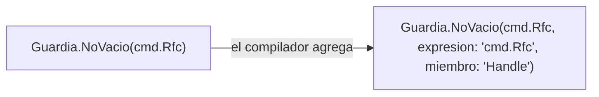

# nameof y otras utilidades del lenguaje

Parte de: [[03-CSharp-DotNet/03 Intermedio/_Índice Intermedio|Intermedio]]

> [!info] Cómo avanzar
> `progreso`: **pendiente** → **viendo** (estudiando) → **visto** (contestaste la autoevaluación sin abrir las respuestas) → **dominado** (hiciste el laboratorio o lo aplicaste de verdad).

## Contenido

### Qué es
C# trae varias utilidades pequeñas que eliminan **cadenas mágicas** y hacen los errores más claros:
- **`nameof(x)`**: el nombre de una variable, tipo, propiedad o método como `string`, verificado en compilación.
- **Atributos de información del llamador**: `[CallerMemberName]`, `[CallerFilePath]`, `[CallerLineNumber]` y `[CallerArgumentExpression]`, que el compilador llena automáticamente en parámetros opcionales.
- **Excepciones con ayudantes**: `ArgumentNullException.ThrowIfNull`, `ArgumentException.ThrowIfNullOrWhiteSpace`, `ArgumentOutOfRangeException.ThrowIfNegative`, `ObjectDisposedException.ThrowIf`, y **`UnreachableException`** para código que nunca debería ejecutarse.

### Cómo funciona
**`nameof`** se evalúa en compilación: `nameof(Pedido.Total)` se convierte en el literal `"Total"`. Si renombras la propiedad con el refactor del IDE, el `nameof` se actualiza; un `"Total"` escrito a mano no. Solo da el **último** identificador: `nameof(cliente.Direccion.Cp)` es `"Cp"`. Desde C# 14 acepta genéricos sin argumentos: `nameof(List<>)` da `"List"`.

**`[CallerMemberName]`**: si un parámetro opcional de tipo `string` lleva este atributo y el llamador no lo pasa, el compilador escribe ahí el nombre del método o propiedad que hizo la llamada. Es la base de `INotifyPropertyChanged` y útil en bitácoras.

**`[CallerArgumentExpression("param")]`** (C# 10): el compilador escribe el **texto del argumento** que se pasó a otro parámetro. Si llamas `Validar(pedido.Total > 0)`, el parámetro recibe la cadena `"pedido.Total > 0"`. Así funcionan los `ThrowIfNull` de .NET: `ArgumentNullException.ThrowIfNull(cliente)` sabe que el parámetro se llama `cliente` sin que lo escribas.

**`UnreachableException`** (.NET 7): se lanza en una rama que, por diseño, no puede ocurrir (el `_` de un switch sobre un enum que ya cubriste). Comunica la intención mejor que `InvalidOperationException` o `NotImplementedException`: si se dispara, es un **bug** del programa, no un error de datos del usuario.



### Ejemplo
```csharp
using System.Diagnostics;
using System.Runtime.CompilerServices;
using Microsoft.Extensions.Logging;

public sealed record CrearPedido(int ClienteId, string Rfc, decimal Total);

public static class Guardia
{
    public static string NoVacio(
        string? valor,
        [CallerArgumentExpression(nameof(valor))] string? expresion = null)
    {
        if (string.IsNullOrWhiteSpace(valor))
            throw new ArgumentException($"'{expresion}' no puede estar vacío.", expresion);
        return valor;
    }
}

public sealed class CrearPedidoHandler(ILogger<CrearPedidoHandler> log)
{
    public Task Handle(CrearPedido cmd, CancellationToken ct)
    {
        ArgumentNullException.ThrowIfNull(cmd);                    // mensaje incluye "cmd"
        ArgumentOutOfRangeException.ThrowIfNegativeOrZero(cmd.Total); // incluye "cmd.Total"
        Guardia.NoVacio(cmd.Rfc);                                  // "'cmd.Rfc' no puede estar vacío."

        Traza("validado");
        return Task.CompletedTask;
    }

    private void Traza(string mensaje, [CallerMemberName] string miembro = "")
        => log.LogDebug("{Miembro}: {Mensaje}", miembro, mensaje);  // "Handle: validado"
}

public enum Canal { Web, Tienda }

public static class Comisiones
{
    public static decimal Tasa(Canal c) => c switch
    {
        Canal.Web => 0.035m,
        Canal.Tienda => 0m,
        _ => throw new UnreachableException($"Canal no contemplado: {c}")
    };
}

// nameof en mensajes de validación, rutas y logs
// RuleFor(x => x.Total).GreaterThan(0).WithName(nameof(CrearPedido.Total));
// return CreatedAtAction(nameof(PedidosController.Obtener), new { id }, dto);
```

### Cuándo usarlo y cuándo no
- **`nameof`** siempre que escribirías el nombre de un símbolo como texto: `ArgumentException(paramName)`, `CreatedAtAction`, claves de log, `INotifyPropertyChanged`, mensajes de validación.
- **`ThrowIfNull` y familia** en la validación de argumentos de métodos públicos: más cortos y con mensajes consistentes.
- **`CallerArgumentExpression`** en tus propios ayudantes de validación o *asserts*.
- **`UnreachableException`** en ramas imposibles; **no** para casos que sí pueden ocurrir por datos externos (eso merece un error de validación con `ProblemDetails`).
- **No uses `nameof` como valor de negocio** que se persiste (nombres en BD o en JSON público): un renombre cambiaría datos guardados.

### Errores comunes
1. **Cadenas mágicas** (`"Total"`) que quedan desactualizadas tras un renombre.
2. **Esperar la ruta completa de `nameof`**: solo regresa el último segmento.
3. **Pasar explícitamente el parámetro con `[CallerMemberName]`** por error, sobrescribiendo el valor automático.
4. **`throw new Exception("no debería pasar")`**: genérico y difícil de filtrar; usa `UnreachableException`.

### Para profundizar
- [Expresión nameof](https://learn.microsoft.com/dotnet/csharp/language-reference/operators/nameof)
- [Atributos de información del llamador](https://learn.microsoft.com/dotnet/csharp/language-reference/attributes/caller-information)
- [Clase UnreachableException](https://learn.microsoft.com/dotnet/api/system.diagnostics.unreachableexception)

## Autoevaluación

Contesta primero en voz alta o en papel; luego despliega la respuesta.

> [!question]- ¿Para qué sirve `nameof`?
> Da el nombre de un símbolo como string en compilación: `nameof(Campos.Codigo)` → `"Codigo"`. Si renombras, se actualiza.

> [!question]- ¿Qué hacen `[CallerMemberName]` y `[CallerArgumentExpression]`?
> El compilador llena el parámetro con el nombre del método que llama o con el texto de la expresión pasada como argumento.

> [!question]- ¿Qué es `UnreachableException`?
> Excepción para marcar código que no debería ejecutarse nunca, p. ej. el `_` de un switch exhaustivo.

