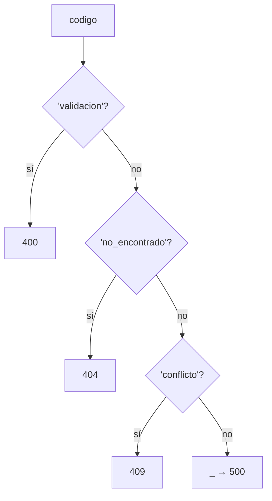

# switch expressions

Parte de: [[03-CSharp-DotNet/03 Intermedio/_Índice Intermedio|Intermedio]]

> [!info] Cómo avanzar
> `progreso`: **pendiente** → **viendo** (estudiando) → **visto** (contestaste la autoevaluación sin abrir las respuestas) → **dominado** (hiciste el laboratorio o lo aplicaste de verdad).

## Contenido

### Qué es
Una **switch expression** (C# 8) es una forma de `switch` que **produce un valor**: `var x = entrada switch { patrón => valor, ... };`. A diferencia de la sentencia `switch`, es una expresión, así que puede ir en un `return`, en una asignación, en un miembro con `=>` o como argumento. Cada brazo usa [[Pattern matching]], así que acepta constantes, tipos, propiedades, rangos, listas y tuplas.

### Cómo funciona
```csharp
resultado = valor switch
{
    patrón1 => expresión1,
    patrón2 when condición => expresión2,   // guarda opcional
    _ => expresiónPorDefecto                // descarte: todo lo demás
};
```
- Los brazos se evalúan **en orden** y gana el primero que coincide.
- Cada brazo es una **expresión**, no un bloque de sentencias. No hay `break` ni *fall-through*. Si necesitas varias sentencias, llama a un método.
- Todos los brazos deben producir un tipo común.
- Un brazo puede **lanzar**: `_ => throw new ArgumentOutOfRangeException(...)` (las *throw expressions* son válidas aquí).

**Diferencias con la sentencia `switch`**:

| Sentencia `switch` | Switch expression |
|---|---|
| Ejecuta sentencias (`case x: ...; break;`) | Regresa un valor |
| `default:` | `_ =>` |
| Puede no cubrir todos los casos sin aviso | El compilador avisa (CS8509) si no es exhaustiva |
| Bloques de varias líneas | Una expresión por brazo |

**Si ningún brazo coincide** en tiempo de ejecución, se lanza `SwitchExpressionException`. Por eso el compilador te advierte cuando no es exhaustiva: casi siempre conviene cerrar con `_ =>`.

**Tuplas**: puedes evaluar varios valores a la vez escribiéndolos como tupla y usando **patrones posicionales**: `(estado, esAdmin) switch { ("Borrador", _) => ..., (_, true) => ... }`. Es ideal para tablas de decisión.



### Ejemplo
```csharp
using Microsoft.AspNetCore.Mvc;

// Traducir el código de error de dominio a status HTTP
public static class CodigosHttp
{
    public static int Status(string codigo) => codigo switch
    {
        "validacion"    => StatusCodes.Status400BadRequest,   // 400
        "no_encontrado" => StatusCodes.Status404NotFound,     // 404
        "conflicto"     => StatusCodes.Status409Conflict,     // 409
        _               => StatusCodes.Status500InternalServerError
    };
}

// En un controller: Result -> IActionResult con ProblemDetails y 'codigo'
public static class ResultadoExtensions
{
    public static IActionResult AActionResult<T>(this Resultado<T> r, ControllerBase c) => r switch
    {
        { Exito: true, Valor: var v } => c.Ok(v),
        { Codigo: var codigo, Mensaje: var msg } => c.Problem(
            title: msg, statusCode: CodigosHttp.Status(codigo!),
            extensions: new Dictionary<string, object?> { ["codigo"] = codigo })
    };
}

// Tuplas: tabla de decisión de permisos
public enum Rol { Lector, Editor, Admin }

public static bool PuedeEditar(string estado, Rol rol) => (estado, rol) switch
{
    (_, Rol.Admin)          => true,          // admin siempre
    ("Borrador", Rol.Editor) => true,
    ("Publicado", _)        => false,
    _                       => false
};

// Guardas con when para valores no constantes
public static string Nivel(decimal total, decimal limiteVip) => total switch
{
    < 0 => throw new ArgumentOutOfRangeException(nameof(total)),
    var t when t >= limiteVip => "VIP",
    _ => "Normal"
};

public sealed record Resultado<T>(bool Exito, T? Valor, string? Codigo, string? Mensaje);
```

La sobrecarga `Problem(..., extensions:)` existe en versiones recientes de ASP.NET Core; si tu versión no la tiene, crea el `ProblemDetails` y agrega `Extensions["codigo"]` a mano.

### Cuándo usarlo y cuándo no
- **Úsala** para mapeos de un valor a otro: códigos a status, enums a textos, tipos de evento a manejadores, reglas tabulares con tuplas.
- **Prefiere la sentencia `switch`** cuando cada caso ejecuta varias sentencias con efectos (guardar, enviar, loguear) y no produce un valor.
- **Prefiere un diccionario** cuando el mapeo viene de configuración o es muy grande y sin lógica.
- **Prefiere polimorfismo** si el *switch* por tipo crece con cada clase nueva.

### Errores comunes
1. **Sin `_ =>`** y con valores nuevos (un enum que creció): `SwitchExpressionException` en producción. Trata la advertencia CS8509 como error.
2. **Orden incorrecto**: un brazo general antes del específico hace inalcanzable al segundo (error de compilación) o cambia el resultado si usa `when`.
3. **Enums y exhaustividad**: aunque cubras todos los valores con nombre, un `enum` puede tener cualquier entero; el compilador seguirá pidiendo `_`.
4. **Meter lógica pesada en cada brazo**: extrae métodos para que siga siendo legible.

### Para profundizar
- [Expresión switch (referencia de C#)](https://learn.microsoft.com/dotnet/csharp/language-reference/operators/switch-expression)
- [Sentencia switch y patrones](https://learn.microsoft.com/dotnet/csharp/language-reference/statements/selection-statements#the-switch-statement)
- [Clase SwitchExpressionException](https://learn.microsoft.com/dotnet/api/system.runtime.compilerservices.switchexpressionexception)

## Ejercicios

Resuélvelos en papel o en la herramienta; la solución está plegada.

> [!question]- Traduce un código de error de dominio a status HTTP: `validacion`→400, `no_encontrado`→404, `conflicto`→409, otro→500.
> ```csharp
> int status = codigo switch {
>     "validacion" => 400,
>     "no_encontrado" => 404,
>     "conflicto" => 409,
>     _ => 500
> };
> ```

## Autoevaluación

Contesta primero en voz alta o en papel; luego despliega la respuesta.

> [!question]- ¿Qué diferencia hay entre una `switch` expression y una sentencia `switch`?
> La expresión regresa un valor, usa `=>` y `_` como descarte, y no lleva `break`. Es ideal para mapeos.

> [!question]- ¿Qué pasa si ningún brazo coincide?
> El compilador avisa (CS8509) si no es exhaustiva y en ejecución lanza `SwitchExpressionException`. Agrega `_ => throw new UnreachableException()` o un valor por defecto.

> [!question]- ¿Se pueden usar tuplas en el switch?
> Sí: `(estado, accion) switch { (Estado.Abierto, Accion.Cerrar) => Estado.Cerrado, _ => estado }`. Útil para máquinas de estados.

