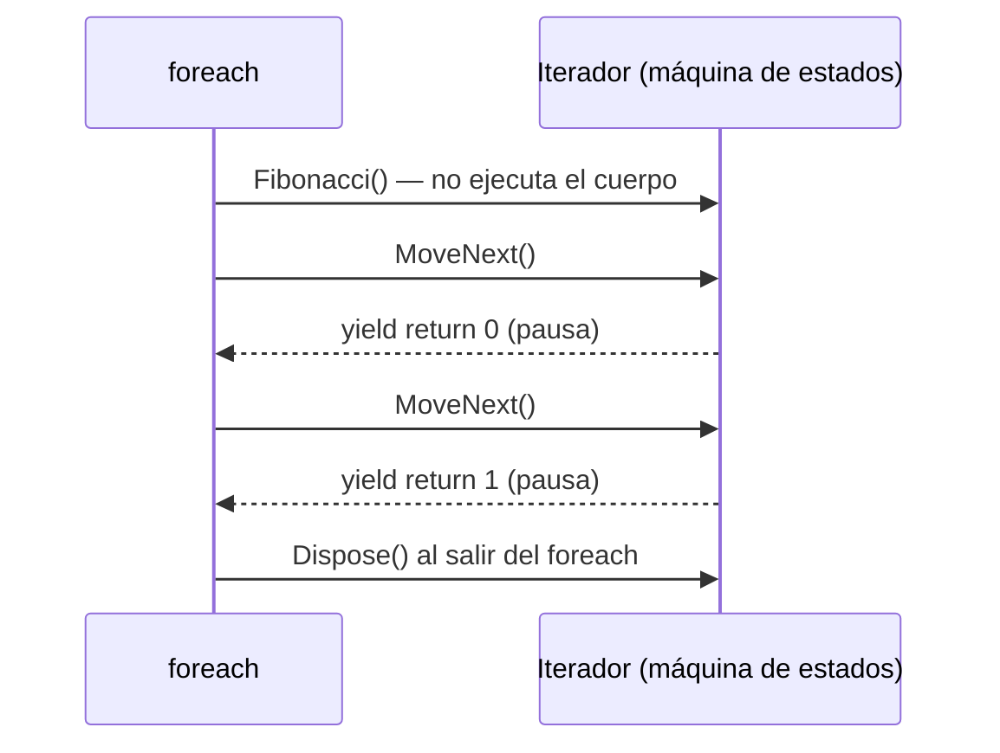

# yield

Parte de: [[03-CSharp-DotNet/03 Intermedio/_Índice Intermedio|Intermedio]]

> [!info] Cómo avanzar
> `progreso`: **pendiente** → **viendo** (estudiando) → **visto** (contestaste la autoevaluación sin abrir las respuestas) → **dominado** (hiciste el laboratorio o lo aplicaste de verdad).

## Contenido

### Qué es
`yield` permite escribir un **iterador**: un método que produce una secuencia **elemento por elemento, bajo demanda**, sin construir una lista completa. Un método con `yield return` que regresa `IEnumerable<T>` (o `IEnumerator<T>`, o `IAsyncEnumerable<T>`) se "pausa" después de entregar cada valor y continúa justo ahí cuando el consumidor pide el siguiente. Es el mecanismo con el que está hecho LINQ to Objects y la base de la [[Ejecución diferida en LINQ]].

### Cómo funciona
El compilador transforma el método en una **máquina de estados** (una clase oculta que implementa `IEnumerable<T>` e `IEnumerator<T>`):
1. Llamar al método **no ejecuta nada** de su cuerpo: solo crea el objeto iterador con los argumentos.
2. Cada `MoveNext()` (lo llama el `foreach`) ejecuta el cuerpo **desde donde se quedó** hasta el siguiente `yield return`, guarda el valor en `Current` y se pausa.
3. **`yield return valor`** entrega un elemento y pausa.
4. **`yield break`** termina la secuencia (como un `return` para iteradores). Llegar al final del método también la termina.
5. Al salir del `foreach` (aunque sea con `break`), se llama `Dispose()` y se ejecutan los bloques `finally` pendientes.



**Por qué la validación de argumentos no falla al llamar el método**: como el cuerpo completo (incluida la línea `ArgumentNullException.ThrowIfNull(...)`) se ejecuta hasta el primer `MoveNext`, la excepción aparece cuando alguien **enumera**, quizá muy lejos de donde se cometió el error y en otra capa. La solución es separar: un método público **no iterador** que valida y regresa una función local iteradora.

### Ejemplo
```csharp
// Iterador infinito de Fibonacci: solo funciona porque es perezoso
static IEnumerable<long> Fibonacci()
{
    long a = 0, b = 1;
    while (true)
    {
        yield return a;
        (a, b) = (b, a + b);
    }
}

Console.WriteLine(string.Join(", ", Fibonacci().Take(7))); // 0, 1, 1, 2, 3, 5, 8

// yield break: termina antes
static IEnumerable<string> LineasHastaVacia(IEnumerable<string> lineas)
{
    foreach (var l in lineas)
    {
        if (string.IsNullOrWhiteSpace(l)) yield break;
        yield return l.Trim();
    }
}

// Validación diferida (problema) vs validación inmediata (solución)
static IEnumerable<T> CadaN_Mal<T>(IEnumerable<T> fuente, int n)
{
    ArgumentNullException.ThrowIfNull(fuente);        // no se ejecuta hasta enumerar
    ArgumentOutOfRangeException.ThrowIfNegativeOrZero(n);
    int i = 0;
    foreach (var x in fuente) if (i++ % n == 0) yield return x;
}

static IEnumerable<T> CadaN<T>(IEnumerable<T> fuente, int n)
{
    ArgumentNullException.ThrowIfNull(fuente);        // se ejecuta al llamar
    ArgumentOutOfRangeException.ThrowIfNegativeOrZero(n);
    return Iterar();

    IEnumerable<T> Iterar()                            // función local iteradora
    {
        int i = 0;
        foreach (var x in fuente) if (i++ % n == 0) yield return x;
    }
}

// Caso real: leer un CSV grande línea por línea sin cargarlo completo
static IEnumerable<string[]> LeerCsv(string ruta)
{
    using var lector = new StreamReader(ruta);         // se cierra al terminar o con break
    lector.ReadLine();                                 // salta encabezado
    while (lector.ReadLine() is { } linea)
        yield return linea.Split(',');
}
```

### Cuándo usarlo y cuándo no
- **Úsalo** para secuencias grandes, infinitas o caras de producir, donde el consumidor quizá no las lea completas: archivos línea por línea, paginación de una API, generadores de datos de prueba, árboles recorridos en profundidad.
- **Úsalo** para escribir tus propios operadores tipo LINQ.
- **No** lo uses cuando el consumidor necesita `Count`, índice o recorrer varias veces: regresa una lista.
- **Para fuentes asíncronas** (BD, HTTP), la versión es `async IAsyncEnumerable<T>` con `yield return` y `await foreach` (ver [[IAsyncEnumerable]]).
- **Alternativa**: si ya tienes los datos en memoria, regresar `IReadOnlyList<T>` es más simple y rápido.

### Errores comunes
1. **Validación diferida**: la excepción aparece al enumerar, no al llamar. Usa el patrón con función local.
2. **Enumerar dos veces** un iterador que lee un archivo o una conexión: lo vuelve a abrir, o falla si el recurso era de un solo uso.
3. **Recursos que dependen de que alguien termine**: si el consumidor nunca enumera ni hace `Dispose`, el `using` interno nunca se ejecuta. `foreach` lo garantiza; el uso manual de `GetEnumerator` no.
4. **No se permite `yield` dentro de un `catch`** ni `yield return` dentro de un `try` que tenga `catch` (sí dentro de `try/finally`); estructura el código para capturar fuera.

### Para profundizar
- [yield (referencia de C#)](https://learn.microsoft.com/dotnet/csharp/language-reference/statements/yield)
- [Iteradores en C#](https://learn.microsoft.com/dotnet/csharp/iterators)
- [Funciones locales](https://learn.microsoft.com/dotnet/csharp/programming-guide/classes-and-structs/local-functions)

## Ejercicios

Resuélvelos en papel o en la herramienta; la solución está plegada.

> [!question]- Escribe un iterador infinito de Fibonacci y toma los primeros 7 con `Take`.
> ```csharp
> IEnumerable<long> Fib() { long a = 0, b = 1; while (true) { yield return a; (a, b) = (b, a + b); } }
> Fib().Take(7) // 0 1 1 2 3 5 8
> ```

## Autoevaluación

Contesta primero en voz alta o en papel; luego despliega la respuesta.

> [!question]- ¿Qué hace `yield return`?
> Convierte el método en un iterador: produce elementos uno a uno bajo demanda y conserva el estado entre llamadas a `MoveNext`.

> [!question]- ¿Por qué la validación de argumentos en un iterador no falla al llamar el método?
> El cuerpo no corre hasta que alguien enumera. Para validar de inmediato separa: un método público que valida y una función local con `yield`.

> [!question]- ¿Qué hace `yield break`?
> Termina la secuencia.

## Práctica

- [[Lab 3 - Consola con LINQ y genéricos]]

