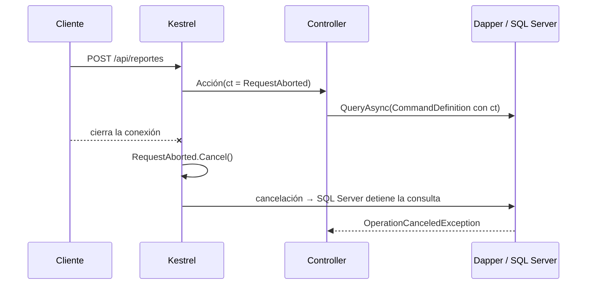

# CancellationToken

Parte de: [[03-CSharp-DotNet/04 Asincronía y concurrencia/_Índice Asincronía y concurrencia|Asincronía y concurrencia]]

> [!info] Cómo avanzar
> `progreso`: **pendiente** → **viendo** (estudiando) → **visto** (contestaste la autoevaluación sin abrir las respuestas) → **dominado** (hiciste el laboratorio o lo aplicaste de verdad).

## Contenido

### Qué es
Un **`CancellationToken`** es la forma estándar en .NET de **pedir cooperativamente** que una operación se detenga. Quien quiere cancelar tiene un `CancellationTokenSource` (CTS) y llama `Cancel()`; quien trabaja recibe el `CancellationToken` y lo revisa o se lo pasa a las operaciones que llama. "Cooperativo" significa que nada se mata a la fuerza: cada operación decide cuándo y cómo detenerse.

### Cómo funciona
- **`CancellationTokenSource`**: dueño de la cancelación. `Cancel()`, `CancelAfter(TimeSpan)` (cancela tras un tiempo) y `Dispose()`.
- **`CancellationToken`**: struct de solo lectura que se pasa como parámetro (por convención el último, llamado `ct` o `cancellationToken`). Tiene `IsCancellationRequested`, `ThrowIfCancellationRequested()` y `Register(callback)`.
- **`CreateLinkedTokenSource(a, b)`**: crea un CTS que se cancela si se cancela **cualquiera** de los tokens origen. Así combinas "el cliente se fue" con "tiempo límite".
- **`CancellationToken.None`**: un token que nunca se cancela.

**Cómo llega el token en una API**: en un controller, si una acción declara un parámetro `CancellationToken`, ASP.NET Core le enlaza automáticamente **`HttpContext.RequestAborted`**, que se cancela cuando el cliente cierra la conexión (cerró la pestaña, el `fetch` se abortó, se agotó su *timeout*). En Minimal APIs funciona igual. En un [[BackgroundService]], el token de `ExecuteAsync` se cancela al apagar la aplicación.

**Qué pasa al cancelar**: las operaciones que recibieron el token (y lo soportan) dejan de esperar y lanzan **`OperationCanceledException`** (o su derivada `TaskCanceledException`). Con SQL Server, el proveedor envía una señal de cancelación al servidor para que detenga la consulta. La excepción sube por la pila como cualquier otra; en ASP.NET Core, si el cliente ya se fue, no tiene caso responder, así que se suele registrar como información y no como error.

**Tiempo límite**: `using var cts = new CancellationTokenSource(TimeSpan.FromSeconds(5));` o `cts.CancelAfter(...)`. Para respetar también el token de la petición, enlázalos.

**Cuándo NO propagar el token (`CancellationToken.None`)**: cuando ya ocurrió un **efecto irreversible** fuera de tu sistema. Si ya cobraste en la pasarela de pago y el cliente cierra la pestaña, cancelar el `INSERT` del pago dejaría el cargo hecho **sin registro** en tu BD. A partir de ese punto, termina el trabajo con `CancellationToken.None` (o con un token de tiempo límite propio, no el de la petición).



### Ejemplo
```csharp
using System.Data;
using Dapper;
using Microsoft.AspNetCore.Mvc;
using Microsoft.Data.SqlClient;

public sealed class ReportesConsulta(string cadena)
{
    public async Task<IReadOnlyList<FilaVenta>> VentasAsync(int anio, CancellationToken ct)
    {
        await using var cn = new SqlConnection(cadena);
        // Dapper recibe el token a través de CommandDefinition
        var cmd = new CommandDefinition("dbo.Reporte_Ventas", new { anio },
            commandType: CommandType.StoredProcedure, cancellationToken: ct);
        return (await cn.QueryAsync<FilaVenta>(cmd)).AsList();
    }
}

[ApiController, Route("api/reportes")]
public sealed class ReportesController(ReportesConsulta consulta, ILogger<ReportesController> log) : ControllerBase
{
    [HttpGet("ventas/{anio:int}")]
    public async Task<IActionResult> Ventas(int anio, CancellationToken ct) // = HttpContext.RequestAborted
    {
        // Tiempo límite de 10 s combinado con la desconexión del cliente
        using var cts = CancellationTokenSource.CreateLinkedTokenSource(ct);
        cts.CancelAfter(TimeSpan.FromSeconds(10));
        try
        {
            return Ok(await consulta.VentasAsync(anio, cts.Token));
        }
        catch (OperationCanceledException) when (!ct.IsCancellationRequested)
        {
            // Se canceló por tiempo límite, no porque el cliente se fue
            return Problem(statusCode: 504, title: "El reporte tardó demasiado.");
        }
    }
}

public sealed class CobroHandler(IPasarela pasarela, IComandoRegistrarPago registrar)
{
    public async Task Handle(Cobro c, CancellationToken ct)
    {
        var autorizacion = await pasarela.CobrarAsync(c, ct);   // aún se puede cancelar
        // Desde aquí el cargo ya existe: no permitir que una desconexión deje el pago sin registrar
        await registrar.EjecutarAsync(c, autorizacion, CancellationToken.None);
    }
}

// En un ciclo CPU-bound, revisa el token periódicamente
static long Sumar(IEnumerable<int> xs, CancellationToken ct)
{
    long t = 0;
    foreach (var x in xs) { ct.ThrowIfCancellationRequested(); t += x; }
    return t;
}

public sealed record FilaVenta(string Zona, decimal Total);
public sealed record Cobro(decimal Monto);
public interface IPasarela { Task<string> CobrarAsync(Cobro c, CancellationToken ct); }
public interface IComandoRegistrarPago { Task EjecutarAsync(Cobro c, string aut, CancellationToken ct); }
```

### Cuándo usarlo y cuándo no
- **Acepta y propaga `CancellationToken`** en toda la cadena asíncrona: controller → handler → consulta → Dapper/HttpClient. Es barato y evita trabajo inútil.
- **Tiempo límite** con `CancelAfter` para dependencias externas (o políticas de [[Resiliencia con Polly]]).
- **`CancellationToken.None`** después de efectos irreversibles, o en operaciones de compensación y registro de auditoría que deben completarse.
- **No** atrapes `OperationCanceledException` para "tragártela" en medio de la lógica: deja que suba o tradúcela en el borde.

### Errores comunes
1. **No pasar el token a Dapper**: con `QueryAsync(sql, param)` sin `CommandDefinition`, la consulta sigue corriendo en SQL Server aunque el cliente se haya ido.
2. **Registrar como error** cada cancelación por desconexión del cliente: llena los logs de ruido.
3. **No hacer `Dispose` del CTS** creado con `CancelAfter` o enlazado: retiene temporizadores y registros.
4. **Propagar el token de la petición a trabajo que debe terminar** (pagos, envíos de correo ya disparados).
5. **Usar el token de la petición en trabajo en segundo plano** que debe sobrevivir a la petición: se cancela al terminar la respuesta.

### Para profundizar
- [Cancelación en subprocesos administrados](https://learn.microsoft.com/dotnet/standard/threading/cancellation-in-managed-threads)
- [Cancelar tareas asincrónicas tras un período de tiempo](https://learn.microsoft.com/dotnet/csharp/asynchronous-programming/cancel-async-tasks-after-a-period-of-time)
- [HttpContext.RequestAborted (referencia de API)](https://learn.microsoft.com/dotnet/api/microsoft.aspnetcore.http.httpcontext.requestaborted)

## Autoevaluación

Contesta primero en voz alta o en papel; luego despliega la respuesta.

> [!question]- ¿Cómo llega el token en una API?
> ASP.NET Core vincula `CancellationToken ct` en la acción a `HttpContext.RequestAborted`: se cancela si el cliente cierra la conexión. Pásalo a cada llamada async (Dapper con `CommandDefinition`, HttpClient, `Task.Delay`).

> [!question]- ¿Qué pasa al cancelar?
> La operación lanza `OperationCanceledException` (o `TaskCanceledException`). No es un error del servidor: no lo reportes a Sentry como fallo ni respondas 500.

> [!question]- ¿Por qué usar `CancellationToken.None` después de cobrar en la pasarela de pago?
> Una vez ocurrido el efecto externo (cargo realizado), registrar el resultado **debe** terminar aunque el cliente se desconecte; si cancelas, el cobro queda sin registro.

> [!question]- ¿Cómo pones un tiempo límite?
> `using var cts = CancellationTokenSource.CreateLinkedTokenSource(ct); cts.CancelAfter(TimeSpan.FromSeconds(5));` y pasas `cts.Token`.

> [!question]- ¿Cómo se pasa el token a Dapper?
> ```csharp
> await cn.QueryAsync<T>(new CommandDefinition(sql, campos, tx, cancellationToken: ct));
> ```

## Práctica

- [[Lab 5 - async-await, CancellationToken y sync over async]]

