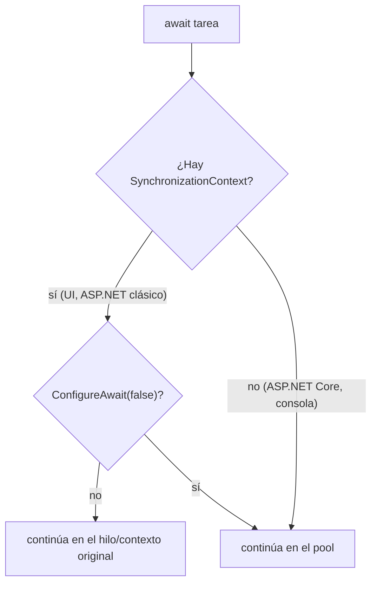

# ConfigureAwait

Parte de: [[03-CSharp-DotNet/04 Asincronía y concurrencia/_Índice Asincronía y concurrencia|Asincronía y concurrencia]]

> [!info] Cómo avanzar
> `progreso`: **pendiente** → **viendo** (estudiando) → **visto** (contestaste la autoevaluación sin abrir las respuestas) → **dominado** (hiciste el laboratorio o lo aplicaste de verdad).

## Contenido

### Qué es
`ConfigureAwait` es un método de `Task`/`ValueTask` que controla **dónde continúa** el código después de un `await`. `await tarea.ConfigureAwait(false)` le dice al runtime: "no necesito regresar al contexto original; continúa en cualquier hilo del pool". Existe por la historia de las aplicaciones con interfaz gráfica y del ASP.NET clásico, que tienen un **`SynchronizationContext`**.

### Cómo funciona
Por defecto, al hacer `await`, el runtime **captura el contexto actual**:
- Si hay un `SynchronizationContext` (el hilo de UI en WinForms, WPF o MAUI; el contexto de petición en ASP.NET clásico de .NET Framework), la continuación se **envía de vuelta a ese contexto**. En UI eso es lo que te permite tocar controles después del `await`.
- Si no lo hay, pero hay un `TaskScheduler` distinto del predeterminado, usa ese.
- Si no hay ninguno, continúa en el pool de hilos.

Con **`ConfigureAwait(false)`** no se captura el contexto: la continuación corre donde convenga (normalmente el hilo que completó la operación o uno del pool). Ventajas en código de **librería**:
- **Rendimiento**: evita el salto de regreso al contexto.
- **Evita *deadlocks***: si alguien bloquea el hilo de UI con `.Result` esperando tu método, y tu método quiere regresar a ese mismo hilo para continuar, ambos se esperan para siempre. Con `ConfigureAwait(false)`, tu continuación no necesita ese hilo.

**¿Hace falta en ASP.NET Core?** **No en el código de la aplicación.** ASP.NET Core **no tiene `SynchronizationContext`**, así que el `await` normal ya continúa en el pool; `ConfigureAwait(false)` no cambia nada ahí. Sí tiene sentido en **librerías reutilizables** (paquetes NuGet, proyectos compartidos) que podrían usarse desde una app de escritorio o desde .NET Framework, porque no sabes en qué contexto te van a llamar.

**`ConfigureAwaitOptions` (.NET 8)**: una sobrecarga nueva, `ConfigureAwait(ConfigureAwaitOptions)`, disponible en `Task` y `Task<T>`, con banderas combinables:
- `None`: equivale a `ConfigureAwait(false)`.
- `ContinueOnCapturedContext`: equivale a `ConfigureAwait(true)`.
- `SuppressThrowing`: espera a que termine **sin lanzar** si la tarea falló o se canceló (útil para esperar que algo termine sin importar cómo). Solo se permite en `Task` sin resultado.
- `ForceYielding`: obliga a que la continuación se programe de forma asíncrona aunque la tarea ya esté completa (parecido a `await Task.Yield()`).



### Ejemplo
```csharp
// Librería compartida (por ejemplo, un cliente NuGet para la API de Xolotl.Hecate)
public sealed class ClienteHecate(HttpClient http)
{
    public async Task<string?> ObtenerTokenAsync(string usuario, CancellationToken ct)
    {
        using var resp = await http.PostAsJsonAsync("/connect/token", new { usuario }, ct)
                                   .ConfigureAwait(false);          // librería: no capturar contexto
        resp.EnsureSuccessStatusCode();
        var dto = await resp.Content.ReadFromJsonAsync<TokenDto>(ct).ConfigureAwait(false);
        return dto?.AccessToken;
    }
}
public sealed record TokenDto(string AccessToken);

// Aplicación ASP.NET Core: no hace falta
public sealed class Handler(ClienteHecate cliente)
{
    public async Task<string?> Handle(string u, CancellationToken ct)
        => await cliente.ObtenerTokenAsync(u, ct);   // sin ConfigureAwait: no hay contexto
}

// .NET 8: esperar que una tarea termine sin que su excepción interrumpa el apagado
public static async Task DetenerAsync(Task trabajoEnCurso)
{
    await trabajoEnCurso.ConfigureAwait(ConfigureAwaitOptions.SuppressThrowing);
    // aquí ya terminó, haya fallado o no; revisa trabajoEnCurso.IsFaulted si importa
}

// App de escritorio (WPF/WinForms): después del await necesitas el hilo de UI
// private async void BtnCargar_Click(object s, EventArgs e)
// {
//     var datos = await servicio.CargarAsync();   // ConfigureAwait(true) implícito
//     grid.DataSource = datos;                    // OK: estamos en el hilo de UI
// }
```

### Cuándo usarlo y cuándo no
- **Librerías** que se publican o comparten: usa `ConfigureAwait(false)` en cada `await` (el analizador CA2007 puede exigirlo).
- **Código de aplicación ASP.NET Core**: no lo necesitas; omítelo para que el código sea más limpio.
- **Apps de UI**: **no** lo uses en métodos que después del `await` tocan controles; sí en servicios internos que no tocan la UI.
- **`SuppressThrowing`**: al esperar tareas en apagados o limpiezas donde el error ya se registró en otro lado.

### Errores comunes
1. **Pensar que `ConfigureAwait(false)` arregla un `.Result`**: solo evita *ese* deadlock en tu método; si cualquier `await` de la cadena (incluidas librerías de terceros) captura el contexto, el bloqueo sigue. La solución real es no bloquear (ver [[Sync over async y thread pool starvation]]).
2. **Usarlo en UI y luego tocar controles**: excepción por acceso desde otro hilo.
3. **Ponerlo solo en el primer `await`**: si esa tarea ya estaba completada, el método sigue en el contexto original y los siguientes `await` sí capturan; en librerías va en **todos**.
4. **`SuppressThrowing` en `Task<T>`**: no está permitido y lanza `ArgumentOutOfRangeException`.

### Para profundizar
- [ConfigureAwait FAQ (blog de .NET)](https://devblogs.microsoft.com/dotnet/configureawait-faq/)
- [Enumeración ConfigureAwaitOptions (referencia de API)](https://learn.microsoft.com/dotnet/api/system.threading.tasks.configureawaitoptions)
- [CA2007: no esperar directamente una tarea](https://learn.microsoft.com/dotnet/fundamentals/code-analysis/quality-rules/ca2007)

## Autoevaluación

Contesta primero en voz alta o en papel; luego despliega la respuesta.

> [!question]- ¿Qué hace `ConfigureAwait(false)`?
> Indica que la continuación no necesita volver al contexto de sincronización original (UI, ASP.NET clásico); puede seguir en cualquier hilo del pool.

> [!question]- ¿Hace falta en ASP.NET Core?
> En el código de la app no: ASP.NET Core no tiene `SynchronizationContext`. Sí conviene en **bibliotecas** reutilizables, que pueden usarse desde WinForms/WPF.

> [!question]- ¿Qué agregó .NET 8 con `ConfigureAwaitOptions`?
> Opciones como `SuppressThrowing` (esperar sin lanzar) y `ForceYielding`, aplicables a `Task` (no a `Task<T>` en el caso de `SuppressThrowing`).

