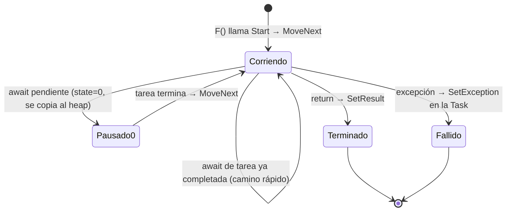

# Cómo funciona async por dentro (máquina de estados)

Parte de: [[03-CSharp-DotNet/04 Asincronía y concurrencia/_Índice Asincronía y concurrencia|Asincronía y concurrencia]]

> [!info] Cómo avanzar
> `progreso`: **pendiente** → **viendo** (estudiando) → **visto** (contestaste la autoevaluación sin abrir las respuestas) → **dominado** (hiciste el laboratorio o lo aplicaste de verdad).

## Contenido

### Qué es
Cuando escribes un método `async`, el compilador de C# lo **reescribe** en una **máquina de estados**: un tipo oculto que guarda las variables locales y "en qué `await` se quedó" para poder pausar y reanudar el método. Entender esto explica el costo real de `async`, por qué el código después de un `await` puede correr en otro hilo, y cómo viajan las excepciones.

### Cómo funciona
**Qué genera el compilador** para `async Task<int> F()`:
1. Un **struct** (en compilaciones Release) que implementa `IAsyncStateMachine`, con:
   - un campo `state` (entero: -1 = corriendo, 0, 1, 2... = pausado en el `await` número N, -2 = terminado),
   - campos para cada **variable local y parámetro** que se use después de un `await`,
   - un **builder** (`AsyncTaskMethodBuilder<int>`) que crea y completa la `Task` que ve el llamador,
   - campos para los *awaiters* pendientes.
2. Un método **`MoveNext()`** con todo el cuerpo original partido en trozos, con un `switch` sobre `state` para saltar al punto correcto.
3. El método `F()` original queda como un "esqueleto" que inicializa el struct, llama `builder.Start(ref maquina)` (que ejecuta `MoveNext` por primera vez, **sincrónicamente**) y regresa `builder.Task`.

**En cada `await expr`** dentro de `MoveNext`:
1. Obtiene el *awaiter*: `var aw = expr.GetAwaiter();`.
2. **Si `aw.IsCompleted` es `true`** (la tarea ya terminó, por ejemplo un valor en caché o un buffer ya lleno), **continúa de inmediato** con `aw.GetResult()` sin pausar, sin cambiar de hilo y sin asignaciones extra. Es el camino rápido.
3. Si no ha terminado: guarda `state = N`, guarda el *awaiter*, llama `builder.AwaitUnsafeOnCompleted(ref aw, ref this)` para registrar `MoveNext` como continuación, y **sale** de `MoveNext`. La pila se libera.
4. Cuando la operación termina, alguien (el pool de hilos, el `SynchronizationContext`) llama otra vez a `MoveNext`; el `switch` salta al punto N y continúa.

**Cuándo la máquina de estados pasa al heap**: mientras todo termina de forma síncrona, el struct vive en la pila y no hay asignación. **La primera vez que un `await` realmente se suspende**, el builder necesita que la máquina sobreviva a que el método salga de la pila, así que la **copia al heap** (*boxing*) junto con un objeto de continuación. Ese es el costo de memoria principal de un `await` que sí espera; por eso `ValueTask` y el camino rápido importan en código muy caliente (ver [[ValueTask]]).

**Excepciones**: el cuerpo de `MoveNext` está envuelto en `try/catch`. Si el código lanza una excepción (antes o después de un `await`), **no se propaga al llamador directamente**: el builder la **guarda en la `Task`** (`builder.SetException`), que queda en estado *Faulted*. La excepción se relanza cuando alguien hace `await` de esa tarea (con su *stack trace* preservado vía `ExceptionDispatchInfo`). Si nadie la espera, la excepción queda "no observada". En `async void` no hay `Task` donde guardarla, por eso se lanza en el contexto y puede tumbar el proceso (ver [[async void y por qué evitarlo]]).



### Ejemplo
Código original y una versión simplificada de lo que genera el compilador (para entender, no para escribirlo así):

```csharp
// Original
public async Task<int> ContarAsync(string ruta)
{
    var texto = await File.ReadAllTextAsync(ruta);
    return texto.Length;
}

// Simplificación de lo generado
public Task<int> ContarAsync_Generado(string ruta)
{
    var sm = new ContarStateMachine { ruta = ruta, state = -1,
                                      builder = System.Runtime.CompilerServices.AsyncTaskMethodBuilder<int>.Create() };
    sm.builder.Start(ref sm);        // corre MoveNext síncronamente hasta el primer await pendiente
    return sm.builder.Task;
}

struct ContarStateMachine : System.Runtime.CompilerServices.IAsyncStateMachine
{
    public int state;
    public System.Runtime.CompilerServices.AsyncTaskMethodBuilder<int> builder;
    public string ruta;
    private System.Runtime.CompilerServices.TaskAwaiter<string> awaiter;

    public void MoveNext()
    {
        try
        {
            if (state != 0)
            {
                awaiter = File.ReadAllTextAsync(ruta).GetAwaiter();
                if (!awaiter.IsCompleted)
                {
                    state = 0;
                    builder.AwaitUnsafeOnCompleted(ref awaiter, ref this); // aquí se copia al heap
                    return;                                                // sale; el hilo queda libre
                }
            }
            state = -1;
            string texto = awaiter.GetResult();   // relanza si la lectura falló
            state = -2;
            builder.SetResult(texto.Length);
        }
        catch (Exception ex)
        {
            state = -2;
            builder.SetException(ex);             // la excepción viaja dentro de la Task
        }
    }

    public void SetStateMachine(System.Runtime.CompilerServices.IAsyncStateMachine sm) => builder.SetStateMachine(sm);
}
```

Puedes ver el código real generado con herramientas como ILSpy o sharplab.io (pegando el método y eligiendo "C#" como salida).

### Cuándo usarlo y cuándo no
Este conocimiento sirve para decidir:
- **Elidir `async`** (regresar la `Task` directamente) en métodos que solo delegan, para ahorrar una máquina de estados; **no** hacerlo cuando hay `using`, `try` o lógica después.
- **`ValueTask`** en métodos que casi siempre terminan sincrónicamente y se llaman muchísimo.
- **Validar argumentos antes del primer `await`** sabiendo que, aun así, la excepción viaja en la `Task` (no se lanza al llamar).
- En código de negocio normal, el costo de la máquina de estados es despreciable frente a una consulta a BD; no optimices sin medir con [[BenchmarkDotNet]].

### Errores comunes
1. **Creer que `async` crea un hilo**: no; solo reorganiza el método. Los hilos los pone quien completa la operación (normalmente nadie mientras se espera I/O).
2. **Esperar que una excepción se lance al llamar el método async**: se guarda en la `Task` y aparece al hacer `await`.
3. **Variables locales grandes** (structs enormes) que cruzan un `await`: se copian a la máquina de estados y al heap.
4. **Asumir el mismo hilo** antes y después del `await` (por ejemplo con `ThreadLocal` o `[ThreadStatic]`); usa `AsyncLocal<T>` si necesitas contexto que fluya.

### Para profundizar
- [Modelo de programación asíncrona: qué pasa detrás](https://learn.microsoft.com/dotnet/csharp/asynchronous-programming/task-asynchronous-programming-model)
- [How Async/Await Really Works in C# (blog de .NET)](https://devblogs.microsoft.com/dotnet/how-async-await-really-works/)
- [Interfaz IAsyncStateMachine (referencia de API)](https://learn.microsoft.com/dotnet/api/system.runtime.compilerservices.iasyncstatemachine)

## Autoevaluación

Contesta primero en voz alta o en papel; luego despliega la respuesta.

> [!question]- ¿Qué genera el compilador para un método `async`?
> Una máquina de estados (struct en Release) que implementa `IAsyncStateMachine`. Cada `await` es un estado; `MoveNext()` avanza y el *builder* (`AsyncTaskMethodBuilder`) crea y completa la `Task`.

> [!question]- ¿Qué pasa si el `await` encuentra la tarea ya completada?
> Sigue de forma síncrona sin suspenderse ni asignar en el heap (ruta rápida).

> [!question]- ¿Cuándo la máquina de estados pasa al heap?
> La primera vez que el método se suspende de verdad: se copia (*boxing*) para sobrevivir a la espera. Por eso los métodos async tienen un costo pequeño de asignación.

> [!question]- ¿Dónde va una excepción lanzada dentro de un método async?
> Se guarda en la `Task` devuelta y se relanza al hacer `await` (no al llamar el método).

