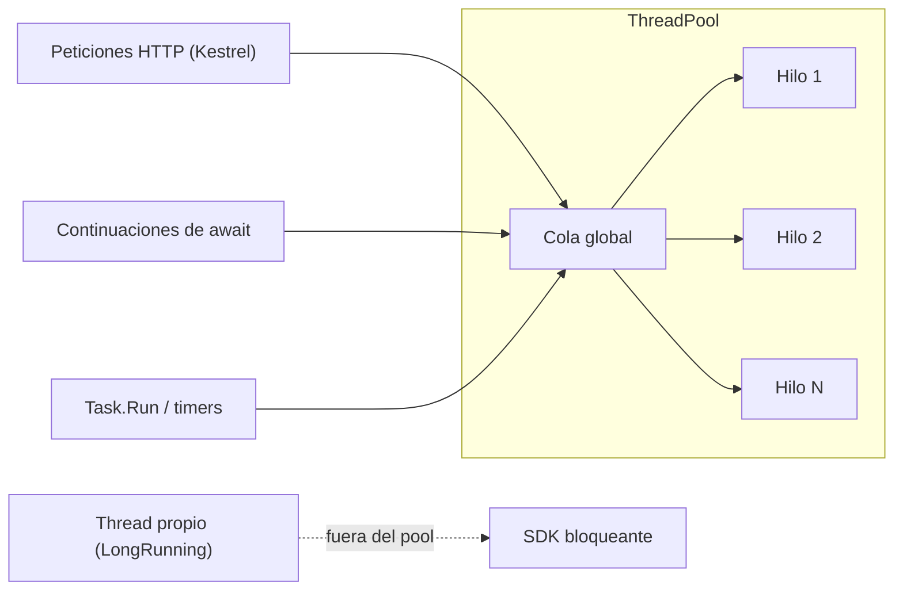

# Hilos y ThreadPool

Parte de: [[03-CSharp-DotNet/04 Asincronía y concurrencia/_Índice Asincronía y concurrencia|Asincronía y concurrencia]]

> [!info] Cómo avanzar
> `progreso`: **pendiente** → **viendo** (estudiando) → **visto** (contestaste la autoevaluación sin abrir las respuestas) → **dominado** (hiciste el laboratorio o lo aplicaste de verdad).

## Contenido

### Qué es
Un **hilo** (*thread*) es una secuencia de ejecución del sistema operativo con su propia pila. Crear y destruir hilos es caro (memoria para la pila, llamadas al SO) y tener demasiados empeora el rendimiento por los cambios de contexto. Por eso .NET mantiene un **ThreadPool**: un conjunto compartido de hilos de trabajo que se **reutilizan** para ejecutar piezas cortas de trabajo (continuaciones de `await`, `Task.Run`, temporizadores, y en ASP.NET Core, cada petición).

### Cómo funciona
- **Colas de trabajo**: el pool tiene una cola global y colas locales por hilo. Cuando un hilo termina su tarea, toma la siguiente (de su cola, de la global o "robando" de otro hilo).
- **Tamaño dinámico**: arranca con un mínimo de hilos (por defecto, igual al número de núcleos lógicos) que puede crear **de inmediato**. Por encima de ese mínimo, un algoritmo de *hill climbing* agrega hilos **gradualmente** (del orden de uno o dos por segundo) si ve que el trabajo se acumula. Esa lentitud es intencional (evita crear cientos de hilos por un pico) y es la causa de la [[Sync over async y thread pool starvation|inanición del pool]] cuando el código bloquea hilos.
- **ASP.NET Core**: Kestrel atiende cada petición en un hilo del pool. Con `async/await`, mientras la petición espera I/O, el hilo regresa al pool y atiende otras. Por eso pocos hilos pueden servir miles de peticiones concurrentes.
- **`Task.Run(func)`**: encola `func` en el pool y regresa una `Task` que se completa al terminar.

**Cuándo crear un `Thread` propio**: casi nunca en código moderno. Tiene sentido cuando el trabajo:
- es de **larga duración y bloqueante** (un ciclo que lee de un dispositivo con una API síncrona, un SDK que exige su propio hilo): ocupar un hilo del pool para siempre le resta capacidad a todo lo demás. Alternativa equivalente: `Task.Factory.StartNew(..., TaskCreationOptions.LongRunning)`, que crea un hilo dedicado.
- necesita propiedades especiales: **STA** para COM o algunas APIs de Windows, prioridad, nombre fijo o tamaño de pila específico.
Para tareas periódicas o de fondo en una API, usa un [[BackgroundService]] con `async`.

**Qué hace `Task.Run` en un controller**: mueve el trabajo de **un hilo del pool a otro hilo del pool**. El hilo de la petición queda libre, pero otro se ocupa: no ganas capacidad, agregas un cambio de hilo y complicas el flujo. Si el trabajo es I/O, usa la API async real; si es CPU, ejecútalo directamente (la petición de todos modos tiene que esperar el resultado). Y si es CPU muy pesado, considera sacarlo de la petición (cola + servicio de fondo).



### Ejemplo
```csharp
// Inspeccionar el pool
ThreadPool.GetMinThreads(out var minTrabajo, out var minIo);
ThreadPool.GetMaxThreads(out var maxTrabajo, out var maxIo);
Console.WriteLine($"Mín: {minTrabajo}, Máx: {maxTrabajo}, Hilos: {ThreadPool.ThreadCount}, Pendientes: {ThreadPool.PendingWorkItemCount}");

// MAL en un controller: Task.Run para "hacerlo async"
// public async Task<IActionResult> Reporte() => Ok(await Task.Run(() => GenerarReporte()));

// BIEN: I/O con API async real
// public async Task<IActionResult> Reporte(CancellationToken ct) => Ok(await consulta.EjecutarAsync(ct));

// Hilo dedicado para un SDK de dispositivo con API bloqueante (por ejemplo, un lector en Ocelotl.Hermes)
public sealed class LectorDispositivo : IDisposable
{
    private readonly Thread _hilo;
    private readonly CancellationTokenSource _cts = new();

    public LectorDispositivo(Action<string> alLeer)
    {
        _hilo = new Thread(() =>
        {
            while (!_cts.IsCancellationRequested)
            {
                var dato = LeerBloqueante();   // la API del SDK bloquea hasta tener datos
                alLeer(dato);                  // ideal: TryWrite a un Channel y regresar rápido
            }
        })
        { IsBackground = true, Name = "LectorDispositivo" };
        _hilo.Start();
    }

    private static string LeerBloqueante() { Thread.Sleep(1000); return "evento"; }

    public void Dispose() { _cts.Cancel(); _hilo.Join(TimeSpan.FromSeconds(2)); _cts.Dispose(); }
}

// Equivalente con Task y LongRunning
// var t = Task.Factory.StartNew(() => CicloBloqueante(ct), ct,
//             TaskCreationOptions.LongRunning, TaskScheduler.Default);
```

### Cuándo usarlo y cuándo no
- **Pool (implícito con `async/await`)** para todo el trabajo normal de una API.
- **`Task.Run`** en apps de escritorio para sacar trabajo CPU del hilo de UI; en APIs, casi nunca.
- **Hilo dedicado / `LongRunning`** para ciclos bloqueantes eternos o APIs que exigen afinidad de hilo.
- **`ThreadPool.SetMinThreads`** solo como mitigación temporal de inanición mientras arreglas el bloqueo; no es una solución.

### Errores comunes
1. **`Task.Run` en controllers** "para no bloquear": no ayuda y agrega costo.
2. **Bloquear hilos del pool** (`.Result`, `Thread.Sleep`, APIs síncronas de I/O) bajo carga: inanición.
3. **Hilos no marcados como `IsBackground`** que impiden que el proceso termine.
4. **Ciclos infinitos en `Task.Run`** sin `LongRunning`: secuestran un hilo del pool para siempre.

### Para profundizar
- [El grupo de subprocesos administrados (ThreadPool)](https://learn.microsoft.com/dotnet/standard/threading/the-managed-thread-pool)
- [Subprocesamiento administrado: procedimientos recomendados](https://learn.microsoft.com/dotnet/standard/threading/managed-threading-best-practices)
- [Configuración del runtime: subprocesamiento](https://learn.microsoft.com/dotnet/core/runtime-config/threading)

## Autoevaluación

Contesta primero en voz alta o en papel; luego despliega la respuesta.

> [!question]- ¿Qué es el ThreadPool?
> Un conjunto de hilos reutilizables que el runtime administra; ahí corren las continuaciones de `await`, `Task.Run` y las peticiones de ASP.NET Core.

> [!question]- ¿Cuándo crearías un `Thread` propio?
> Casi nunca; solo para trabajo de muy larga duración que no quieres que ocupe un hilo del pool (o `TaskCreationOptions.LongRunning`). Para trabajo en segundo plano en una API usa `BackgroundService`.

> [!question]- ¿Qué hace `Task.Run` en un controller?
> Mueve el trabajo a otro hilo del pool y libera el actual: no gana nada y agrega costo. Evítalo en código de servidor.

## Práctica

- [[Lab 5 - async-await, CancellationToken y sync over async]]

