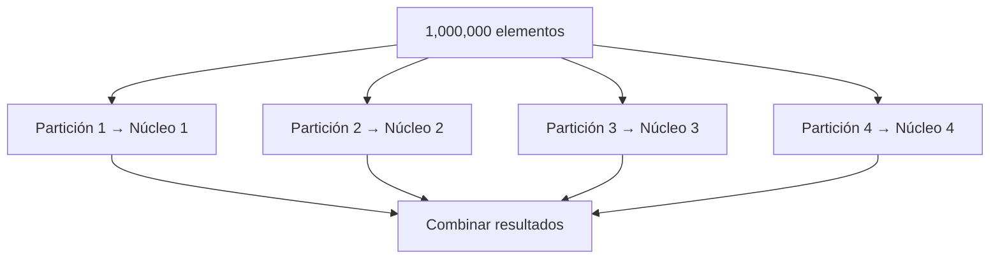

# Parallel y PLINQ

Parte de: [[03-CSharp-DotNet/04 Asincronía y concurrencia/_Índice Asincronía y concurrencia|Asincronía y concurrencia]]

> [!info] Cómo avanzar
> `progreso`: **pendiente** → **viendo** (estudiando) → **visto** (contestaste la autoevaluación sin abrir las respuestas) → **dominado** (hiciste el laboratorio o lo aplicaste de verdad).

## Contenido

### Qué es
`Parallel` (`Parallel.For`, `Parallel.ForEach`, `Parallel.Invoke`) y **PLINQ** (`AsParallel()` sobre una consulta LINQ) son herramientas de la **Task Parallel Library** para ejecutar **trabajo de CPU** en varios núcleos a la vez. Dividen una colección en particiones y procesan cada una en un hilo del pool, aprovechando todos los procesadores para terminar antes. Desde .NET 6 existe además **`Parallel.ForEachAsync`**, pensado para trabajo **asíncrono** con concurrencia limitada.

### Cómo funciona
- **`Parallel.For(0, n, i => ...)`** y **`Parallel.ForEach(items, x => ...)`**: el hilo que llama **también trabaja** y se **bloquea** hasta que terminan todas las iteraciones. El runtime decide cuántos hilos usar; puedes limitarlo con `ParallelOptions.MaxDegreeOfParallelism` y cancelar con `CancellationToken`.
- **PLINQ**: `datos.AsParallel().Where(...).Select(...)` reparte la consulta entre núcleos. Por defecto **no conserva el orden** (agrega `.AsOrdered()` si lo necesitas, con algo de costo). `WithDegreeOfParallelism(n)` limita los hilos.
- **Excepciones**: se recolectan de todas las iteraciones y se lanzan juntas como `AggregateException`.
- **Costo de coordinación**: particionar, sincronizar y juntar resultados cuesta. Si cada elemento es trivial (sumar dos números), la versión paralela puede ser **más lenta** que un `for` normal. Conviene cuando cada elemento tiene trabajo real de CPU o la colección es grande; **mide** con [[BenchmarkDotNet]].

**Por qué no usarlos para llamadas HTTP o a la BD**: `Parallel.ForEach` está diseñado para mantener **hilos ocupados calculando**. Si cada iteración espera I/O, tienes hilos del pool **bloqueados** sin hacer nada (o, peor, con una lambda `async` que se convierte en `async void` porque el parámetro es un `Action`). Eso desperdicia hilos, puede causar [[Sync over async y thread pool starvation|inanición]] y no controla bien cuántas llamadas simultáneas haces al servidor. Para I/O concurrente usa **`Task.WhenAll`** o **`Parallel.ForEachAsync`** con `MaxDegreeOfParallelism`.

**Riesgo con `List<T>` desde `Parallel.ForEach`**: `List<T>` **no es segura para escrituras concurrentes**. Dos hilos que llaman `Add` al mismo tiempo pueden escribir en la misma posición, perder elementos, dejar `null` en medio o lanzar `IndexOutOfRangeException` al redimensionar. El error no siempre aparece en pruebas y es intermitente en producción. Soluciones: dejar que PLINQ construya el resultado (`.Select(...).ToList()`), usar `ConcurrentBag<T>`/`ConcurrentQueue<T>`, o acumular en variables locales por partición y combinar al final con `lock`.



### Ejemplo
```csharp
using System.Collections.Concurrent;
using System.Security.Cryptography;
using System.Text;

public sealed record Registro(int Id, string Contenido);

public static class ProcesoCpu
{
    // PLINQ: calcular hashes (trabajo de CPU real por elemento)
    public static List<(int Id, string Hash)> Hashes(IReadOnlyList<Registro> registros)
        => registros.AsParallel()
                    .WithDegreeOfParallelism(Environment.ProcessorCount)
                    .Select(r => (r.Id, Convert.ToHexString(SHA256.HashData(Encoding.UTF8.GetBytes(r.Contenido)))))
                    .ToList();                          // PLINQ junta el resultado de forma segura

    // MAL: List<T>.Add desde varios hilos
    public static List<int> LongitudesMal(IReadOnlyList<Registro> rs)
    {
        var lista = new List<int>();
        Parallel.ForEach(rs, r => lista.Add(r.Contenido.Length));  // carrera de datos
        return lista;
    }

    // BIEN: colección concurrente
    public static int[] Longitudes(IReadOnlyList<Registro> rs)
    {
        var bolsa = new ConcurrentBag<int>();
        Parallel.ForEach(rs, r => bolsa.Add(r.Contenido.Length));
        return [.. bolsa];
    }

    // BIEN y más rápido para totales: acumulador local por hilo
    public static long TotalCaracteres(IReadOnlyList<Registro> rs)
    {
        long total = 0;
        Parallel.ForEach(rs,
            () => 0L,                                         // inicial por hilo
            (r, _, local) => local + r.Contenido.Length,      // sin sincronizar
            local => Interlocked.Add(ref total, local));      // combinar una vez por hilo
        return total;
    }
}

// I/O concurrente con límite: Parallel.ForEachAsync, no Parallel.ForEach
public sealed class Notificador(HttpClient http)
{
    public Task EnviarTodosAsync(IEnumerable<string> urls, CancellationToken ct)
        => Parallel.ForEachAsync(urls,
            new ParallelOptions { MaxDegreeOfParallelism = 8, CancellationToken = ct },
            async (url, token) =>
            {
                using var resp = await http.PostAsync(url, content: null, token);
                resp.EnsureSuccessStatusCode();
            });
}
```

### Cuándo usarlo y cuándo no
- **Úsalos** para procesamiento **CPU-bound** sobre muchos datos: cálculos de un reporte grande, transformación de imágenes, hashing, parseo de archivos ya en memoria, simulaciones.
- **En una API web**, piénsalo dos veces: cada petición ya corre en paralelo con las demás; usar todos los núcleos en una sola petición le quita CPU al resto. Es más común en procesos batch, consolas, servicios de fondo o herramientas de Wee.Reporteria.
- **Para I/O** (HTTP, BD, Blob): `Task.WhenAll` o `Parallel.ForEachAsync` con límite.
- **Alternativas**: [[System.Threading.Channels]] para tuberías productor/consumidor; TPL Dataflow para flujos con varias etapas.

### Errores comunes
1. **Escribir en colecciones no concurrentes** (`List<T>`, `Dictionary<,>`) desde varias iteraciones.
2. **Lambda `async` en `Parallel.ForEach`**: se vuelve `async void`; nada se espera y las excepciones tumban el proceso.
3. **Paralelizar trabajo diminuto**: más lento que secuencial por la coordinación.
4. **Compartir objetos no seguros para hilos** (una `SqlConnection`, un `DbContext`, un `Random` antiguo); usa `Random.Shared`.
5. **Esperar orden** en PLINQ sin `AsOrdered()`.

### Para profundizar
- [Paralelismo de datos (Task Parallel Library)](https://learn.microsoft.com/dotnet/standard/parallel-programming/data-parallelism-task-parallel-library)
- [Introducción a PLINQ](https://learn.microsoft.com/dotnet/standard/parallel-programming/introduction-to-plinq)
- [Problemas potenciales en el paralelismo de datos y tareas](https://learn.microsoft.com/dotnet/standard/parallel-programming/potential-pitfalls-in-data-and-task-parallelism)

## Autoevaluación

Contesta primero en voz alta o en papel; luego despliega la respuesta.

> [!question]- ¿Para qué sirven `Parallel.For` y PLINQ (`AsParallel()`)?
> Para repartir trabajo **de CPU** entre núcleos (procesar una lista grande en memoria).

> [!question]- ¿Por qué no usarlos para llamadas HTTP o a la BD?
> Bloquean hilos esperando I/O. Para I/O concurrente usa `Parallel.ForEachAsync` con `MaxDegreeOfParallelism` o `Task.WhenAll` limitado.

> [!question]- ¿Qué riesgo hay al agregar a una `List<T>` desde `Parallel.ForEach`?
> `List<T>` no es segura entre hilos: se pierden elementos o lanza excepción. Usa `ConcurrentBag`, resultados por índice o PLINQ con `ToList()`.

