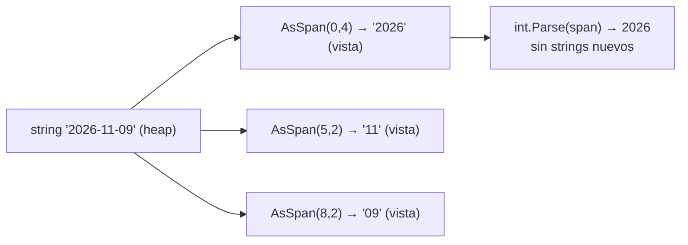

# Span y Memory

Parte de: [[03-CSharp-DotNet/04 Asincronía y concurrencia/_Índice Asincronía y concurrencia|Asincronía y concurrencia]]

> [!info] Cómo avanzar
> `progreso`: **pendiente** → **viendo** (estudiando) → **visto** (contestaste la autoevaluación sin abrir las respuestas) → **dominado** (hiciste el laboratorio o lo aplicaste de verdad).

## Contenido

### Qué es
`Span<T>` y `ReadOnlySpan<T>` representan una **ventana** sobre una región **contigua** de memoria: parte de un arreglo, de un string, de memoria en la pila (`stackalloc`) o de memoria nativa. Permiten leer y (en `Span<T>`) escribir esa región **sin copiarla** y con verificación de límites. `Memory<T>` y `ReadOnlyMemory<T>` son su contraparte que **sí puede vivir en el heap**: guardarse en campos, cruzar `await` y pasarse a métodos asíncronos.

### Cómo funciona
- Un `Span<T>` es básicamente un **puntero administrado + longitud**. `span.Slice(inicio, largo)` crea otra ventana sobre la misma memoria: **cero asignaciones, cero copias**. `"2026-11-09".AsSpan(0, 4)` es una vista de los primeros 4 caracteres, no un string nuevo.
- Muchas APIs del BCL aceptan spans: `int.Parse(ReadOnlySpan<char>)`, `decimal.TryParse`, `DateOnly.TryParseExact`, `Utf8Formatter`, `Encoding.GetBytes(span, ...)`, `TryFormat`, `MemoryExtensions.Split` (.NET 8+), y los métodos `Read`/`Write` de `Stream`.

**Restricciones de `Span<T>`**: es un **`ref struct`**, lo que significa que solo puede vivir en la **pila**. Por eso:
- No puede ser **campo de una clase** ni de un struct normal (solo de otro `ref struct`).
- No puede **encajonarse** (*boxing*), convertirse a `object` ni a una interfaz (salvo, desde C# 13, en genéricos con `allows ref struct`).
- No puede ser capturado por **lambdas** ni usarse en **iteradores**.
- No puede **cruzar un `await`**: desde C# 13 se permite declararlo en métodos `async`, pero no usarlo de un lado y otro de un `await`.
Estas reglas garantizan que la ventana nunca sobreviva a la memoria a la que apunta (por ejemplo, un `stackalloc` que desaparece al salir del método).

**Cuándo `Memory<T>`**: cuando necesitas **guardar** la referencia o usarla en código **asíncrono**: un buffer como campo de una clase, un parámetro de `Stream.ReadAsync(Memory<byte>)`, datos que pasan por un `Channel`. Cuando vayas a trabajar con los datos de forma síncrona, obtienes el span con `.Span`.

**Qué ganas al parsear con `ReadOnlySpan<char>`**: con `Substring` y `Split`, cada pedazo es un **string nuevo** en el heap; parsear un CSV de un millón de líneas crea millones de strings temporales que el GC tiene que limpiar. Con spans haces los mismos cortes como **vistas** y conviertes directo a números o fechas: menos asignaciones, menos pausas del [[Recolector de basura]], más rendimiento en rutas calientes.



### Ejemplo
```csharp
using System.Buffers;
using System.Globalization;

// Extraer el año sin crear substrings
string fecha = "2026-11-09";
int anio = int.Parse(fecha.AsSpan(0, 4), CultureInfo.InvariantCulture);  // 2026
// Con rangos: int.Parse(fecha.AsSpan()[..4])

// Parsear una línea CSV "folio,total,fecha" sin Split
public readonly record struct Movimiento(int Folio, decimal Total, DateOnly Fecha);

public static class ParserCsv
{
    public static bool TryParse(ReadOnlySpan<char> linea, out Movimiento m)
    {
        m = default;
        int c1 = linea.IndexOf(',');
        if (c1 < 0) return false;
        var resto = linea[(c1 + 1)..];
        int c2 = resto.IndexOf(',');
        if (c2 < 0) return false;

        if (!int.TryParse(linea[..c1], NumberStyles.None, CultureInfo.InvariantCulture, out var folio)) return false;
        if (!decimal.TryParse(resto[..c2], NumberStyles.Number, CultureInfo.InvariantCulture, out var total)) return false;
        if (!DateOnly.TryParseExact(resto[(c2 + 1)..], "yyyy-MM-dd", CultureInfo.InvariantCulture, DateTimeStyles.None, out var f)) return false;

        m = new Movimiento(folio, total, f);
        return true;
    }
}
// ParserCsv.TryParse("123,450.50,2026-11-09", out var mov) -> true

// stackalloc: buffer temporal en la pila para formatear sin heap
static string Folio(int n)
{
    Span<char> buffer = stackalloc char[12];
    "FAC-".CopyTo(buffer);
    n.TryFormat(buffer[4..], out int escritos, "D8", CultureInfo.InvariantCulture);
    return new string(buffer[..(4 + escritos)]);   // una sola asignación: el string final
}

// Memory<T> en código asíncrono: el buffer cruza awaits
public static async Task<long> ContarBytesAsync(Stream s, CancellationToken ct)
{
    byte[] rentado = ArrayPool<byte>.Shared.Rent(64 * 1024);
    try
    {
        Memory<byte> buffer = rentado;           // Memory sí puede cruzar await
        long total = 0;
        int n;
        while ((n = await s.ReadAsync(buffer, ct)) > 0) total += n;
        return total;
    }
    finally { ArrayPool<byte>.Shared.Return(rentado); }
}

// No compila: Span como campo de clase
// public class Mal { private Span<byte> _datos; }   // CS8345
```

### Cuándo usarlo y cuándo no
- **Úsalos** en rutas calientes medidas: parseo de archivos grandes, protocolos, serialización, formateo masivo, librerías de infraestructura. Muchas APIs del BCL ya los usan por dentro: te beneficias sin escribirlos.
- **`Memory<T>`** para buffers que se guardan o se usan con `await`; **`Span<T>`** para el trabajo síncrono sobre ellos.
- **`stackalloc`** solo para tamaños **pequeños y acotados** (cientos de bytes, pocos KB); para tamaños variables o grandes usa `ArrayPool<T>`.
- **No** reescribas código de negocio normal con spans: la ganancia es irrelevante frente a una consulta a BD y el código se vuelve más difícil. Mide primero con [[BenchmarkDotNet]].

### Errores comunes
1. **Intentar guardar un `Span<T>`** en un campo o usarlo después de un `await`: no compila; usa `Memory<T>`.
2. **`stackalloc` con tamaño que viene del usuario**: riesgo de `StackOverflowException`, que no se puede atrapar y tumba el proceso.
3. **Regresar un span sobre memoria rentada** después de devolverla al pool: lees datos de otro.
4. **Convertir a string "para comodidad"** (`span.ToString()`) en cada paso y perder la ventaja.
5. **Olvidar la cultura** al parsear números con spans: usa `CultureInfo.InvariantCulture` para formatos de máquina.

### Para profundizar
- [Guía de uso de Memory y Span](https://learn.microsoft.com/dotnet/standard/memory-and-spans/memory-t-usage-guidelines)
- [Tipos relacionados con la memoria y los intervalos](https://learn.microsoft.com/dotnet/standard/memory-and-spans/)
- [Tipos ref struct (referencia de C#)](https://learn.microsoft.com/dotnet/csharp/language-reference/builtin-types/ref-struct)

## Ejercicios

Resuélvelos en papel o en la herramienta; la solución está plegada.

> [!question]- Extrae el año de `"2026-11-09"` sin crear substrings.
> ```csharp
> ReadOnlySpan<char> s = "2026-11-09";
> int anio = int.Parse(s[..4]); // 2026
> ```

## Autoevaluación

Contesta primero en voz alta o en papel; luego despliega la respuesta.

> [!question]- ¿Qué es `Span<T>`?
> Una vista sobre memoria contigua (array, `stackalloc`, memoria nativa) sin copiar. Es un `ref struct`: vive solo en el stack.

> [!question]- ¿Qué restricciones tiene `Span<T>` y cuándo usas `Memory<T>`?
> No puede ser campo de una clase, ni guardarse en el heap, ni cruzar un `await`. `Memory<T>` sí puede (es un struct normal) y de él obtienes `.Span` cuando necesitas procesar.

> [!question]- ¿Qué ganas al parsear con `ReadOnlySpan<char>`?
> Puedes cortar (`Slice`) y parsear (`int.Parse(span)`) sin crear substrings: menos asignaciones y menos trabajo del GC.

## Práctica

- [[Lab 8 - BenchmarkDotNet midiendo allocations]]

