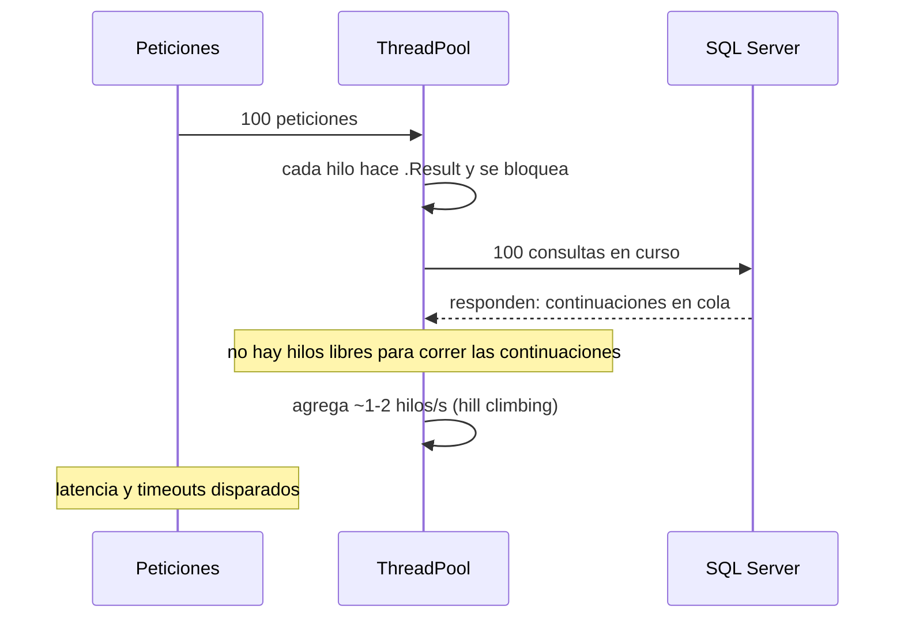

# Sync over async y thread pool starvation

Parte de: [[03-CSharp-DotNet/04 Asincronía y concurrencia/_Índice Asincronía y concurrencia|Asincronía y concurrencia]]

> [!info] Cómo avanzar
> `progreso`: **pendiente** → **viendo** (estudiando) → **visto** (contestaste la autoevaluación sin abrir las respuestas) → **dominado** (hiciste el laboratorio o lo aplicaste de verdad).

## Contenido

### Qué es
- **Sync over async** es **bloquear un hilo esperando** el resultado de una operación asíncrona: `tarea.Result`, `tarea.Wait()`, `tarea.GetAwaiter().GetResult()`, `Task.WaitAll(...)`. El código "parece" síncrono, pero por debajo hay I/O asíncrono y un hilo detenido sin hacer nada.
- **Thread pool starvation** (inanición del pool) es la situación en la que **todos los hilos del ThreadPool están ocupados** (normalmente bloqueados) y el trabajo nuevo se queda en la cola esperando un hilo libre. La aplicación sigue viva pero responde lentísimo o deja de responder.

### Cómo funciona
El círculo vicioso bajo carga:
1. Llega una petición; su hilo llama `consulta.EjecutarAsync().Result` y se **bloquea**.
2. La consulta termina en SQL Server, pero **la continuación** (el código que completa la `Task`) necesita **otro hilo del pool** para ejecutarse.
3. Con muchas peticiones simultáneas, todos los hilos están bloqueados esperando continuaciones que, a su vez, esperan un hilo libre.
4. El pool solo agrega hilos **gradualmente** (ver [[Hilos y ThreadPool]]), del orden de uno o dos por segundo. Cada hilo nuevo se ocupa de inmediato con otra petición que también se bloquea.
5. La cola crece, la latencia sube de milisegundos a decenas de segundos, aparecen *timeouts* en cascada, y los *health checks* fallan aunque la CPU esté casi en cero.

En apps con `SynchronizationContext` (UI, ASP.NET clásico) el mismo patrón causa un **deadlock** directo: el hilo de UI espera la tarea, y la tarea espera regresar al hilo de UI.



**Cómo detectarlo**:
- Síntomas: latencia altísima con **CPU baja**, *timeouts* que empeoran con la carga y mejoran solos cuando baja, reinicio de la app que "lo arregla" por un rato.
- **[[dotnet-counters]]**: `dotnet-counters monitor -n MiApi --counters System.Runtime` y observa *ThreadPool Queue Length* (crece y no baja) y *ThreadPool Thread Count* (sube lentamente, sin parar).
- **[[dotnet-dump]]**: toma un volcado y con `clrstack -all` o `dumpasync` verás muchos hilos detenidos en `Task.Wait`, `GetResult` o `Monitor.Wait`.
- Revisión de código: busca `.Result`, `.Wait()`, `GetAwaiter().GetResult()`, `Thread.Sleep` y APIs síncronas de I/O (`ExecuteReader`, `File.ReadAllText`, `HttpClient.Send`) en rutas de petición.

**Cómo arreglarlo**: **async todo el camino**. Cambia la firma del método a `async Task`, usa `await` y propaga hacia arriba hasta el controller. ASP.NET Core soporta async en controllers, filtros, middleware, validadores (FluentValidation tiene `ValidateAsync` y reglas `MustAsync`) y servicios de fondo.

### Ejemplo
```csharp
using Dapper;
using Microsoft.Data.SqlClient;

// MAL: sync over async dentro de una API
public sealed class ServicioClientesMal(string cadena)
{
    public Cliente? Obtener(int id)
    {
        using var cn = new SqlConnection(cadena);
        return cn.QuerySingleOrDefaultAsync<Cliente>("dbo.Cliente_Obtener", new { id },
                    commandType: System.Data.CommandType.StoredProcedure)
                 .Result;                          // bloquea un hilo del pool
    }
}

// BIEN: async de punta a punta
public sealed class ServicioClientes(string cadena)
{
    public async Task<Cliente?> ObtenerAsync(int id, CancellationToken ct)
    {
        await using var cn = new SqlConnection(cadena);
        return await cn.QuerySingleOrDefaultAsync<Cliente>(new CommandDefinition(
            "dbo.Cliente_Obtener", new { id },
            commandType: System.Data.CommandType.StoredProcedure, cancellationToken: ct));
    }
}

// Controller
// [HttpGet("{id:int}")]
// public async Task<IActionResult> Get(int id, CancellationToken ct)
//     => await servicio.ObtenerAsync(id, ct) is { } c ? Ok(c) : NotFound();

public sealed record Cliente(int Id, string Nombre);
```

Si estás atrapado con una interfaz síncrona que no controlas (un *callback* de una librería vieja), las opciones, de mejor a peor: buscar la versión async de esa librería; usar la API **síncrona** real del recurso (por ejemplo, `Query` en lugar de `QueryAsync().Result`), que al menos no necesita una continuación; y como último recurso, bloquear **solo** en el arranque de la app (`Main`), nunca por petición.

### Cuándo usarlo y cuándo no
- **Nunca** bloquees sobre tareas en rutas de petición, *middleware* o servicios de fondo de ASP.NET Core.
- **Aceptable** (con cuidado): en `Main` de una consola antigua sin `async Main`, o en inicialización única al arrancar. Hoy `static async Task Main` y `await` en *top-level statements* eliminan casi todos esos casos.
- **`SetMinThreads`** puede comprar tiempo durante un incidente en producción, pero esconde el problema; arregla el bloqueo.

### Errores comunes
1. **`GetAwaiter().GetResult()` creyendo que es "más seguro" que `.Result`**: solo cambia cómo se envuelve la excepción; sigue bloqueando.
2. **Async a medias**: el controller es async, pero un servicio intermedio hace `.Result`.
3. **Constructores o propiedades** que llaman métodos async con `.Result` (los constructores no pueden ser async): usa un método de inicialización async o una fábrica.
4. **Bloquear dentro de `lock`** o de *callbacks* de temporizadores que corren en el pool.

### Para profundizar
- [Diagnosticar inanición del ThreadPool (tutorial)](https://learn.microsoft.com/dotnet/core/diagnostics/debug-threadpool-starvation)
- [Procedimientos recomendados de ASP.NET Core: evitar llamadas bloqueantes](https://learn.microsoft.com/aspnet/core/fundamentals/best-practices#avoid-blocking-calls)
- [ASP.NET Core Diagnostic Scenarios: async guidance (David Fowler)](https://github.com/davidfowl/AspNetCoreDiagnosticScenarios/blob/master/AsyncGuidance.md)

## Autoevaluación

Contesta primero en voz alta o en papel; luego despliega la respuesta.

> [!question]- ¿Qué es *sync over async*?
> Bloquear un hilo esperando una tarea async: `.Result`, `.Wait()`, `.GetAwaiter().GetResult()`. El hilo queda ocupado sin hacer nada mientras dura la I/O.

> [!question]- ¿Por qué causa *thread pool starvation* bajo carga?
> Cada petición bloquea un hilo; cuando se acaban, las continuaciones que destrabarían a esos hilos no tienen dónde correr. El pool inyecta hilos nuevos despacio, así que la latencia se dispara aunque la CPU esté baja.

> [!question]- ¿Cómo lo detectas?
> `dotnet-counters monitor -n MiApi --counters System.Runtime`: el *ThreadPool Queue Length* crece y el *ThreadPool Thread Count* sube poco a poco. Un `dotnet-dump` muestra muchos hilos detenidos en `Task.Wait`/`GetResult`.

> [!question]- ¿Cómo lo arreglas?
> Async de punta a punta. Si un constructor o una interfaz síncrona te obliga, rediseña (fábrica async, inicializar en `IHostedService`). Subir `SetMinThreads` solo es un parche.

## Práctica

- [[Lab 5 - async-await, CancellationToken y sync over async]]

