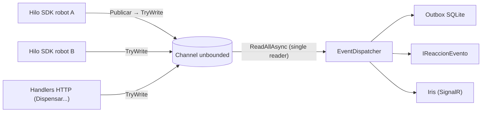

# System.Threading.Channels

> Colas productor/consumidor asíncronas y seguras entre hilos; en [[Ocelotl.Hermes]] separan el hilo del SDK de Rowa (que solo deja el evento) del procesamiento lento (SQLite, Argo, SignalR).

## Qué es y qué problema resuelve
Un `Channel<T>` es una cola en memoria con un **escritor** (`ChannelWriter<T>`) y un **lector** (`ChannelReader<T>`). Permite que uno o varios productores dejen elementos y uno o varios consumidores los lean con `await`, sin locks manuales ni sondeo.

Problema que resuelve en Hermes: los eventos del SDK de BD Rowa llegan **en un hilo del SDK**. Si ese hilo esperara a escribir en SQLite, avisar a Iris o hablar con Argo, el SDK quedaría bloqueado (y con él la comunicación con el robot). Con un canal, el manejador del evento solo hace `TryWrite` y regresa de inmediato.

## Cómo funciona por dentro
- **Unbounded** (`Channel.CreateUnbounded`): sin límite; `TryWrite` siempre tiene éxito mientras el canal no esté completado. Riesgo: crecer sin control si el consumidor no avanza.
- **Bounded** (`Channel.CreateBounded(n)`): con capacidad; al llenarse puede esperar, descartar el más viejo/nuevo, etc. (`BoundedChannelFullMode`).
- **`SingleReader` / `SingleWriter`**: pistas de optimización; si las declaras, debes cumplirlas.
- **Lectura**: `ReadAllAsync(ct)` devuelve un `IAsyncEnumerable<T>` que espera sin consumir CPU hasta que hay datos o el canal se completa.
- **Completar**: `Writer.TryComplete()` indica que no habrá más elementos; el `await foreach` termina al vaciarse.



## Cuándo usarla y cuándo no
### Ventajas
- Desacopla productor y consumidor: el productor nunca espera trabajo lento.
- API `async` nativa, sin `lock` ni `BlockingCollection`.
- Muy eficiente (incluida en .NET).
### Desventajas
- Todo vive en memoria: si el proceso cae, lo que estaba en el canal y no se procesó se pierde.
- Unbounded puede crecer sin límite si el consumidor se atasca.
- No hay reintentos ni persistencia por sí solo.

## Alternativas
| Alternativa | En qué se diferencia |
|---|---|
| `BlockingCollection<T>` | Bloquea hilos al leer; API síncrona, más antigua. |
| `ConcurrentQueue<T>` + sondeo | Sin espera asíncrona; hay que sondear o señalizar a mano. |
| TPL Dataflow (`ActionBlock`) | Pipelines con paralelismo configurable; más pesado. |
| Broker externo (RabbitMQ, Azure Service Bus) | Persistente y distribuido; innecesario dentro de un solo proceso local. |

## Cómo se usó en Ocelotl
En [[Ocelotl.Hermes]], `ChannelEventPublisher` implementa el puerto `IEventPublisher` con un canal **unbounded**, **un solo lector** (el `EventDispatcher`) y **varios escritores** (cada robot conectado y los slices que publican eventos) (`Ocelotl.Hermes/src/Ocelotl.Hermes.Infrastructure/Eventos/ChannelEventPublisher.cs`):
```csharp
public sealed class ChannelEventPublisher : IEventPublisher
{
    private readonly Channel<IEventoRobot> _canal = Channel.CreateUnbounded<IEventoRobot>(
        new UnboundedChannelOptions { SingleReader = true, SingleWriter = false });

    public ChannelReader<IEventoRobot> Lector => _canal.Reader;

    public void Publicar(IEventoRobot evento) => _canal.Writer.TryWrite(evento);

    internal void Completar() => _canal.Writer.TryComplete();
}
```

**Por qué no bloquea al SDK del robot**: `RowaEventTranslator` se suscribe a los eventos del SDK (`PackStored`, `PackDispensed`, `StateChanged`…) y cada manejador solo traduce a un evento de dominio y llama `Publicar`, que es `TryWrite` en un canal sin límite: retorna en microsegundos, sin `await`, sin E/S. Todo lo lento (outbox en [[SQLite]], [[SignalR]] a Iris, reacciones de trazabilidad) lo hace después el [[BackgroundService]] `EventDispatcher` con `ReadAllAsync`. Ver [[SDK BD Rowa y WWKS2]] y [[Eventos en tiempo real]].

La pérdida en memoria se mitiga porque lo primero que hace el dispatcher con cada evento es guardarlo en el outbox ([[Patrón Outbox]]); un evento que estuviera en el canal en el momento de un cierre abrupto sí se perdería (no se encontró manejo para ese caso: Pendiente de confirmar si se considera aceptable).

`Completar()` existe pero no se encontró quién lo llama en el código actual (Pendiente de confirmar).

> [!tip] Reutilizable
> "Productor en un hilo que no puedes bloquear (SDK, callback nativo, UI) → `TryWrite` en un canal → un `BackgroundService` consume" es un patrón general para aislar callbacks de terceros.

## Errores comunes y buenas prácticas
- Declarar `SingleWriter = true` cuando escriben varios hilos (en Hermes es `false` porque escriben varios robots y slices).
- Usar `WriteAsync` con `await` desde un callback síncrono del SDK: se pierde la ventaja de no bloquear.
- Olvidar que unbounded no aplica contrapresión: vigilar que el consumidor no se atasque.
- No atrapar errores en el consumidor: una excepción terminaría el `await foreach`.
- Persistir lo importante cuanto antes (outbox) si no se puede perder.

## Qué estudiar después
- [[BackgroundService]], [[Patrón Outbox]], [[Eventos de dominio y reacciones]]
- `IAsyncEnumerable<T>` y `await foreach`; canales bounded y contrapresión.

## Documentación oficial
- https://learn.microsoft.com/dotnet/core/extensions/channels

## Autoevaluación

Contesta primero en voz alta o en papel; luego despliega la respuesta.

> [!question]- ¿Qué es un `Channel<T>`?
> Una cola asíncrona productor-consumidor: el productor escribe con `WriteAsync` y el consumidor lee con `await foreach (var x in reader.ReadAllAsync(ct))`.

> [!question]- ¿Qué diferencia hay entre `CreateBounded` y `CreateUnbounded`?
> El acotado tiene capacidad máxima y aplica *backpressure* (el productor espera o se descartan mensajes según `BoundedChannelFullMode`). El no acotado puede crecer sin límite y agotar memoria.

> [!question]- ¿Qué combinación típica usas con un `BackgroundService`?
> Los endpoints escriben trabajos al canal (singleton) y un `BackgroundService` los consume; así la petición responde rápido (202) y el trabajo se hace en segundo plano.

