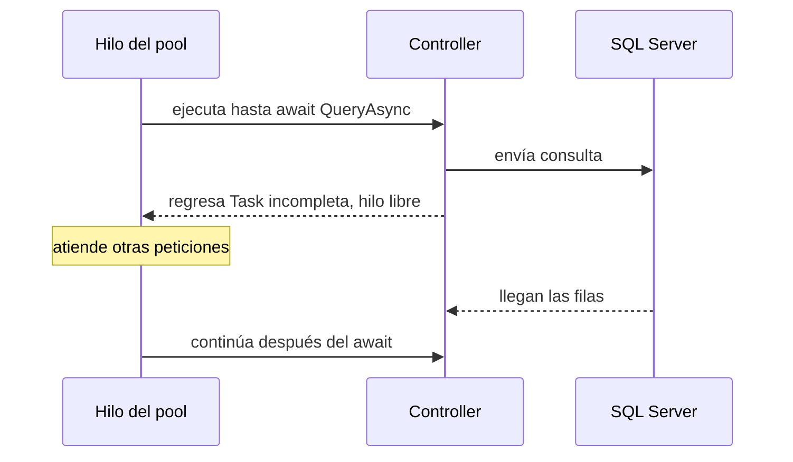

# Task y async-await

Parte de: [[03-CSharp-DotNet/04 Asincronía y concurrencia/_Índice Asincronía y concurrencia|Asincronía y concurrencia]]

> [!info] Cómo avanzar
> `progreso`: **pendiente** → **viendo** (estudiando) → **visto** (contestaste la autoevaluación sin abrir las respuestas) → **dominado** (hiciste el laboratorio o lo aplicaste de verdad).

## Contenido

### Qué es
`Task` y `Task<T>` representan una **operación que terminará en el futuro**: una consulta a SQL Server, una llamada HTTP, leer un archivo. `async`/`await` es la sintaxis de C# para escribir código que **espera** esas operaciones **sin bloquear el hilo**, pero que se lee de arriba abajo como código síncrono. En una API, esto permite atender muchas más peticiones con los mismos hilos.

### Cómo funciona
- Un método marcado `async` puede usar `await`. Regresa `Task` (sin valor), `Task<T>` (con valor), `ValueTask`/`ValueTask<T>` o `IAsyncEnumerable<T>`.
- **El método se ejecuta de forma síncrona hasta el primer `await` de algo que no ha terminado.** Ahí:
  1. Registra "lo que falta del método" como **continuación** de la tarea esperada.
  2. **Regresa** al llamador una `Task` todavía incompleta.
  3. El hilo queda **libre** para otra cosa (en ASP.NET Core, vuelve al pool para atender otra petición).
- Cuando la operación termina (llega la respuesta de SQL Server), la continuación se programa y el método **sigue desde la línea siguiente al `await`**, quizá en otro hilo del pool.
- Si la tarea ya estaba terminada al llegar al `await`, continúa sin pausa. El detalle de cómo lo arma el compilador está en [[Cómo funciona async por dentro (máquina de estados)]].

Por eso este código imprime **`123`**:
```csharp
async Task<int> F() { Console.Write("1"); await Task.Delay(10); Console.Write("3"); return 0; }
var t = F();          // imprime 1 y regresa al llegar al await (Delay no ha terminado)
Console.Write("2");   // imprime 2
await t;              // espera; cuando termina el Delay, F imprime 3
```

**I/O-bound frente a CPU-bound**:
- **I/O-bound** (esperar BD, red, disco): mientras esperas **no hay ningún hilo trabajando**; el sistema operativo avisa cuando llegan los datos. Aquí `async/await` brilla: usa los métodos `Async` de las librerías (`QueryAsync`, `GetAsync`, `ReadAsync`).
- **CPU-bound** (calcular, comprimir, generar un PDF): sí hay un hilo ocupado. `async` no lo hace más rápido. En una app de escritorio puedes mandarlo a otro hilo con `Task.Run` para no congelar la UI; en una API normalmente se ejecuta directo (ver [[Hilos y ThreadPool]] y [[Parallel y PLINQ]]).



### Ejemplo
```csharp
using Microsoft.AspNetCore.Mvc;

public sealed record CrearPedido(int ClienteId, decimal Total);
public sealed record Result(bool Exito, int? Id, string? Codigo);

public interface IComandoCrearPedido { Task<int> EjecutarAsync(CrearPedido c, CancellationToken ct); }

public sealed class CrearPedidoHandler(IComandoCrearPedido comando)
{
    public async Task<Result> Handle(CrearPedido cmd, CancellationToken ct)
    {
        if (cmd.Total <= 0) return new Result(false, null, "validacion");
        var id = await comando.EjecutarAsync(cmd, ct);   // I/O: el hilo se libera aquí
        return new Result(true, id, null);
    }
}

[ApiController, Route("api/pedidos")]
public sealed class PedidosController(CrearPedidoHandler h) : ControllerBase
{
    // El controller no hace trabajo propio: regresa la Task del handler y ASP.NET Core la espera
    [HttpPost]
    public Task<Result> Crear(CrearPedido cmd, CancellationToken ct) => h.Handle(cmd, ct);
}

// Error común: fire-and-forget
public sealed class Mal(IRepo repo)
{
    public void Procesar(Pedido x)
    {
        _ = repo.GuardarAsync(x);   // nadie espera: excepciones perdidas, puede correr
                                    // después de que se deseche la conexión scoped
    }
}
public interface IRepo { Task GuardarAsync(Pedido p); }
public sealed record Pedido(int Id);
```

**Por qué los handlers regresan `Task<Result>` y el controller solo hace `return h.Handle(cmd, ct);`**: el handler contiene la lógica asíncrona y su resultado de negocio (`Result` con `codigo` para ProblemDetails); el controller es una capa delgada que no necesita `async/await` porque no hace nada después: regresa la misma `Task` y el framework la espera. Eso evita una máquina de estados extra. Si el controller tuviera que transformar el resultado o envolver en `try/using`, entonces sí debe ser `async` y hacer `await`.

**Olvidar el `await`** (`_ = repo.GuardarAsync(x);`): la operación arranca pero nadie la espera. La petición puede terminar antes de que se guarde, la conexión *scoped* puede desecharse a mitad de la operación (`ObjectDisposedException`), las excepciones no llegan a ningún `catch` ni al manejador global, y el cliente recibe 200 aunque no se haya guardado nada. Para trabajo en segundo plano real, usa una cola y un [[BackgroundService]].

### Cuándo usarlo y cuándo no
- **Úsalo en toda operación de I/O** de una API: BD, HTTP, archivos, colas. "Async todo el camino": del controller al repositorio.
- **No** envuelvas código síncrono en `Task.Run` dentro de una API solo para "hacerlo async": usa otro hilo y no libera nada.
- **No** bloquees con `.Result` o `.Wait()`: ver [[Sync over async y thread pool starvation]].
- **Paraleliza** operaciones independientes con [[Task.WhenAll y Task.WhenAny]] en lugar de esperarlas una tras otra.

### Errores comunes
1. **Fire-and-forget** sin querer (falta de `await`): el analizador CS4014 avisa; no lo silencies.
2. **`.Result` / `.Wait()`**: bloqueo de hilos y riesgo de *deadlocks* en contextos con `SynchronizationContext`.
3. **`async void`**: excepciones que tumban el proceso (ver [[async void y por qué evitarlo]]).
4. **No pasar el `CancellationToken`** (ver [[CancellationToken]]): la BD sigue trabajando aunque el cliente ya se fue.
5. **Elidir `async` con `using`** (`using var cn = ...; return cn.QueryAsync(...)`): la conexión se desecha antes de que termine la consulta. Si hay `using` o `try`, usa `async/await`.

### Para profundizar
- [Programación asíncrona con async y await](https://learn.microsoft.com/dotnet/csharp/asynchronous-programming/)
- [Modelo de programación asíncrona de tareas (TAP)](https://learn.microsoft.com/dotnet/standard/asynchronous-programming-patterns/task-based-asynchronous-pattern-tap)
- [Procedimientos recomendados de ASP.NET Core: async](https://learn.microsoft.com/aspnet/core/fundamentals/best-practices#avoid-blocking-calls)

## Ejercicios

Resuélvelos en papel o en la herramienta; la solución está plegada.

> [!question]- ¿Qué imprime? `async Task<int> F() { Console.Write("1"); await Task.Delay(10); Console.Write("3"); return 0; } var t = F(); Console.Write("2"); await t;`
> `123`: el método corre síncrono hasta el primer `await` que no está completo.

## Autoevaluación

Contesta primero en voz alta o en papel; luego despliega la respuesta.

> [!question]- ¿Qué hace `await` realmente?
> Si la tarea no terminó, **libera el hilo** y registra la continuación; cuando la tarea termina, el resto del método continúa (en ASP.NET Core, en un hilo del pool). No crea hilos nuevos.

> [!question]- ¿Qué diferencia hay entre trabajo *I/O-bound* y *CPU-bound* en async?
> I/O (BD, HTTP, archivos): `await` sobre la operación async, sin ocupar hilos mientras espera. CPU: el cálculo ocupa un hilo de todos modos; `Task.Run` solo lo mueve a otro hilo (útil en UI, rara vez en una API).

> [!question]- ¿Por qué tus handlers regresan `Task<Result>` y los controllers solo hacen `return h.Handle(cmd, ct);`?
> Así toda la cadena es async de punta a punta. Regresar la `Task` directamente sin `async/await` está bien cuando no hay `using` ni `try` alrededor.

> [!question]- Error común: olvidar el `await` en `_ = repo.GuardarAsync(x);`. ¿Qué pasa?
> La operación queda "suelta": la petición responde antes de guardar, una excepción se pierde y el scope de DI (y la conexión) puede liberarse a mitad. El analizador CS4014 lo avisa.

## Práctica

- [[Lab 5 - async-await, CancellationToken y sync over async]]

