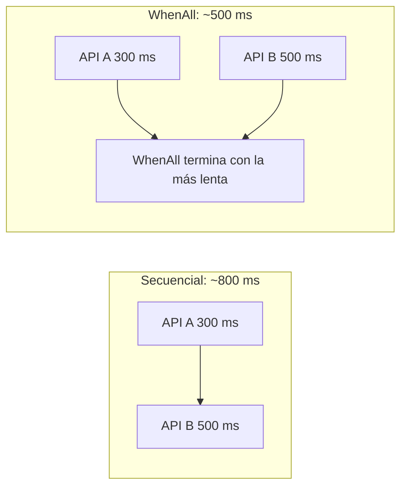

# Task.WhenAll y Task.WhenAny

Parte de: [[03-CSharp-DotNet/04 Asincronía y concurrencia/_Índice Asincronía y concurrencia|Asincronía y concurrencia]]

> [!info] Cómo avanzar
> `progreso`: **pendiente** → **viendo** (estudiando) → **visto** (contestaste la autoevaluación sin abrir las respuestas) → **dominado** (hiciste el laboratorio o lo aplicaste de verdad).

## Contenido

### Qué es
Son combinadores de tareas:
- **`Task.WhenAll(t1, t2, ...)`** regresa una tarea que se completa cuando **todas** las tareas terminan. Si son `Task<T>`, su resultado es un arreglo con todos los resultados en el mismo orden.
- **`Task.WhenAny(t1, t2, ...)`** regresa una tarea que se completa cuando **la primera** termina (bien, con error o cancelada); su resultado es **esa tarea** ganadora.
- **`Task.WhenEach`** (.NET 9) permite procesar las tareas **conforme van terminando** con `await foreach`.

### Cómo funciona
**Concurrencia de I/O**: si dos llamadas HTTP independientes tardan 300 ms y 500 ms:
- Con `await` una tras otra: 300 + 500 = **~800 ms**, porque la segunda no empieza hasta que termina la primera.
- Iniciándolas ambas y luego `await Task.WhenAll(a, b)`: ambas corren al mismo tiempo, así que el total es el de la más lenta, **~500 ms**.
La clave es **iniciar** las tareas (llamar a los métodos) **antes** de esperarlas. `WhenAll` no inicia nada, solo espera.

**Excepciones en `WhenAll`**: espera a que **todas** terminen, aunque alguna falle pronto. Si una o varias fallan, la tarea combinada queda *Faulted* y `await` relanza **la primera** excepción; las demás están en `tareaCombinada.Exception.InnerExceptions`. Las tareas que sí terminaron bien conservan su resultado.

**`WhenAny`** no cancela a las perdedoras: siguen corriendo. Si ya no te interesan, cancélalas con un `CancellationTokenSource` compartido. Usos típicos: tiempo límite (competir contra `Task.Delay`), "el primero que responda" entre réplicas, procesar resultados en orden de llegada.



### Ejemplo
```csharp
using Dapper;
using Microsoft.Data.SqlClient;

public sealed class TableroHandler(IClienteInventario inventario, IClienteEnvios envios)
{
    public async Task<Tablero> Handle(int sucursalId, CancellationToken ct)
    {
        // Iniciar ambas ANTES de esperar
        Task<int> existencias = inventario.ExistenciasAsync(sucursalId, ct);   // ~300 ms
        Task<int> pendientes = envios.PendientesAsync(sucursalId, ct);         // ~500 ms

        await Task.WhenAll(existencias, pendientes);                           // ~500 ms en total
        return new Tablero(await existencias, await pendientes);              // ya terminaron: no esperan
    }
}

// Tiempo límite de 2 s con WhenAny
public static async Task<string> ObtenerConLimiteAsync(Func<CancellationToken, Task<string>> obtenerAsync, CancellationToken ct)
{
    using var cts = CancellationTokenSource.CreateLinkedTokenSource(ct);
    Task<string> trabajo = obtenerAsync(cts.Token);
    Task limite = Task.Delay(TimeSpan.FromSeconds(2), cts.Token);

    if (await Task.WhenAny(trabajo, limite) == trabajo)
    {
        cts.Cancel();                      // libera el Delay
        return await trabajo;              // await para obtener el valor o relanzar su error
    }
    cts.Cancel();                          // avisa a la operación que ya no interesa
    throw new TimeoutException("ObtenerAsync tardó más de 2 s");
}
// Alternativa más corta (.NET 6+): await obtenerAsync(ct).WaitAsync(TimeSpan.FromSeconds(2), ct);
// Ojo: WaitAsync deja de esperar pero no cancela la operación original.

// Varias consultas Dapper en paralelo: UNA CONEXIÓN POR CONSULTA
public sealed class ResumenConsultas(string cadena)
{
    public async Task<(int Clientes, int Pedidos)> ContarAsync(CancellationToken ct)
    {
        async Task<int> Contar(string sp)
        {
            await using var cn = new SqlConnection(cadena);          // conexión propia (del pool)
            return await cn.ExecuteScalarAsync<int>(new CommandDefinition(sp,
                commandType: System.Data.CommandType.StoredProcedure, cancellationToken: ct));
        }
        var c = Contar("dbo.Clientes_Contar");
        var p = Contar("dbo.Pedidos_Contar");
        await Task.WhenAll(c, p);
        return (c.Result, p.Result);  // .Result es seguro aquí: ya terminaron
    }
}

public sealed record Tablero(int Existencias, int EnviosPendientes);
public interface IClienteInventario { Task<int> ExistenciasAsync(int s, CancellationToken ct); }
public interface IClienteEnvios { Task<int> PendientesAsync(int s, CancellationToken ct); }
```

**¿`WhenAll` con varias consultas Dapper sobre la misma conexión?** **No.** Un `SqlConnection` solo puede ejecutar **un comando a la vez**; lanzar dos en paralelo sobre la misma conexión produce errores como "There is already an open DataReader associated with this connection" o comportamiento indefinido. (MARS permite intercalar lecturas, pero no ejecuta en paralelo ni lo hace seguro entre hilos.) Opciones: una conexión por consulta (el [[Connection pooling]] las hace baratas), o una sola ida a la BD con `QueryMultiple` y varios `SELECT` en el mismo `.sql` o procedimiento. Dentro de una **transacción**, todo debe ir en la misma conexión y, por tanto, **en secuencia**.

### Cuándo usarlo y cuándo no
- **`WhenAll`** para operaciones de I/O **independientes**: llamadas a varias APIs, consultas a distintas fuentes, subir varios archivos a Blob.
- **`WhenAny`** para tiempos límite, *hedging* (preguntar a dos réplicas) y procesar en orden de llegada (o `Task.WhenEach` en .NET 9+).
- **Limita la concurrencia** cuando son muchas (cientos de llamadas): `Parallel.ForEachAsync` con `MaxDegreeOfParallelism` o un `SemaphoreSlim`, para no saturar el servicio remoto ni el pool de conexiones.
- **No** paralelices pasos que dependen uno del otro, ni operaciones dentro de la misma transacción.

### Errores comunes
1. **`await` dentro del ciclo** que crea las tareas: vuelve todo secuencial.
2. **Compartir la conexión o el `DbContext`** entre tareas concurrentes: no son seguros para uso concurrente.
3. **Ignorar las demás excepciones** de `WhenAll`: si importan, revisa `Exception.InnerExceptions`.
4. **Olvidar cancelar a las perdedoras** de `WhenAny`: siguen consumiendo recursos.
5. **`Task.WaitAll`** (bloqueante) en lugar de `await Task.WhenAll`.

### Para profundizar
- [Task.WhenAll (referencia de API)](https://learn.microsoft.com/dotnet/api/system.threading.tasks.task.whenall)
- [Task.WhenAny (referencia de API)](https://learn.microsoft.com/dotnet/api/system.threading.tasks.task.whenany)
- [Procesar tareas asincrónicas a medida que se completan](https://learn.microsoft.com/dotnet/csharp/asynchronous-programming/start-multiple-async-tasks-and-process-them-as-they-complete)

## Ejercicios

Resuélvelos en papel o en la herramienta; la solución está plegada.

> [!question]- Dos llamadas HTTP independientes tardan 300 ms y 500 ms. ¿Cuánto tarda en total hacer `await` una tras otra y con `WhenAll`?
> Secuencial ≈ 800 ms; con `WhenAll` ≈ 500 ms.

> [!question]- Escribe un tiempo límite de 2 s para `ObtenerAsync()` con `WhenAny`.
> ```csharp
> var t = ObtenerAsync();
> if (await Task.WhenAny(t, Task.Delay(2000)) != t) throw new TimeoutException();
> var r = await t;
> ```
> (Mejor aún: `await t.WaitAsync(TimeSpan.FromSeconds(2));`).

## Autoevaluación

Contesta primero en voz alta o en papel; luego despliega la respuesta.

> [!question]- ¿Qué hace `Task.WhenAll`?
> Regresa una tarea que termina cuando terminan todas; con `Task<T>` regresa `T[]`. Si varias fallan, `await` lanza la primera excepción (las demás quedan en `task.Exception`).

> [!question]- ¿Para qué `Task.WhenAny`?
> Para reaccionar a la primera que termine: tiempos límite, *hedging* o procesar resultados conforme llegan. Desde .NET 9 `Task.WhenEach` da cada tarea al completarse.

> [!question]- ¿Puedes usar `WhenAll` con varias consultas Dapper sobre la **misma** conexión?
> No: una conexión no admite comandos simultáneos (sin MARS). Usa conexiones distintas o `QueryMultiple` en una sola ida.

## Práctica

- [[Lab 5 - async-await, CancellationToken y sync over async]]

