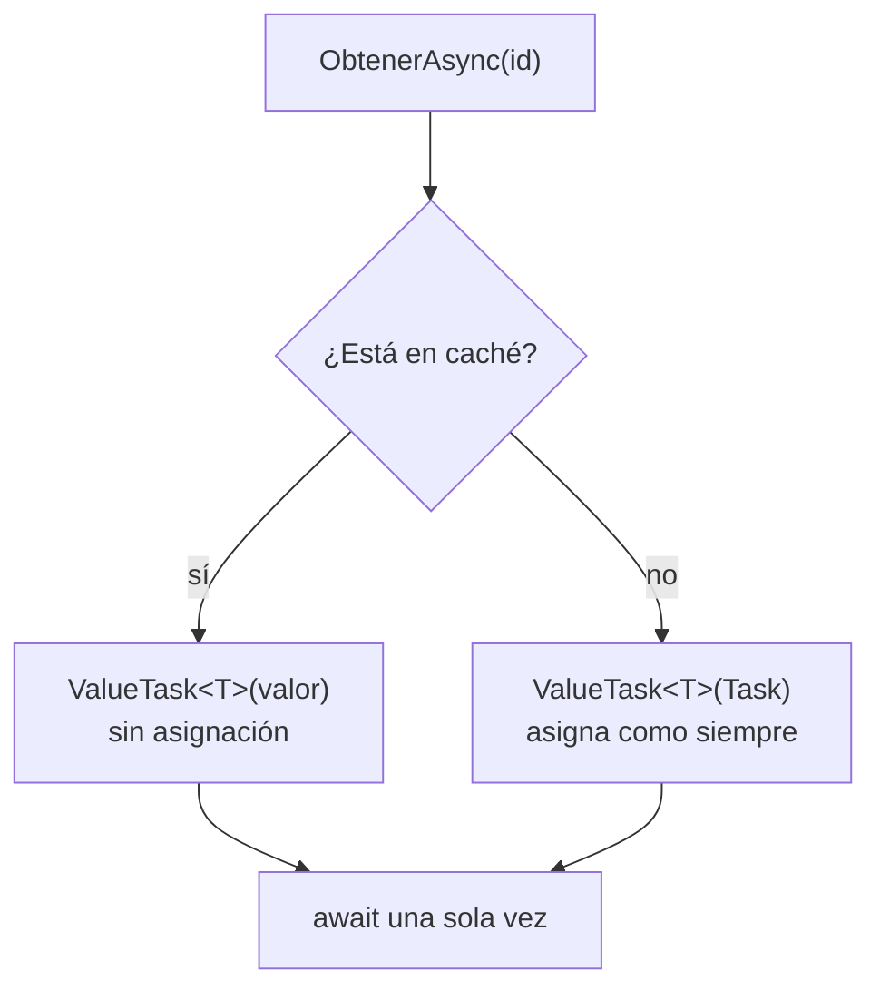

# ValueTask

Parte de: [[03-CSharp-DotNet/04 Asincronía y concurrencia/_Índice Asincronía y concurrencia|Asincronía y concurrencia]]

> [!info] Cómo avanzar
> `progreso`: **pendiente** → **viendo** (estudiando) → **visto** (contestaste la autoevaluación sin abrir las respuestas) → **dominado** (hiciste el laboratorio o lo aplicaste de verdad).

## Contenido

### Qué es
`ValueTask` y `ValueTask<T>` son alternativas **de tipo valor** (structs) a `Task`/`Task<T>`. Sirven para métodos asíncronos que **muy a menudo terminan de forma síncrona**: en lugar de asignar un objeto `Task<T>` en el heap para un resultado que ya tienes, el `ValueTask<T>` lleva el resultado directamente. Solo cuando la operación realmente tiene que esperar, envuelve una `Task<T>` (o un `IValueTaskSource<T>` reutilizable).

### Cómo funciona
Un `ValueTask<T>` puede contener una de tres cosas:
1. **Un resultado ya listo** (`T`): cero asignaciones.
2. **Una `Task<T>`**: igual que antes, con su asignación.
3. **Un `IValueTaskSource<T>`**: un objeto reutilizable (con *pooling*) que usan componentes de muy bajo nivel como `Socket`, `PipeReader` o `Channel<T>` para no asignar por operación.

`Task.FromResult(x)` también existe para resultados síncronos, pero asigna un objeto (salvo algunos valores que .NET cachea, como `true`/`false` o `Task.CompletedTask`). En un método que se llama millones de veces y casi siempre responde desde caché, esa asignación por llamada se nota en el GC.

**Reglas** (porque un `ValueTask` puede estar respaldado por un objeto que se recicla):
- **Espéralo una sola vez.** No hagas `await` dos veces del mismo `ValueTask`.
- **No lo esperes concurrentemente** desde varios lugares.
- **No uses `.Result` ni `.GetAwaiter().GetResult()`** si no ha terminado (`IsCompleted`).
- Si necesitas cualquiera de esas cosas (guardarlo, pasarlo a `Task.WhenAll`, esperarlo varias veces), conviértelo **una vez** con **`.AsTask()`** y trabaja con la `Task`.
- Lo más seguro: `await` inmediato en el lugar donde lo recibes.



### Ejemplo
```csharp
using System.Collections.Concurrent;

public sealed record TipoCambio(string Moneda, decimal Valor);

public interface IProveedorTipoCambio { Task<TipoCambio> ConsultarAsync(string moneda, CancellationToken ct); }

public sealed class TipoCambioCache(IProveedorTipoCambio proveedor)
{
    private readonly ConcurrentDictionary<string, TipoCambio> _cache = new();

    // La mayoría de las llamadas responde desde memoria: ValueTask evita asignar
    public ValueTask<TipoCambio> ObtenerAsync(string moneda, CancellationToken ct)
    {
        if (_cache.TryGetValue(moneda, out var tc))
            return new ValueTask<TipoCambio>(tc);          // camino síncrono, sin heap

        return new ValueTask<TipoCambio>(CargarAsync(moneda, ct)); // camino asíncrono
    }

    private async Task<TipoCambio> CargarAsync(string moneda, CancellationToken ct)
    {
        var tc = await proveedor.ConsultarAsync(moneda, ct);
        _cache[moneda] = tc;
        return tc;
    }
}

// Uso correcto: await inmediato
// var usd = await cache.ObtenerAsync("USD", ct);

// Uso incorrecto
// var vt = cache.ObtenerAsync("USD", ct);
// var a = await vt;
// var b = await vt;                 // MAL: segundo await del mismo ValueTask

// Si necesitas combinarlos: AsTask una vez
// var t1 = cache.ObtenerAsync("USD", ct).AsTask();
// var t2 = cache.ObtenerAsync("EUR", ct).AsTask();
// await Task.WhenAll(t1, t2);
```

**¿Debería ser el tipo por defecto en tus handlers?** **No.** Un handler de una API casi siempre hace I/O real (consulta Dapper, HTTP), así que termina de forma asíncrona y el `ValueTask` termina envolviendo una `Task` de todas formas: no ahorras nada y agregas reglas que es fácil romper. La guía oficial es: **`Task` por defecto**; `ValueTask` solo cuando **mides** que la ruta síncrona es frecuente y el método es caliente, o cuando implementas interfaces que ya lo exigen (`IAsyncDisposable.DisposeAsync`, `IAsyncEnumerator<T>.MoveNextAsync`).

### Cuándo usarlo y cuándo no
- **Úsalo** en métodos de muy alta frecuencia con resultado frecuentemente síncrono: cachés en memoria, lectores con buffer, parsers, componentes de infraestructura.
- **Úsalo** cuando la interfaz que implementas lo define (`DisposeAsync`, `MoveNextAsync`, `ChannelReader<T>.ReadAsync`).
- **No** en handlers, controllers ni repositorios normales: `Task` es más simple y seguro.
- **No** si el llamador probablemente necesite guardarlo, combinarlo o esperarlo varias veces.

### Errores comunes
1. **Esperar dos veces** o guardar el `ValueTask` para "después": comportamiento indefinido si está respaldado por un `IValueTaskSource` reciclado.
2. **`.Result` antes de que termine**.
3. **Adoptarlo en todos lados "por rendimiento"** sin medir: no hay ganancia cuando siempre hay I/O.
4. **`Task.WhenAll` directo** con `ValueTask`: convierte con `.AsTask()` primero.

### Para profundizar
- [Understanding the Whys, Whats, and Whens of ValueTask (blog de .NET)](https://devblogs.microsoft.com/dotnet/understanding-the-whys-whats-and-whens-of-valuetask/)
- [Estructura ValueTask genérica (referencia de API)](https://learn.microsoft.com/dotnet/api/system.threading.tasks.valuetask-1)
- [CA2012: usar ValueTask correctamente](https://learn.microsoft.com/dotnet/fundamentals/code-analysis/quality-rules/ca2012)

## Autoevaluación

Contesta primero en voz alta o en papel; luego despliega la respuesta.

> [!question]- ¿Cuándo usar `ValueTask<T>` en vez de `Task<T>`?
> Cuando el método casi siempre termina síncrono (p. ej. respuesta desde caché) y está en una ruta muy caliente: evita asignar una `Task`.

> [!question]- ¿Qué reglas tiene?
> Se debe esperar **una sola vez**; no se espera dos veces ni de forma concurrente, y no se llama `.Result` si no ha terminado. Si necesitas eso, conviértelo con `.AsTask()`.

> [!question]- ¿Debería ser el tipo por defecto en tus handlers?
> No. `Task` es más simple y segura; `ValueTask` es una optimización que se justifica midiendo. `IExceptionHandler.TryHandleAsync` sí usa `ValueTask<bool>`.

