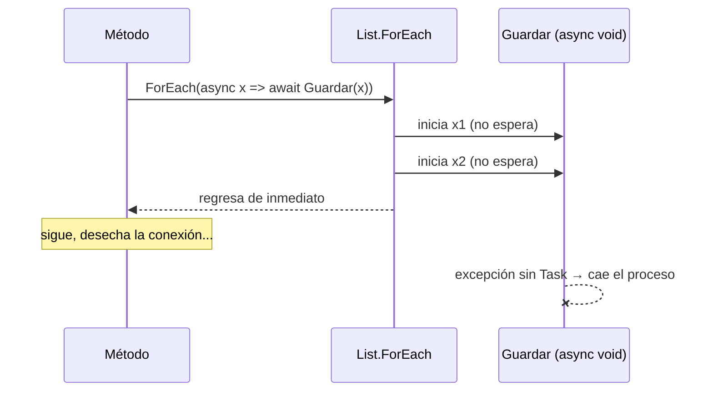

# async void y por qué evitarlo

Parte de: [[03-CSharp-DotNet/04 Asincronía y concurrencia/_Índice Asincronía y concurrencia|Asincronía y concurrencia]]

> [!info] Cómo avanzar
> `progreso`: **pendiente** → **viendo** (estudiando) → **visto** (contestaste la autoevaluación sin abrir las respuestas) → **dominado** (hiciste el laboratorio o lo aplicaste de verdad).

## Contenido

### Qué es
Un método **`async void`** es un método asíncrono que **no regresa `Task`**. Existe solo para poder escribir **manejadores de eventos** asíncronos (la firma de un evento es `void`). Fuera de ese caso es una trampa: el llamador no puede esperarlo, no sabe cuándo termina y **no puede atrapar sus excepciones**.

### Cómo funciona
En un método `async Task`, la máquina de estados guarda cualquier excepción **dentro de la `Task`**; quien hace `await` la recibe y puede atraparla (ver [[Cómo funciona async por dentro (máquina de estados)]]).

En `async void` **no hay `Task`** donde guardarla. Si el método lanza:
- Si había un `SynchronizationContext` al iniciar (UI), la excepción se envía a ese contexto: en WinForms/WPF termina en el manejador global de excepciones no controladas.
- Si no lo había (ASP.NET Core, servicios, consola), la excepción se lanza **en un hilo del pool** y, como nadie puede atraparla, **termina el proceso**. Tu API se cae entera por un error en una sola operación.

Además:
- **No se puede esperar**: el llamador sigue de inmediato, sin saber si terminó.
- **No se puede probar** fácilmente (una prueba no puede esperar su fin ni verificar su excepción).
- **No se puede componer** con `Task.WhenAll`, reintentos, *timeouts*.

**Cuándo es aceptable**: en **manejadores de eventos** de UI y similares (`Button_Click`, eventos de MAUI, de un SDK que te obliga a la firma `void`). Incluso ahí, envuelve el cuerpo en `try/catch` para que un error no tumbe la aplicación.

**El error de `lista.ForEach(async x => await Guardar(x));`**: `List<T>.ForEach` recibe un `Action<T>`, que regresa `void`. La lambda `async x => ...` se convierte en un **`async void`**. Resultado:
1. `ForEach` arranca cada guardado y **regresa de inmediato** sin esperar ninguno.
2. El código siguiente corre mientras los guardados siguen en curso (o la conexión ya se desechó).
3. Los guardados corren de forma **concurrente**, quizá sobre la misma conexión (lo cual no está permitido).
4. Cualquier excepción tumba el proceso.



### Ejemplo
```csharp
public sealed class Importador(IRepositorio repo)
{
    // MAL: ForEach con lambda async -> async void
    public void ImportarMal(List<Producto> productos)
    {
        productos.ForEach(async p => await repo.GuardarAsync(p));
    }

    // BIEN: secuencial y esperado
    public async Task ImportarAsync(IEnumerable<Producto> productos, CancellationToken ct)
    {
        foreach (var p in productos)
            await repo.GuardarAsync(p, ct);
    }

    // BIEN: concurrente con límite (cada operación con su propia conexión)
    public Task ImportarParaleloAsync(IEnumerable<Producto> productos, CancellationToken ct)
        => Parallel.ForEachAsync(productos,
            new ParallelOptions { MaxDegreeOfParallelism = 4, CancellationToken = ct },
            async (p, token) => await repo.GuardarAsync(p, token));

    // MAL: método async void "de servicio"
    public async void EnviarCorreoMal(string a) => await Task.Delay(10);

    // BIEN
    public Task EnviarCorreoAsync(string a, CancellationToken ct) => Task.Delay(10, ct);
}

// Caso aceptable: manejador de evento de UI, con try/catch
// private async void BtnExportar_Click(object? sender, EventArgs e)
// {
//     try { await exportador.ExportarAsync(); }
//     catch (Exception ex) { MessageBox.Show(ex.Message); }
// }

public sealed record Producto(string Sku);
public interface IRepositorio { Task GuardarAsync(Producto p, CancellationToken ct = default); }
```

### Cuándo usarlo y cuándo no
- **Solo** en manejadores de eventos cuya firma exige `void`, con `try/catch` adentro.
- **En todo lo demás**, `async Task` (o `Task<T>`). Aunque "no necesites esperar", regresa `Task`: quien llame decide.
- **Para trabajo en segundo plano** en una API, no uses `async void` ni *fire-and-forget*: encola en un [[System.Threading.Channels|canal]] y procésalo en un [[BackgroundService]].
- **Cuidado con APIs que reciben `Action`**: `List.ForEach`, `Timer` de `System.Threading` (*callback* `void`), eventos. Busca la versión que recibe `Func<Task>` o usa un `foreach`.

### Errores comunes
1. **`List<T>.ForEach` con lambda async**: nada se espera y las excepciones tumban el proceso.
2. **Métodos de servicio `async void`** por costumbre de escritorio.
3. **Pasar una lambda async a un parámetro `Action`** sin darte cuenta: revisa la firma; el analizador de Visual Studio (VSTHRD101 en Microsoft.VisualStudio.Threading.Analyzers) puede detectarlo.
4. **Manejadores de eventos async sin `try/catch`**: un error de red cierra la aplicación.

### Para profundizar
- [Async/Await: procedimientos recomendados (MSDN Magazine)](https://learn.microsoft.com/archive/msdn-magazine/2013/march/async-await-best-practices-in-asynchronous-programming)
- [Tipos de valor devueltos asíncronos (async void)](https://learn.microsoft.com/dotnet/csharp/asynchronous-programming/async-return-types#void-return-type)
- [Parallel.ForEachAsync (referencia de API)](https://learn.microsoft.com/dotnet/api/system.threading.tasks.parallel.foreachasync)

## Autoevaluación

Contesta primero en voz alta o en papel; luego despliega la respuesta.

> [!question]- ¿Por qué evitar `async void`?
> Nadie puede esperarlo ni atrapar su excepción: un error se lanza en el contexto y puede **tumbar el proceso**. Tampoco sabes cuándo terminó.

> [!question]- ¿Cuándo es aceptable?
> Solo en manejadores de eventos de UI (`button.Click`), donde la firma exige `void`; aun así envuelve el cuerpo en `try/catch`.

> [!question]- Error común: `lista.ForEach(async x => await Guardar(x));`. ¿Qué pasa?
> La lambda se convierte en `async void`: `ForEach` no espera, las operaciones corren a la vez sin control y los errores se pierden. Usa `foreach` con `await`.

## Práctica

- [[Lab 5 - async-await, CancellationToken y sync over async]]

