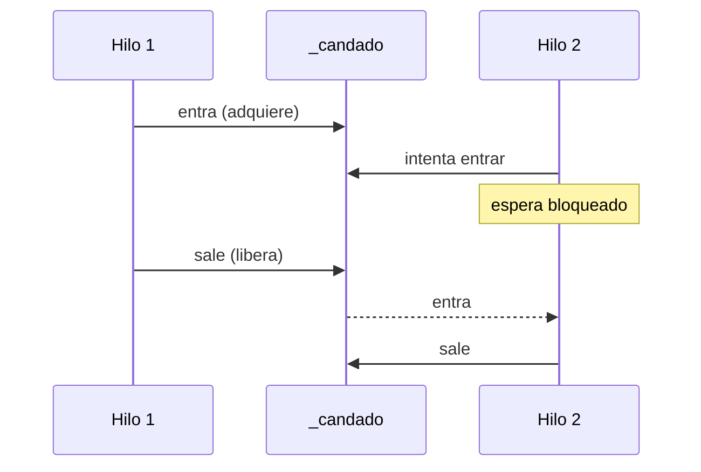

# lock y concurrencia

Parte de: [[03-CSharp-DotNet/04 Asincronía y concurrencia/_Índice Asincronía y concurrencia|Asincronía y concurrencia]]

> [!info] Cómo avanzar
> `progreso`: **pendiente** → **viendo** (estudiando) → **visto** (contestaste la autoevaluación sin abrir las respuestas) → **dominado** (hiciste el laboratorio o lo aplicaste de verdad).

## Contenido

### Qué es
Cuando varios hilos leen y escriben **el mismo estado** (un contador, un diccionario, una caché) al mismo tiempo, aparecen **condiciones de carrera**: resultados que dependen del orden exacto en que se intercalan los hilos. `lock` es la herramienta básica de C# para la **exclusión mutua**: garantiza que solo **un hilo a la vez** ejecute un bloque de código protegido por el mismo objeto de bloqueo.

### Cómo funciona
```csharp
lock (_candado)
{
    // sección crítica: un solo hilo a la vez
}
```
**Qué garantiza**:
1. **Exclusión mutua**: si un hilo está dentro, los demás que intenten entrar con el **mismo** objeto esperan (bloqueados) hasta que salga.
2. **Visibilidad de memoria**: al entrar y salir hay barreras de memoria; lo que un hilo escribió dentro del `lock` es visible para el siguiente que entre. Sin esto, un hilo podría leer valores viejos en caché del procesador.
3. **Liberación segura**: compila a `try/finally`, así que el candado se libera aunque haya excepción.
4. **Reentrada**: el mismo hilo puede volver a entrar a un `lock` que ya tiene.

Tradicionalmente usa `Monitor.Enter/Exit` sobre cualquier objeto de referencia. Desde **.NET 9 / C# 13** existe el tipo **`System.Threading.Lock`**: si el objeto del `lock` es de ese tipo, el compilador usa su API (`EnterScope`), más eficiente y con intención explícita.

**Por qué no puedes hacer `await` dentro de un `lock`**: el `lock` pertenece al **hilo** que lo tomó (afinidad de hilo). Después de un `await`, la continuación puede ejecutarse en **otro hilo**, que intentaría liberar un candado que no es suyo; además, mantener un candado durante una espera de I/O bloquearía a todos los demás hilos por un tiempo indefinido. Por eso el compilador lo prohíbe (error CS1996). Para secciones críticas asíncronas usa **`SemaphoreSlim(1, 1)`** con `await WaitAsync()` y `Release()` en un `finally`.

**Alternativas más ligeras**:
- **`Interlocked`**: operaciones **atómicas** sobre una sola variable (`Increment`, `Add`, `Exchange`, `CompareExchange`). Sin bloqueo; ideal para contadores y banderas.
- **`ConcurrentDictionary<TKey, TValue>`**, `ConcurrentQueue<T>`, `ConcurrentBag<T>`: colecciones diseñadas para acceso concurrente, con operaciones atómicas como `GetOrAdd`, `AddOrUpdate`, `TryRemove`.
- **Inmutabilidad**: si el estado no cambia (o se reemplaza completo con `Interlocked.Exchange`), no hace falta bloquear para leer.

**Por qué no `lock (this)` ni `lock ("texto")`**: el objeto de bloqueo debe ser **privado** y exclusivo para ese propósito. `this` es visible para cualquier código externo, que podría bloquear sobre tu instancia y provocar esperas o *deadlocks* que no controlas. Los **strings literales están internados**: `"texto"` es el **mismo objeto** en toda la aplicación (incluidas librerías), así que dos componentes que no se conocen terminarían compartiendo candado. Lo mismo aplica a `typeof(MiClase)`.



### Ejemplo
```csharp
using System.Collections.Concurrent;

public sealed class Estadisticas
{
    private readonly Lock _candado = new();              // .NET 9+: tipo dedicado
    private readonly Dictionary<string, decimal> _totalesPorZona = [];
    private long _peticiones;

    // Contador: Interlocked basta, sin lock
    public void ContarPeticion() => Interlocked.Increment(ref _peticiones);
    public long Peticiones => Interlocked.Read(ref _peticiones);

    // Varias operaciones que deben ser atómicas juntas: lock
    public void Registrar(string zona, decimal monto)
    {
        lock (_candado)
        {
            _totalesPorZona[zona] = _totalesPorZona.GetValueOrDefault(zona) + monto;
        }
    }

    public IReadOnlyDictionary<string, decimal> Foto()
    {
        lock (_candado) return new Dictionary<string, decimal>(_totalesPorZona); // copia consistente
    }
}

// ConcurrentDictionary: caché simple segura entre hilos
public sealed class CacheTarifas
{
    private readonly ConcurrentDictionary<string, decimal> _tarifas = new();
    public decimal Obtener(string cp) => _tarifas.GetOrAdd(cp, static c => CalcularTarifa(c));
    private static decimal CalcularTarifa(string cp) => cp.StartsWith('4') ? 59m : 149m;
}

// Sección crítica asíncrona: SemaphoreSlim, no lock
public sealed class RenovadorToken(HttpClient http)
{
    private readonly SemaphoreSlim _semaforo = new(1, 1);
    private string? _token;
    private DateTimeOffset _expira;

    public async Task<string> ObtenerAsync(CancellationToken ct)
    {
        if (_token is not null && _expira > DateTimeOffset.UtcNow) return _token;

        await _semaforo.WaitAsync(ct);
        try
        {
            if (_token is null || _expira <= DateTimeOffset.UtcNow)  // doble verificación
            {
                _token = await http.GetStringAsync("/token", ct);    // await permitido aquí
                _expira = DateTimeOffset.UtcNow.AddMinutes(50);
            }
            return _token;
        }
        finally
        {
            _semaforo.Release();
        }
    }
}
```

En el ejemplo de `RenovadorToken`, leer `_token` y `_expira` fuera del semáforo es una optimización que funciona porque el peor caso es entrar al semáforo de más; si el estado fuera más complejo, protege también la lectura.

### Cuándo usarlo y cuándo no
- **`lock`** para secciones críticas **cortas y síncronas** que tocan varias variables a la vez.
- **`Interlocked`** para una sola variable numérica o de referencia.
- **Colecciones concurrentes** para mapas y colas compartidas (cachés en singletons, contadores por clave).
- **`SemaphoreSlim`** cuando dentro hay `await`, o para limitar concurrencia (N a la vez).
- **Evita el estado compartido** cuando puedas: en una API, los servicios *scoped* no se comparten entre peticiones; el problema aparece en **singletons** y campos `static` (ver [[Ciclos de vida (Singleton, Scoped, Transient)]]).
- **Para coordinar productores y consumidores**, [[System.Threading.Channels]] es más claro que colas con `lock`.

### Errores comunes
1. **`lock (this)`, `lock ("texto")` o `lock (typeof(X))`**: candados públicos o compartidos sin querer.
2. **Trabajo lento dentro del `lock`** (I/O, logs pesados): todos los hilos esperan; reduce la sección crítica al mínimo.
3. **Tomar dos candados en distinto orden** en distintos lugares: *deadlock* clásico. Define un orden fijo.
4. **Proteger la escritura pero no la lectura** de estado compuesto: lees datos a medio actualizar.
5. **Usar `Dictionary<,>` en un singleton** sin protección: corrupción interna y ciclos infinitos bajo carga.

### Para profundizar
- [Instrucción lock (referencia de C#)](https://learn.microsoft.com/dotnet/csharp/language-reference/statements/lock)
- [Información general sobre primitivas de sincronización](https://learn.microsoft.com/dotnet/standard/threading/overview-of-synchronization-primitives)
- [Colecciones seguras para subprocesos](https://learn.microsoft.com/dotnet/standard/collections/thread-safe/)

## Autoevaluación

Contesta primero en voz alta o en papel; luego despliega la respuesta.

> [!question]- ¿Qué garantiza `lock`?
> Que solo un hilo a la vez ejecute la sección protegida sobre el mismo objeto de bloqueo. En .NET 9+ conviene `private readonly Lock _lock = new();`.

> [!question]- ¿Por qué no puedes hacer `await` dentro de un `lock`?
> No compila (CS1996): el lock pertenece a un hilo y tras el `await` podrías estar en otro. Usa `SemaphoreSlim(1, 1)` con `await WaitAsync()` y `Release()` en `finally`.

> [!question]- ¿Cuándo `Interlocked` o `ConcurrentDictionary` en vez de `lock`?
> Para un contador (`Interlocked.Increment`) o un diccionario compartido (`GetOrAdd`): más simples y sin bloqueo explícito.

> [!question]- Error común: `lock (this)` o `lock ("texto")`. ¿Por qué no?
> Código externo puede bloquear el mismo objeto y causar *deadlocks*. Usa un objeto privado.

