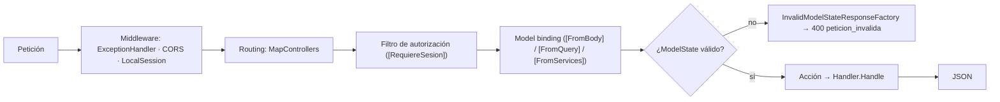

---
proyecto:
  - Ocelotl.Hermes
  - Itzamna.Dionisio
  - ReporteriaAzure
proyectos:
  - "[[Ocelotl.Hermes]]"
  - "[[Itzamna.Dionisio]]"
  - "[[ReporteriaAzure]]"
tipo: tecnologia
nivel: intermedio
estado: completo
tags:
  - conocimiento
  - backend
  - dotnet
  - aspnetcore
  - mvc
progreso: pendiente
area: C# y .NET
---
# ASP.NET Core Controllers

> Forma clásica de declarar una API en ASP.NET Core: clases que heredan de `ControllerBase`, con rutas y verbos por atributo. Desde el 2026-11-08 es la forma estándar de [[Ocelotl.Hermes]] (antes usaba [[ASP.NET Core Minimal APIs]]). Ver [[Reglas Back - .NET]].

## Qué es y qué problema resuelve
Un controller agrupa en una clase las acciones de un mismo recurso. El framework (MVC) se encarga de:
- **enrutar** por atributos (`[Route]`, `[HttpGet]`…);
- **leer la entrada** (*model binding*) desde el cuerpo, la query, la ruta o el contenedor de DI;
- **ejecutar filtros** por atributo (autorización, acción, excepción);
- **escribir la respuesta** en JSON.

Frente a Minimal APIs da una estructura fija y explícita: un archivo por funcionalidad, filtros como atributos y una convención que conoce cualquier desarrollador de .NET.

## Cómo funciona por dentro

- **`[ApiController]`** activa:
  - la respuesta 400 automática cuando el binding falla (personalizable con `InvalidModelStateResponseFactory`);
  - la inferencia de origen: un tipo complejo se lee del **body** si no se dice otra cosa;
  - el `[Required]` implícito en referencias no anulables, que se apaga con `SuppressImplicitRequiredAttributeForNonNullableReferenceTypes`.
- **Filtros:**
  - `IAuthorizationFilter` corre **antes** del binding;
  - `IActionFilter` corre alrededor de la acción;
  - una excepción en un filtro de autorización sale al middleware (`UseExceptionHandler`).
- **Resultados:**
  - regresar un objeto produce un 200 con JSON;
  - `Accepted(x)` produce un 202, `NoContent()` un 204;
  - `[ProducesResponseType<T>(código)]` documenta la respuesta para OpenAPI.

## Cuándo usarla y cuándo no
### Ventajas
- Estructura explícita por funcionalidad y filtros por atributo.
- Binding y validación de modelo maduros; buena integración con Swagger.
- Convención conocida: cualquier persona del equipo encuentra dónde está cada ruta.
### Desventajas
- Más ceremonia que Minimal APIs (clase, atributos, `ControllerBase`).
- `[ApiController]` hace cosas solas (inferencia de body, 400 automático); hay que conocerlas.
- Un poco más de costo por petición que Minimal APIs (irrelevante en una API local).

## Alternativas
| Alternativa | En qué se diferencia |
|---|---|
| [[ASP.NET Core Minimal APIs]] | Lambdas mapeadas a rutas; menos ceremonia, filtros por `IEndpointFilter`. Lo que usaba Hermes antes |
| FastEndpoints | Una clase por endpoint (patrón REPR) |
| gRPC | Contrato binario por `.proto`, no REST/JSON |

## Cómo se usó en Ocelotl
En [[Ocelotl.Hermes]], `src/Ocelotl.Hermes.Api/Controllers/` tiene un controller por pantalla de Iris: `Sesion`, `Conexion`, `Stock`, `Operacion`, `Ingresos`, `Cajas`, `Egresos` y `Salud`. Cada acción solo llama al `Handler` del slice ([[Vertical Slice Architecture]]):

```csharp
// Api/Controllers/EgresosController.cs
[ApiController]
[Route("api/egresos")]
[Tags("Egresos")]
[RequiereSesion]
public sealed class EgresosController : ControllerBase
{
    [HttpGet]
    public Task<IReadOnlyList<ListarEgresos.Item>> Listar(
        [FromQuery] ListarEgresos.Query query, [FromServices] ListarEgresos.Handler h, CancellationToken ct) =>
        h.Handle(query, ct);
}
```

Decisiones:
- **`[RequiereSesion]`** (`Security/RequiereSesionAttribute.cs`) es un `IAuthorizationFilter`. Sin sesión lanza `SesionRequeridaException`, y `ManejadorErrores` responde `401 sesion_requerida` ([[Sesión y roles - Back]]).
- **`SuppressImplicitRequiredAttributeForNonNullableReferenceTypes = true`:** los records de los slices tienen `string` no anulables, y sin esto MVC respondería antes que el slice. Así el error sale del slice con `codigo: "validacion"`.
- **`RespuestaModeloInvalido`:** JSON mal formado o cuerpo vacío responden `400` con `codigo: "peticion_invalida"`, con la misma forma que el resto ([[ProblemDetails]]).
- **Query en un record:** `[FromQuery] ListarEgresos.Query` (sin el atributo, `[ApiController]` lo leería del body).
- **Nombres de acción** distintos del slice (`ConectarRobot`, `IniciarDispensado`), para no confundirlos con los tipos `Conectar.Command` / `Dispensar.Command`.
- **`/salud`** es un controller con `[ApiExplorerSettings(IgnoreApi = true)]` y no aparece en OpenAPI ([[OpenAPI con Swagger y Scalar]]).

> [!tip] Reutilizable
> El patrón "controller sin lógica + slice + `[RequiereSesion]` + `RespuestaModeloInvalido`" sirve igual en cualquier API .NET. Está descrito en [[Reglas Back - .NET]].


## Cómo se usó en Itzamna
En [[Itzamna.Dionisio]] (API .NET 10) todos los endpoints son controllers con atributos, igual que en [[Ocelotl.Hermes]]; la diferencia es que aquí delegan en un **mediador** ([[CQRS y mediador]]) en vez de pedir el handler por `[FromServices]`.

- **Base común** `ApiControllerBase(ISender)` con `[ApiController]` y `[Produces("application/json")]` (`Itzamna.Dionisio/src/Itzamna.Dionisio.API/Controllers/ApiControllerBase.cs`).
- **Controllers**: `MeController`, `DevAuthController` y `AccessController` (los tres en `MeController.cs`), `PortfolioController`, `CollectionsController`, `MediaController`, `PublishingController`, `PublicPortfoliosController`.
- **Todo autenticado por defecto** (`FallbackPolicy` con `RequireAuthenticatedUser`); lo público lleva `[AllowAnonymous]`. No hay filtro propio tipo `[RequiereSesion]` ([[JWT y autenticación con Bearer]]).
- **Enums como texto camelCase**: `AddControllers().AddJsonOptions(o => o.JsonSerializerOptions.Converters.Add(new JsonStringEnumConverter(JsonNamingPolicy.CamelCase)))`.
- **Atributos por acción**: `[EnableRateLimiting("public"|"uploads"|"auth")]` ([[Rate limiting]]), `[OutputCache(PolicyName = "public-portfolio")]` ([[Output caching]]), `[Consumes("multipart/form-data")]` + `[RequestSizeLimit]` + `[RequestFormLimits]` (210 MB) en la subida de medios.
- **Rutas**: `api/me`, `api/portfolio/...`, `api/media`, `api/public/portfolios/{slug}`; restricciones `{id:guid}`, `{version:int}`.

Acciones de una línea (`Itzamna.Dionisio/src/Itzamna.Dionisio.API/Controllers/PublishingController.cs`):
```csharp
[HttpPost("publish")]
public async Task<ActionResult<PublishResultDto>> Publish(CancellationToken ct) =>
    Ok(await Sender.Send(new PublishPortfolioCommand(), ct));

[HttpPost("versions/{version:int}/restore")]
public async Task<ActionResult<PublishResultDto>> Restore(int version, CancellationToken ct) =>
    Ok(await Sender.Send(new RestoreVersionCommand(version), ct));
```

Casos que no son de una línea:
- `MediaController.Upload` copia el `IFormFile` a un archivo temporal, manda `UploadMediaCommand` y responde `201 Created` o `200 OK` si el archivo ya existía (`dto.Reused`); borra el temporal en `finally` ([[Biblioteca de medios]]).
- `PublicPortfoliosController.Get` responde `RedirectPermanent` (301) si el slug cambió, `Problem(404)` si no está publicado y `Content(json, "application/json; charset=utf-8")` con el snapshot tal cual ([[Portfolio público]], [[Slug y dirección pública]]).
- `AccessController` y `DevAuthController` no usan el mediador: emiten tokens con `LocalTokenService` ([[Autenticación y acceso]]).

Hay un archivo `Itzamna.Dionisio.API.http` con peticiones de ejemplo (login de desarrollo con el demo de Jatz, `GET /api/me`, borrador).

> [!note] Pendiente de confirmar
> `DevAuthController.Login` tiene un mensaje de validación con texto de prueba ("Escribe un email  esto es prueba de pr válido."). Parece un resto; solo aplica en Development.


## Cómo se usó en ReporteriaAzure
[[ReporteriaAzure]] tiene un solo controller y es el ejemplo más corto de "controller delgado": recibe, llama al handler y regresa. No hay `try/catch` ni `BadRequest(...)` a mano; los errores los resuelve el manejador global ([[ProblemDetails]]).

```csharp
// ReporteriaAzure/API/Controllers/ConsultaInfoController.cs
[HttpPost("InfoTablero")]
[ProducesResponseType<IReadOnlyList<ConsultarTablero.Item>>(StatusCodes.Status200OK)]
[ProducesResponseType<ProblemDetails>(StatusCodes.Status400BadRequest)]
public Task<IReadOnlyList<ConsultarTablero.Item>> InfoTablero(
    [FromBody] ConsultarTablero.Query query, [FromServices] ConsultarTablero.Handler h, CancellationToken ct) =>
    h.Handle(query, ct);
```

- Ruta y contrato JSON se conservaron (`POST /ConsultaInfo/InfoTablero`, `{ nombreTablero }`) para no romper a quien ya la llama.
- El handler llega por `[FromServices]` en la acción, no por el constructor.
- Antes el controller validaba y regresaba `BadRequest("...")` como texto plano; ahora la validación vive en el slice ([[Vertical Slice Architecture]]).

## Errores comunes y buenas prácticas
- Olvidar `[FromQuery]` en un record: `[ApiController]` lo busca en el body y responde 415 o 400.
- Dejar el `[Required]` implícito y duplicar validaciones (binding y slice) con mensajes distintos.
- Poner lógica en el controller: va en el slice.
- Usar el mismo nombre para la acción y el tipo del slice.

## Qué estudiar después
- [[Inyección de dependencias]] (`[FromServices]`), [[ProblemDetails]], [[OpenAPI con Swagger y Scalar]]
- Filtros de MVC: orden y tipos (authorization, resource, action, exception, result).

## Documentación oficial

- https://learn.microsoft.com/aspnet/core/web-api/
- https://learn.microsoft.com/aspnet/core/mvc/controllers/filters

## Autoevaluación

Contesta primero en voz alta o en papel; luego despliega la respuesta.

> [!question]- ¿Qué activa `[ApiController]`?
> Respuesta 400 automática cuando falla el binding, inferencia de origen (tipos complejos desde el body), `[Required]` implícito en referencias no anulables y respuestas de error como ProblemDetails.

> [!question]- ¿Por qué tus controllers son delgados (solo llaman al Handler del slice)?
> La lógica queda en el slice, que se prueba sin HTTP; el controller solo enruta, vincula y traduce el `Result` a HTTP.

> [!question]- ¿Qué pasa si quitas `[FromQuery]` de un record de filtros en un `GET`?
> Con `[ApiController]` un tipo complejo se infiere desde el **body**; en un GET llega vacío y responde 400 o 415.

> [!question]- ¿Cómo devuelves un error con tu `codigo` en ProblemDetails desde una acción?
> ```csharp
> return Problem(statusCode: 409, title: "Conflicto", extensions: new Dictionary<string, object?> { ["codigo"] = "caja_duplicada" });
> ```
> (o con un `ProblemDetailsFactory`/método de extensión común que traduzca tu `Result`).

## Práctica

- [[Lab 6 - API con controllers, FluentValidation, ProblemDetails y Options]]

