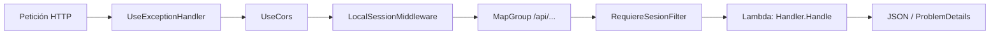

# ASP.NET Core Minimal APIs
> [!warning] Ya no se usa en Ocelotl.Hermes
> Desde el 2026-11-08, Hermes usa [[ASP.NET Core Controllers]] (ver [[Reglas Back - .NET]]). Esta nota queda como conocimiento: describe cómo estaba hecho antes (`Api/Endpoints/`).


> Forma ligera de declarar endpoints HTTP en ASP.NET Core con lambdas, sin controladores; es la capa `Api` de [[Ocelotl.Hermes]].

## Qué es y qué problema resuelve
Minimal APIs permite mapear una ruta a un delegado (`app.MapGet("/ruta", (...) => ...)`). El framework hace el **binding** de los parámetros (cuerpo JSON, query, ruta, servicios de DI, `CancellationToken`) y serializa el resultado. Elimina la ceremonia de controladores MVC cuando cada endpoint solo delega en un caso de uso.

## Cómo funciona por dentro
- **`WebApplication.CreateBuilder`** arma host, configuración, logging y DI; `builder.Build()` crea la app y luego se configura el **pipeline** de middlewares (`UseExceptionHandler`, `UseCors`, middleware propio…).
- **Endpoints**: `MapGet/MapPost/...` registran rutas. Los parámetros de la lambda se resuelven así (simplificado):
  - tipos complejos en POST → cuerpo JSON;
  - tipos simples → ruta (`{id}`) o query string;
  - tipos registrados en DI → servicio;
  - `CancellationToken` → se cancela si el cliente aborta.
  - `[AsParameters]` → agrupa varios parámetros de query/ruta en un tipo (record).
- **`MapGroup(prefijo)`**: agrupa endpoints con un prefijo común y configuración compartida (`WithTags`, filtros).
- **Endpoint filters** (`IEndpointFilter`): código que corre antes/después del delegado, a nivel de endpoint o grupo (equivalente ligero a los action filters de MVC).
- **Resultados**: devolver un objeto → 200 + JSON; `Results.Accepted`, `Results.NoContent`, etc. para otros códigos.



## Cuándo usarla y cuándo no
### Ventajas
- Muy poco código: el endpoint es una línea que llama al `Handler` del slice.
- Encaja con [[Vertical Slice Architecture]]: no hay controlador intermedio ni MediatR.
- Integración directa con [[Inyección de dependencias]], OpenAPI y filtros.
### Desventajas
- Con muchos endpoints, `Program.cs` crecería; hay que organizarlos (Hermes usa una clase de extensión por funcionalidad).
- Algunas convenciones de MVC (model binding avanzado, filtros de acción complejos) no existen o son distintas.
- El binding implícito puede sorprender (p. ej. un parámetro obligatorio que falta devuelve 400 antes de llegar al slice).

## Alternativas
| Alternativa | En qué se diferencia |
|---|---|
| Controladores MVC / Web API | Clases con atributos `[HttpGet]`, filtros de acción; más estructura y más ceremonia. |
| FastEndpoints | Librería de terceros: una clase por endpoint (patrón REPR). |
| Carter | Módulos sobre Minimal APIs para organizar rutas. |
| gRPC | Contrato binario por Protobuf; no es lo que consume Iris desde `fetch`. |

## Cómo se usó en Ocelotl
[[Ocelotl.Hermes]] expone su API a [[Ocelotl.Iris]] en `127.0.0.1` con puerto dinámico. `HermesEndpoints.MapHermes()` llama a una clase por funcionalidad (Sesion, Conexion, Stock, Operacion, Ingresos, Egresos), espejo de las pantallas de Iris. Funcionalidades: [[Sesión y roles]], [[Conexión de robots]], [[Stock e inventario]], [[Dispensar]], [[Ingresos]], [[Historial de salidas]], [[Trazabilidad por caja]].

Grupo con filtro de sesión; el endpoint pide el `Handler` por DI (`Ocelotl.Hermes/src/Ocelotl.Hermes.Api/Endpoints/ConexionEndpoints.cs`):
```csharp
var conexion = app.MapGroup("/api/conexion")
    .WithTags("Conexión")
    .AddEndpointFilter<RequiereSesionFilter>();

conexion.MapPost("/conectar", (Conectar.Command cmd, Conectar.Handler h, CancellationToken ct) => h.Handle(cmd, ct));
```

El filtro (`Ocelotl.Hermes/src/Ocelotl.Hermes.Api/Security/RequiereSesionFilter.cs`) lanza una excepción que luego se convierte en [[ProblemDetails]] con `codigo = "sesion_requerida"`:
```csharp
public sealed class RequiereSesionFilter(ISesionActual sesion) : IEndpointFilter
{
    public ValueTask<object?> InvokeAsync(EndpointFilterInvocationContext contexto, EndpointFilterDelegate siguiente) =>
        sesion.Actual is null ? throw new SesionRequeridaException() : siguiente(contexto);
}
```

`[AsParameters]` agrupa la query del historial en el record `ListarEgresos.Query` (`Ocelotl.Hermes/src/Ocelotl.Hermes.Api/Endpoints/EgresoEndpoints.cs`):
```csharp
// Historial de salidas: ?desde=2026-11-01&hasta=2026-11-08&robotId=&origen=Iris&limite=100
egresos.MapGet("/", ([AsParameters] ListarEgresos.Query query, ListarEgresos.Handler h, CancellationToken ct) =>
    h.Handle(query, ct));

// Opcionales en el binding para que, si faltan, el slice responda con codigo "validacion".
egresos.MapGet("/detalle", (string? robotId, string? orden, ObtenerEgreso.Handler h, CancellationToken ct) =>
    h.Handle(new ObtenerEgreso.Query(robotId ?? "", orden ?? ""), ct));
```

Otros detalles de `Program.cs` (`Ocelotl.Hermes/src/Ocelotl.Hermes.Api/Program.cs`):
- Con `isElectron=1` escucha en `http://127.0.0.1:0` (puerto libre) e imprime `PUERTO:xxxx` para que Electron lo lea ([[Arranque y seguridad local]]).
- `ConfigureHttpJsonOptions` agrega `JsonStringEnumConverter` (los enums viajan como texto).
- Pipeline: `UseExceptionHandler()` → `UseCors()` → `LocalSessionMiddleware` (secreto `X-Iris-Session`) → endpoints y `MapHub<RobotHub>("/robot-hub")` ([[SignalR]]).
- `/salud` se excluye de la documentación con `ExcludeFromDescription()`.
- `public partial class Program;` deja visible `Program` para pruebas con `WebApplicationFactory` (no se encontraron pruebas que lo usen hoy: Pendiente de confirmar).

> [!tip] Reutilizable
> El molde "un `Map<Funcionalidad>()` por archivo + `MapGroup` + filtro de grupo + lambda de una línea que delega al `Handler`" sirve para cualquier API con slices verticales.

## Errores comunes y buenas prácticas
- Poner lógica de negocio en la lambda: en Hermes la lambda solo delega; las reglas viven en el slice.
- Parámetros obligatorios en query: si faltan, ASP.NET Core responde 400 con `BadHttpRequestException`. Hermes los declara opcionales (`string?`) cuando quiere que el slice valide y devuelva su propio `codigo`.
- Olvidar `CancellationToken`: sin él no se cancela trabajo cuando Iris aborta la petición ([[AbortController]]).
- Datos con caracteres especiales en la ruta: Hermes pasa la `orden` por query, no por ruta.
- Restringir rutas con constraints (`{cajaGuid:guid}` en `IngresoEndpoints.cs`).

## Qué estudiar después
- [[Inyección de dependencias]], [[ProblemDetails]], [[OpenAPI con Swagger y Scalar]]
- [[SignalR]] (hub `/robot-hub`)
- [[Vertical Slice Architecture]], [[Molde Service-View-Handlers-Events]]
- Middlewares de ASP.NET Core y CORS.

## Documentación oficial
- https://learn.microsoft.com/aspnet/core/fundamentals/minimal-apis
- https://learn.microsoft.com/aspnet/core/fundamentals/minimal-apis/route-handlers
- https://learn.microsoft.com/aspnet/core/fundamentals/minimal-apis/min-api-filters
- https://learn.microsoft.com/aspnet/core/fundamentals/minimal-apis/parameter-binding

## Autoevaluación

Contesta primero en voz alta o en papel; luego despliega la respuesta.

> [!question]- ¿Qué diferencia principal hay con los controllers?
> Endpoints como lambdas o métodos (`app.MapGet(...)`), sin clases ni MVC. Menos ceremonia y algo más rápidos; los filtros son `IEndpointFilter` y se agrupan con `MapGroup`.

> [!question]- ¿Cuándo elegirías Minimal APIs y cuándo controllers?
> Minimal: servicios pequeños, Native AOT, alto rendimiento. Controllers: APIs grandes con convenciones de equipo, filtros por atributo y model binding/validación de MVC (tu estándar).

> [!question]- ¿Cómo se validan las entradas en Minimal APIs?
> No hay `ModelState` automático como en MVC; usas un `IEndpointFilter` que ejecute FluentValidation. .NET 10 agregó validación integrada con `AddValidation()` para DataAnnotations (Pendiente de confirmar detalles).

> [!question]- ¿Qué devuelven típicamente los endpoints?
> `Results.Ok(x)`, `TypedResults.NotFound()`, `TypedResults.Problem(...)`. `TypedResults` documenta mejor en OpenAPI.

