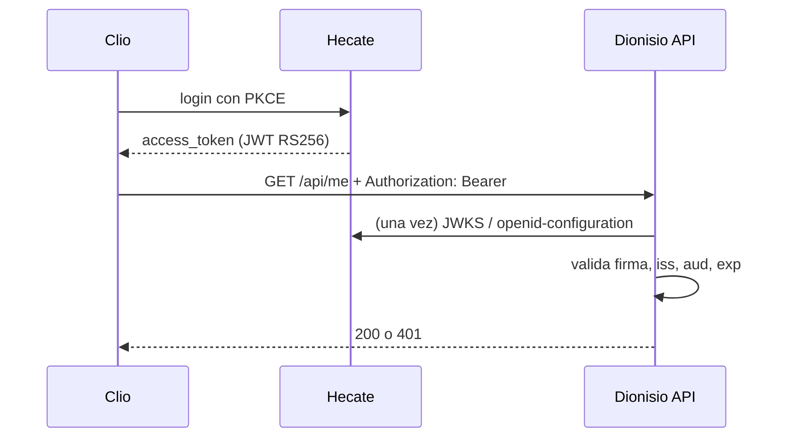

# Autenticación con JWT en ASP.NET Core

Parte de: [[03-CSharp-DotNet/05 ASP.NET Core/_Índice ASP.NET Core|ASP.NET Core]]

> [!info] Cómo avanzar
> `progreso`: **pendiente** → **viendo** (estudiando) → **visto** (contestaste la autoevaluación sin abrir las respuestas) → **dominado** (hiciste el laboratorio o lo aplicaste de verdad).

## Contenido

### Qué es
La **autenticación con JWT Bearer** es la forma estándar de proteger una API: el cliente (Itzamna.Clio, Ocelotl.Iris, otra API) manda en cada petición el header `Authorization: Bearer <token>`, y la API **valida** ese token sin consultar una sesión en servidor. El token lo emite un servidor de identidad (en tu caso Xolotl.Hecate, firmando con **RS256**; o Entra ID, Auth0, etc.). La teoría del formato y del flujo está en [[JWT y autenticación con Bearer]]; esta nota es la parte de ASP.NET Core.

### Cómo funciona
El paquete es `Microsoft.AspNetCore.Authentication.JwtBearer`. El handler de JWT Bearer, en cada petición:
1. Lee el header `Authorization` y extrae el token.
2. Verifica la **firma** con la llave pública del emisor. Si configuras `Authority`, descarga el documento `/.well-known/openid-configuration` y las llaves públicas (JWKS) y los cachea, así que la rotación de llaves funciona sola.
3. Verifica el **emisor** (`iss`) contra `ValidIssuer`/`Authority`.
4. Verifica la **audiencia** (`aud`) contra `Audience`: el token debe haberse emitido para **esta** API.
5. Verifica la **vigencia**: `exp` (expiración) y `nbf` (no antes de), con una tolerancia de reloj (`ClockSkew`) de **5 minutos por defecto**.
6. Si todo pasa, crea un `ClaimsPrincipal` con los claims y lo deja en `HttpContext.User`.



La autenticación solo responde "¿quién eres?". Decidir "¿puedes hacer esto?" es trabajo de [[Autorización con policies]]. De ahí salen dos códigos que se confunden mucho:
- **401 Unauthorized**: no autenticado. No mandaste token, el token es inválido, expiró o la firma no cuadra. La respuesta incluye `WWW-Authenticate: Bearer error="invalid_token"`.
- **403 Forbidden**: autenticado, pero sin permiso: el token es válido y el usuario no tiene el rol o la policy requerida.

### Ejemplo
Configuración en Dionisio para validar tokens de Hecate:

```csharp
using Microsoft.AspNetCore.Authentication.JwtBearer;

builder.Services.AddAuthentication(JwtBearerDefaults.AuthenticationScheme)
    .AddJwtBearer(o =>
    {
        o.Authority = builder.Configuration["Jwt:Emisor"];      // https://hecate.midominio.mx
        o.Audience = builder.Configuration["Jwt:Audiencia"];    // itzamna-api
        o.MapInboundClaims = false;                             // conserva "sub", "role" tal cual
        o.TokenValidationParameters.NameClaimType = "sub";
        o.TokenValidationParameters.RoleClaimType = "role";
        o.TokenValidationParameters.ValidAlgorithms = ["RS256"]; // rechaza otros algoritmos
        o.TokenValidationParameters.ClockSkew = TimeSpan.FromMinutes(1);
    });

builder.Services.AddAuthorization();

var app = builder.Build();
app.UseAuthentication();
app.UseAuthorization();
app.MapControllers();
```

En el controller:

```csharp
[ApiController]
[Route("api/me")]
[Authorize]
public sealed class MeController : ControllerBase
{
    [HttpGet]
    public IActionResult Get() => Ok(new { Id = User.FindFirst("sub")?.Value });
}
```

En desarrollo, `dotnet user-jwts create` genera tokens de prueba para tu API sin levantar el servidor de identidad.

### Cuándo usarlo y cuándo no
- **Sí** para APIs consumidas por SPAs, apps móviles u otras APIs, con un servidor de identidad que emite tokens.
- **Sí** cuando quieres escalar sin sesión en servidor.
- **Cookies** son mejor opción si front y API están en el mismo sitio y quieres protección `HttpOnly` sin manejar el token en JavaScript (patrón BFF).
- **No** emitas tokens "caseros" con llave simétrica compartida si ya tienes Hecate con RS256: la API solo debe conocer la llave pública.

### Errores comunes
- **Datos sensibles en el payload**: el JWT solo está **codificado** en Base64Url, no cifrado. Cualquiera que tenga el token lo decodifica en segundos. No pongas contraseñas, datos personales ni información interna; solo identificadores y claims de autorización.
- **No validar audiencia**: un token emitido para otra API de tu organización sirve en la tuya.
- **`UseAuthorization` antes de `UseAuthentication`**: 401 con token válido ([[Orden de los middleware en ASP.NET Core]]).
- **Confundir 401 y 403** en el front: con 401 hay que renovar o volver a iniciar sesión; con 403 no sirve reintentar.
- **Tokens de larga duración** sin refresh: si se filtra, sirve por días.

### Para profundizar
- [Configurar autenticación JWT Bearer (Microsoft Learn)](https://learn.microsoft.com/aspnet/core/security/authentication/configure-jwt-bearer-authentication)
- [Autenticación en ASP.NET Core (Microsoft Learn)](https://learn.microsoft.com/aspnet/core/security/authentication/)
- [RFC 7519: JSON Web Token](https://www.rfc-editor.org/rfc/rfc7519)

## Autoevaluación

Contesta primero en voz alta o en papel; luego despliega la respuesta.

> [!question]- ¿Cómo se configura?
> ```csharp
> builder.Services.AddAuthentication(JwtBearerDefaults.AuthenticationScheme)
>     .AddJwtBearer(o => { o.Authority = "https://login..."; o.Audience = "api://mi-api"; });
> ```
> y `app.UseAuthentication(); app.UseAuthorization();`.

> [!question]- ¿Qué valida el handler de JWT Bearer?
> Firma, emisor (`iss`), audiencia (`aud`), expiración (`exp`/`nbf`, con una tolerancia de reloj de 5 min por defecto).

> [!question]- ¿Qué diferencia hay entre 401 y 403?
> 401: no autenticado (sin token o inválido). 403: autenticado pero sin permiso.

> [!question]- Error común: guardar datos sensibles en el payload del JWT. ¿Por qué es un problema?
> El payload solo está codificado en Base64Url, no cifrado: cualquiera lo lee.

