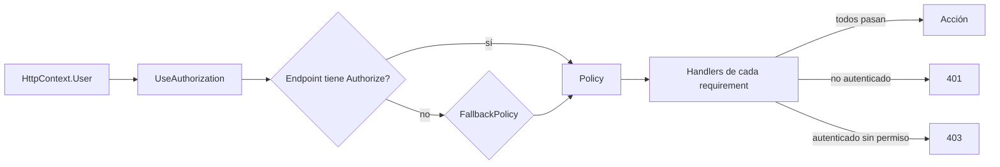

# Autorización con policies

Parte de: [[03-CSharp-DotNet/05 ASP.NET Core/_Índice ASP.NET Core|ASP.NET Core]]

> [!info] Cómo avanzar
> `progreso`: **pendiente** → **viendo** (estudiando) → **visto** (contestaste la autoevaluación sin abrir las respuestas) → **dominado** (hiciste el laboratorio o lo aplicaste de verdad).

## Contenido

### Qué es
La **autorización** decide si un usuario ya autenticado puede hacer algo. En ASP.NET Core el modelo central es la **policy** (política): un conjunto de **requisitos** con nombre, por ejemplo "Admin" = "tiene el rol admin", o "PuedePublicar" = "tiene el claim `permiso=publicar` y su cuenta está verificada". Se aplican con `[Authorize(Policy = "...")]` en controllers o acciones. Viene después de la autenticación ([[Autenticación con JWT en ASP.NET Core]]): primero se sabe quién eres, luego qué puedes hacer.

### Cómo funciona
Piezas:
- **Requirement** (`IAuthorizationRequirement`): un dato que describe la regla ("edad mínima 18", "dueño del recurso").
- **Handler** (`AuthorizationHandler<TRequirement>`): el código que evalúa el requirement contra el usuario (y opcionalmente un recurso) y llama `context.Succeed(requirement)`.
- **Policy**: agrupa requirements. Los atajos `RequireRole`, `RequireClaim`, `RequireAuthenticatedUser` y `RequireAssertion` crean requirements por ti.
- **`IAuthorizationService`**: evalúa policies desde código, necesario para autorización basada en recursos.



**FallbackPolicy**: se aplica a todo endpoint que **no** tiene ningún atributo de autorización. Si la defines como "usuario autenticado", la API queda **cerrada por defecto**: olvidar `[Authorize]` en un controller nuevo ya no lo expone. Lo público se marca explícitamente con `[AllowAnonymous]`. Así está Itzamna.Dionisio. Es distinta de la **DefaultPolicy**, que es la que usa `[Authorize]` sin nombre.

**Handler propio** cuando la regla depende de **datos**, no solo del token. "Solo el dueño del portafolio puede editarlo" no se resuelve con roles: hay que cargar el portafolio y comparar su dueño con el `sub` del usuario. Eso es autorización **basada en recursos**: el handler recibe el recurso, y desde el slice llamas `IAuthorizationService.AuthorizeAsync(User, recurso, "EsDueno")`.

### Ejemplo
Registro de policies con fallback:

```csharp
builder.Services.AddAuthorizationBuilder()
    .AddPolicy("Admin", p => p.RequireRole("admin"))
    .AddPolicy("PuedePublicar", p => p.RequireClaim("permiso", "publicar"))
    .AddPolicy("EsDueno", p => p.AddRequirements(new DuenoRequirement()))
    .SetFallbackPolicy(new AuthorizationPolicyBuilder().RequireAuthenticatedUser().Build());

builder.Services.AddSingleton<IAuthorizationHandler, DuenoHandler>();
```

Requirement y handler basados en recurso:

```csharp
public sealed class DuenoRequirement : IAuthorizationRequirement;

public sealed class DuenoHandler : AuthorizationHandler<DuenoRequirement, Portafolio>
{
    protected override Task HandleRequirementAsync(
        AuthorizationHandlerContext ctx, DuenoRequirement req, Portafolio recurso)
    {
        if (ctx.User.FindFirst("sub")?.Value == recurso.DuenoId)
            ctx.Succeed(req);
        return Task.CompletedTask;   // no llamar Succeed = no autorizado
    }
}
```

Uso en controller y en el slice:

```csharp
[HttpDelete("{id:guid}")]
[Authorize(Policy = "Admin")]
public Task<IActionResult> Borrar(Guid id, [FromServices] BorrarPortafolio.Handler h, CancellationToken ct) => h.Handle(new(id), ct);

// Dentro de EditarPortafolio.Handler
var portafolio = await consulta.Obtener(cmd.Id, ct);
var r = await authz.AuthorizeAsync(usuario, portafolio, "EsDueno");
if (!r.Succeeded) return Result.Prohibido("no_es_dueno");   // tu controller lo traduce a 403
```

Observa la división de responsabilidades: la policy "Admin" se resuelve solo con el token, así que va como atributo y el slice ni se entera; "EsDueno" necesita el portafolio cargado, así que se evalúa **dentro** del slice, después de leerlo, y el resultado se traduce a tu `Result` con `codigo`. Así no consultas dos veces la BD ni metes acceso a datos en un handler de autorización.

Un handler puede atender varios requirements y una policy puede tener varios requirements: **todos** deben cumplirse. Si quieres "A o B", usa `RequireAssertion(ctx => ...)` o un solo handler que evalúe ambas condiciones.

### Cuándo usarlo y cuándo no
- **Roles** (`RequireRole`) para permisos gruesos y estables.
- **Claims/policies** para permisos finos que vienen en el token.
- **Handler propio** cuando la regla necesita datos del recurso o de la BD.
- **FallbackPolicy** siempre en APIs privadas.
- No metas lógica de negocio compleja en handlers de autorización: deben ser reglas de acceso, rápidas y claras.

### Errores comunes
- **No definir FallbackPolicy** y olvidar `[Authorize]` en un controller nuevo.
- **Usar `[Authorize(Roles = "admin")]` regado** por todo el código: centraliza en policies con nombre.
- **Comparar roles con mapeo de claims activo** y no encontrarlos (`MapInboundClaims` cambia `role` por un URI largo).
- **Llamar `Fail()`** cuando solo querías "no aplica": `Fail` bloquea aunque otro handler tenga éxito.
- **Resolver un Scoped en un handler registrado como Singleton**: [[Captive dependency]].

### Para profundizar
- [Autorización basada en policies (Microsoft Learn)](https://learn.microsoft.com/aspnet/core/security/authorization/policies)
- [Autorización basada en recursos (Microsoft Learn)](https://learn.microsoft.com/aspnet/core/security/authorization/resourcebased)
- [Introducción a la autorización en ASP.NET Core (Microsoft Learn)](https://learn.microsoft.com/aspnet/core/security/authorization/introduction)

## Autoevaluación

Contesta primero en voz alta o en papel; luego despliega la respuesta.

> [!question]- ¿Qué es una policy?
> Un conjunto de requisitos con nombre: `AddAuthorization(o => o.AddPolicy("Admin", p => p.RequireRole("admin")))` y se aplica con `[Authorize(Policy = "Admin")]`.

> [!question]- ¿Para qué la `FallbackPolicy`?
> Para que todo endpoint sin atributo requiera usuario autenticado (como en Dionisio); lo público se marca con `[AllowAnonymous]`.

> [!question]- ¿Cuándo un `IAuthorizationHandler` propio?
> Cuando la regla depende de datos ("solo el dueño del portafolio puede editarlo"): un requirement + handler que consulta el recurso.

