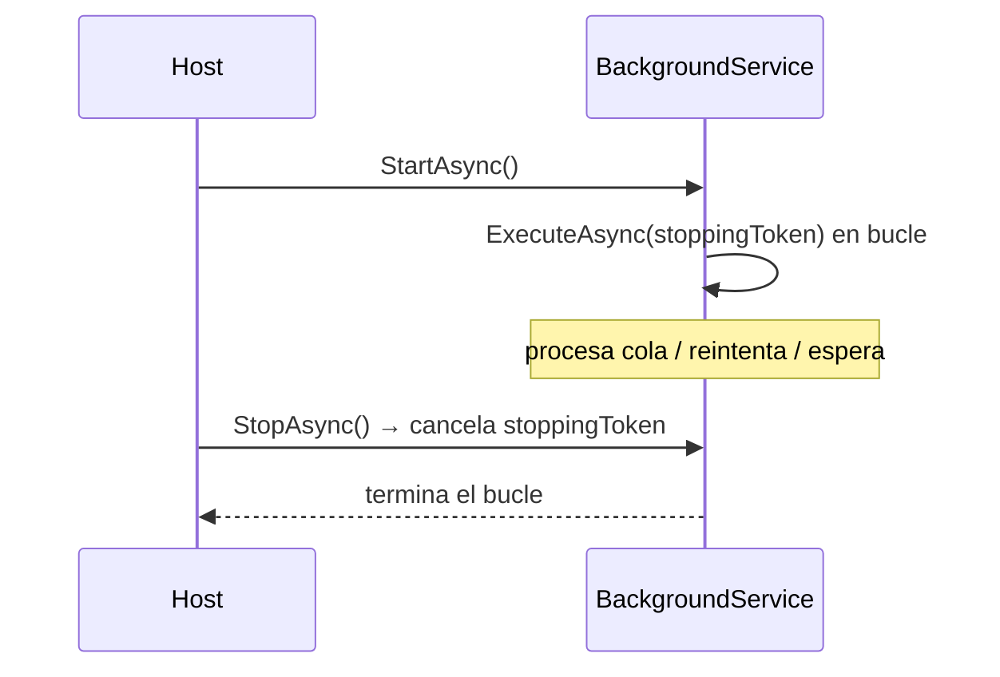

# BackgroundService

> Clase base de .NET para tareas de larga duración que viven junto al servidor web; en [[Ocelotl.Hermes]] mueven los eventos del robot (`EventDispatcher`) y los envían a [[Argo]] (`OutboxDispatcher`).

## Qué es y qué problema resuelve
Un servidor HTTP responde peticiones, pero hay trabajo que no nace de una petición: procesar una cola, reintentar envíos, limpiar datos viejos. `BackgroundService` (de `Microsoft.Extensions.Hosting`) implementa `IHostedService` y te deja escribir solo un método `ExecuteAsync(CancellationToken stoppingToken)` que el **host** arranca al iniciar y cancela al apagar.

## Cómo funciona por dentro
- Se registra con `services.AddHostedService<T>()` → el host lo crea como **singleton** y llama `StartAsync` al arrancar.
- `StartAsync` lanza `ExecuteAsync` y regresa; el bucle corre en paralelo a las peticiones HTTP.
- Al apagar, el host cancela `stoppingToken` y espera (con un tiempo límite) a que `ExecuteAsync` termine.
- Si `ExecuteAsync` lanza una excepción no controlada, el comportamiento por defecto desde .NET 6 es **detener el host** (`BackgroundServiceExceptionBehavior.StopHost`). Por eso los bucles deben atrapar sus errores.
- Al ser singleton, no puede recibir servicios *scoped* por constructor: debe crear un scope con `IServiceScopeFactory`.



## Cuándo usarla y cuándo no
### Ventajas
- Integrado con DI, logging, configuración y el ciclo de vida del host.
- Apagado ordenado con `CancellationToken`.
- Suficiente para colas en memoria y sondeos periódicos en un solo proceso.
### Desventajas
- Vive dentro del proceso: si el proceso muere, el trabajo en memoria se pierde (Hermes lo compensa con el outbox en [[SQLite]]).
- Una excepción no controlada detiene toda la aplicación.
- No es un planificador distribuido (sin cron, sin varios nodos).

## Alternativas
| Alternativa | En qué se diferencia |
|---|---|
| `IHostedService` directo | Controlas `StartAsync`/`StopAsync` a mano; más código. |
| `PeriodicTimer` dentro de un BackgroundService | Temporizador `await`able en lugar de `Task.Delay`. |
| Hangfire / Quartz.NET | Trabajos persistentes, programados (cron), con panel; más infraestructura. |
| Servicio de Windows separado | Otro proceso; Hermes ya corre embebido en Electron. |

## Cómo se usó en Ocelotl
En [[Ocelotl.Hermes]] hay dos hosted services, registrados en `Ocelotl.Hermes/src/Ocelotl.Hermes.Infrastructure/DependencyInjection.cs`:
```csharp
// Eventos: cola en memoria → (outbox + Iris)
services.AddSingleton<ChannelEventPublisher>();
services.AddSingleton<IEventPublisher>(sp => sp.GetRequiredService<ChannelEventPublisher>());
services.AddSingleton<OutboxRepositorio>();
services.AddHostedService<EventDispatcher>();
services.AddHostedService<OutboxDispatcher>();
```

**1. `EventDispatcher`** — lee la cola de [[System.Threading.Channels]] y reparte cada evento a: outbox (SQLite), reacciones de la aplicación (`IReaccionEvento`, ver [[Eventos de dominio y reacciones]]) y [[Ocelotl.Iris]] por [[SignalR]]. Cada destino tiene su propio `try/catch`: un fallo en uno no impide el otro ni detiene el ciclo. Crea **un scope por evento** porque las reacciones son `Handler` scoped (`Ocelotl.Hermes/src/Ocelotl.Hermes.Infrastructure/Eventos/EventDispatcher.cs`):
```csharp
protected override async Task ExecuteAsync(CancellationToken stoppingToken)
{
    try
    {
        await foreach (var evento in cola.Lector.ReadAllAsync(stoppingToken))
            await RepartirAsync(evento, stoppingToken);
    }
    catch (OperationCanceledException) when (stoppingToken.IsCancellationRequested)
    {
        // Apagado normal.
    }
}
```

**2. `OutboxDispatcher`** — cada 2 s toma hasta 50 pendientes del outbox y los manda a Argo; si Argo no está disponible, marca el fallo (backoff exponencial hasta 5 min) y corta el lote; cada hora purga lo enviado hace más de 7 días. Usa `Task.Delay(Intervalo, reloj, stoppingToken)` con `TimeProvider` para poder probarlo. `DespacharAsync` es público para que las pruebas hagan "un pase" sin arrancar el bucle (ver [[xUnit]] y [[Patrón Outbox]]).

Funcionalidades: [[Eventos en tiempo real]], [[Sincronización con Argo]], [[Trazabilidad por caja]].

> [!tip] Reutilizable
> El molde "bucle con `try/catch` por iteración + `catch (OperationCanceledException) when (stoppingToken.IsCancellationRequested)` + método público de un solo pase para pruebas" sirve para cualquier worker.

## Errores comunes y buenas prácticas
- Dejar escapar excepciones del bucle → se apaga todo Hermes (el comentario en `EventDispatcher.ReaccionarAsync` lo advierte).
- Inyectar servicios scoped en el constructor de un hosted service (singleton) → usar `IServiceScopeFactory.CreateAsyncScope()`.
- Bloquear `StartAsync` con trabajo síncrono largo: retrasa el arranque del servidor.
- Usar `Task.Delay` sin `TimeProvider`: dificulta las pruebas.
- Tratar `OperationCanceledException` del apagado como error.

## Qué estudiar después
- [[System.Threading.Channels]], [[Patrón Outbox]], [[Eventos de dominio y reacciones]]
- [[Inyección de dependencias]] (scopes)
- Generic Host y ciclo de vida (`IHostApplicationLifetime`).

## Documentación oficial
- https://learn.microsoft.com/aspnet/core/fundamentals/host/hosted-services
- https://learn.microsoft.com/dotnet/core/extensions/workers

## Autoevaluación

Contesta primero en voz alta o en papel; luego despliega la respuesta.

> [!question]- ¿Qué es `BackgroundService`?
> Una clase base de `IHostedService` donde implementas `ExecuteAsync(CancellationToken stoppingToken)` para trabajo continuo en segundo plano dentro del host.

> [!question]- ¿Qué pasa si `ExecuteAsync` lanza una excepción no atrapada?
> Desde .NET 6 el host se detiene por defecto (`BackgroundServiceExceptionBehavior.StopHost`). Atrapa por iteración, registra y continúa.

> [!question]- ¿Cómo usas servicios Scoped dentro?
> Inyecta `IServiceScopeFactory` y crea un scope por iteración o mensaje.

> [!question]- ¿Cómo haces un ciclo periódico correcto?
> ```csharp
> using var timer = new PeriodicTimer(TimeSpan.FromSeconds(30));
> while (await timer.WaitForNextTickAsync(stoppingToken)) { await ProcesarAsync(stoppingToken); }
> ```

## Práctica

- [[Lab 7 - Cliente HTTP tipado con resiliencia y health checks]]

