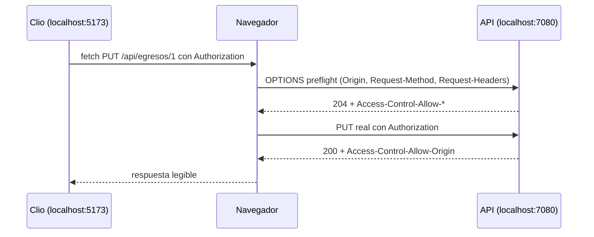

# CORS en ASP.NET Core

Parte de: [[03-CSharp-DotNet/05 ASP.NET Core/_Índice ASP.NET Core|ASP.NET Core]]

> [!info] Cómo avanzar
> `progreso`: **pendiente** → **viendo** (estudiando) → **visto** (contestaste la autoevaluación sin abrir las respuestas) → **dominado** (hiciste el laboratorio o lo aplicaste de verdad).

## Contenido

### Qué es
**CORS** (*Cross-Origin Resource Sharing*) es un mecanismo del **navegador** que decide si el JavaScript de una página puede leer la respuesta de un servidor de **otro origen**. Un origen es la combinación de esquema, dominio y puerto: `http://localhost:5173` (Vite con Itzamna.Clio) y `https://localhost:7080` (la API) son orígenes distintos. Por defecto el navegador bloquea esas lecturas (política de mismo origen); CORS es la forma en que el servidor dice "a este origen sí le permito leer".

Punto clave: CORS **no protege tu API**. Postman, curl o un script en un servidor ignoran CORS por completo. Sirve para proteger a los usuarios del navegador de que un sitio malicioso use su sesión contra tu API. La seguridad de la API la dan autenticación y autorización.

### Cómo funciona
1. El JavaScript de `http://localhost:5173` hace `fetch("https://localhost:7080/api/egresos")`.
2. Si la petición no es "simple" (por ejemplo, lleva `Authorization`, `Content-Type: application/json` o es `PUT`/`DELETE`), el navegador manda primero un **preflight**: `OPTIONS` con `Origin`, `Access-Control-Request-Method` y `Access-Control-Request-Headers`.
3. El servidor responde con `Access-Control-Allow-Origin`, `-Methods`, `-Headers` (y `-Credentials` si aplica).
4. Si coinciden, el navegador manda la petición real y deja que el JS lea la respuesta, que también debe traer `Access-Control-Allow-Origin`.



En ASP.NET Core defines políticas con `AddCors` y las aplicas con `UseCors("Nombre")` (global) o con `[EnableCors("Nombre")]` por controller. El middleware responde los preflight él mismo (corta el pipeline) y por eso va **antes** de autenticación: el preflight no lleva token ([[Orden de los middleware en ASP.NET Core]]).

**`AllowAnyOrigin()` + `AllowCredentials()` no se permite.** Con credenciales (cookies o autenticación HTTP que el navegador manda sola), permitir cualquier origen significaría que **cualquier** sitio podría hacer peticiones autenticadas con las cookies del usuario y leer la respuesta. La especificación lo prohíbe (`Access-Control-Allow-Origin: *` no vale con credenciales) y ASP.NET Core lanza una excepción al construir esa política. Lista los orígenes explícitamente.

### Ejemplo
Orígenes desde configuración, por entorno:

```csharp
var origenes = builder.Configuration.GetSection("Cors:Origenes").Get<string[]>() ?? [];

builder.Services.AddCors(o => o.AddPolicy("Front", p => p
    .WithOrigins(origenes)                  // ["http://localhost:5173", "https://clio.midominio.mx"]
    .WithMethods("GET", "POST", "PUT", "DELETE")
    .WithHeaders("Authorization", "Content-Type", "X-Idempotencia")
    .WithExposedHeaders("Content-Disposition", "X-Correlacion")   // headers que el JS puede leer
    .SetPreflightMaxAge(TimeSpan.FromMinutes(10))));

var app = builder.Build();
app.UseRouting();
app.UseCors("Front");
app.UseAuthentication();
app.UseAuthorization();
app.MapControllers();
```

`WithExposedHeaders` importa cuando el front descarga un archivo y necesita leer `Content-Disposition` para el nombre ([[Subida y descarga de archivos]]). `SetPreflightMaxAge` deja que el navegador cachee el preflight y reduce peticiones `OPTIONS`.

Alternativa sin CORS en desarrollo: configurar el **proxy de Vite** (`server.proxy` en `vite.config.ts`) para que Clio llame a `/api` en su mismo origen. En producción, si front y API se sirven bajo el mismo dominio, tampoco necesitas CORS.

### Cuándo usarlo y cuándo no
- **Sí** cuando un front en el navegador llama a una API en otro origen.
- **No** para llamadas servidor a servidor: no aplica.
- **No** como sustituto de autenticación.
- **Evita CORS** si puedes servir front y API bajo el mismo origen (proxy inverso o Vite proxy).

### Errores comunes
- **`AllowAnyOrigin()` en producción** "porque funciona": cualquier sitio puede leer tus respuestas.
- **`SetIsOriginAllowed(_ => true)` con credenciales**: es el mismo agujero, disfrazado.
- **Orígenes con `/` al final** (`http://localhost:5173/`): no coinciden.
- **`UseCors` después de auth**: el preflight recibe 401.
- **Diagnosticar con Postman**: no hace preflight; revisa la pestaña Network del navegador.

### Para profundizar
- [Habilitar CORS en ASP.NET Core (Microsoft Learn)](https://learn.microsoft.com/aspnet/core/security/cors)
- [CORS (MDN)](https://developer.mozilla.org/en-US/docs/Web/HTTP/Guides/CORS)
- [Proxy del servidor de Vite](https://vite.dev/config/server-options#server-proxy)

## Autoevaluación

Contesta primero en voz alta o en papel; luego despliega la respuesta.

> [!question]- ¿Qué es CORS?
> Un mecanismo del **navegador**: antes de permitir que JS de otro origen lea tu respuesta, verifica los headers `Access-Control-Allow-*`. No protege contra clientes que no son navegador.

> [!question]- ¿Cómo configuras una política?
> ```csharp
> builder.Services.AddCors(o => o.AddPolicy("Front", p => p.WithOrigins("https://app.midominio.mx").AllowAnyHeader().AllowAnyMethod()));
> app.UseCors("Front");
> ```

> [!question]- ¿Por qué no se permite `AllowAnyOrigin()` con `AllowCredentials()`?
> Sería permitir que cualquier sitio haga peticiones con las cookies del usuario. ASP.NET Core lo rechaza; lista orígenes explícitos.

