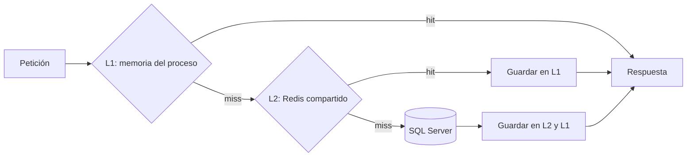

# Caché en memoria, distribuida y HybridCache

Parte de: [[03-CSharp-DotNet/05 ASP.NET Core/_Índice ASP.NET Core|ASP.NET Core]]

> [!info] Cómo avanzar
> `progreso`: **pendiente** → **viendo** (estudiando) → **visto** (contestaste la autoevaluación sin abrir las respuestas) → **dominado** (hiciste el laboratorio o lo aplicaste de verdad).

## Contenido

### Qué es
Cachear es guardar el resultado de algo caro (una consulta SQL, una llamada a otra API, un cálculo) para reutilizarlo sin repetir el trabajo. En ASP.NET Core hay tres herramientas principales para cachear **datos** en tu código, y una cuarta para cachear **respuestas HTTP** completas ([[Output caching]]):
- [[IMemoryCache]]: caché en el proceso, la más rápida.
- [[IDistributedCache]]: caché compartida fuera del proceso (Redis, SQL Server).
- [[HybridCache]]: una API que combina ambas en dos niveles y resuelve los problemas típicos.

### Cómo funciona
**En memoria vs. distribuida:**
- La caché **en memoria** vive dentro del proceso de la API: guarda objetos .NET tal cual, sin serializar, así que leer es casi gratis. Pero se **pierde al reiniciar** y **cada instancia tiene la suya**: con dos instancias en Azure, invalidar en una no invalida en la otra.
- La caché **distribuida** vive en un servicio externo (Redis, SQL Server) compartido por todas las instancias y sobrevive a reinicios de la app. A cambio, cada lectura es una **llamada de red** más **serialización**.



HybridCache implementa justamente este esquema de dos niveles (L1 memoria, L2 distribuida opcional).

**Cache stampede** (estampida): una clave muy usada expira y, en ese instante, cien peticiones concurrentes ven el *miss* y **todas** van a la BD a regenerar el mismo valor. La BD recibe un pico de carga justo cuando más tráfico hay. `IMemoryCache.GetOrCreateAsync` no lo evita (la fábrica puede correr varias veces). HybridCache sí: si varias peticiones piden la misma clave a la vez, **solo una** ejecuta la fábrica y las demás esperan su resultado.

### Ejemplo
Catálogo de cajas de Hermes, que cambia poco y se consulta en cada pantalla:

```csharp
builder.Services.AddHybridCache(o =>
{
    o.DefaultEntryOptions = new HybridCacheEntryOptions
    {
        Expiration = TimeSpan.FromMinutes(10),          // vida total (L2)
        LocalCacheExpiration = TimeSpan.FromMinutes(2)  // vida en memoria (L1)
    };
});

public sealed class ListarCajasCacheado(HybridCache cache, ListarCajas.Handler h)
{
    public ValueTask<IReadOnlyList<Caja>> Ejecutar(long sucursalId, CancellationToken ct) =>
        cache.GetOrCreateAsync(
            $"cajas:sucursal:{sucursalId}",
            async c => await h.Handle(new(sucursalId), c),
            tags: ["cajas"],
            cancellationToken: ct);
}

// Al crear o editar una caja, invalida:
// await cache.RemoveByTagAsync("cajas", ct);
```

### Cuándo usarlo y cuándo no
Antes de cachear, **siempre** decide tres cosas:
1. **Duración**: ¿cuánto tiempo es aceptable servir el dato sin volver a la fuente? Un catálogo, minutos u horas; un saldo, probablemente nunca.
2. **Invalidación**: ¿cómo se entera la caché de que el dato cambió? Por expiración, borrando la clave al escribir o por tags.
3. **Dato viejo**: ¿qué pasa si alguien ve el valor anterior? Si la respuesta es "se cobra mal" o "se vende algo sin stock", no caches o usa duraciones muy cortas.

Guía rápida:
- **Una instancia, datos pequeños**: `IMemoryCache` o HybridCache sin L2.
- **Varias instancias o sobrevivir reinicios**: HybridCache con Redis como L2.
- **Respuestas GET públicas completas**: [[Output caching]].
- **No** caches datos por usuario con claves que no incluyen al usuario: le muestras a B los datos de A.

### Errores comunes
- **Cachear sin plan de invalidación**: "¿por qué no veo el cambio?".
- **Claves sin todos los parámetros** (sucursal, usuario, página): datos cruzados.
- **Guardar objetos mutables** en memoria y modificarlos después: cambias lo que ven todos.
- **Cachear errores o `null`** sin querer, y servir el fallo por diez minutos.
- **Cachear lo que no es caro**: agregas complejidad sin ganar nada; mide primero.

### Para profundizar
- [Panorama de caché en ASP.NET Core (Microsoft Learn)](https://learn.microsoft.com/aspnet/core/performance/caching/overview)
- [HybridCache en ASP.NET Core (Microsoft Learn)](https://learn.microsoft.com/aspnet/core/performance/caching/hybrid)
- [Caché distribuida en ASP.NET Core (Microsoft Learn)](https://learn.microsoft.com/aspnet/core/performance/caching/distributed)

## Subtemas

- [[IMemoryCache]]
- [[IDistributedCache]]
- [[HybridCache]]

## Autoevaluación

Contesta primero en voz alta o en papel; luego despliega la respuesta.

> [!question]- ¿Qué diferencia hay entre caché en memoria y distribuida?
> En memoria vive en el proceso: rapidísima pero se pierde al reiniciar y cada instancia tiene la suya. Distribuida (Redis, SQL) se comparte entre instancias, con costo de red y serialización.

> [!question]- ¿Qué es una *cache stampede*?
> Cuando expira una clave muy usada y muchas peticiones van a la vez a la fuente. HybridCache la evita dejando que solo una regenere el valor.

> [!question]- ¿Qué debes decidir siempre al cachear?
> Duración, cómo invalidar y qué pasa si el dato está viejo.

## Práctica

- [[Lab 7 - Cliente HTTP tipado con resiliencia y health checks]]

## Progreso de los subtemas

```base
filters:
  and:
    - file.inFolder("03-CSharp-DotNet/05 ASP.NET Core/Caché en memoria, distribuida y HybridCache")
    - file.name != "Caché en memoria, distribuida y HybridCache"
views:
  - type: table
    name: Progreso
    order:
      - file.name
      - progreso
      - nivel
```
