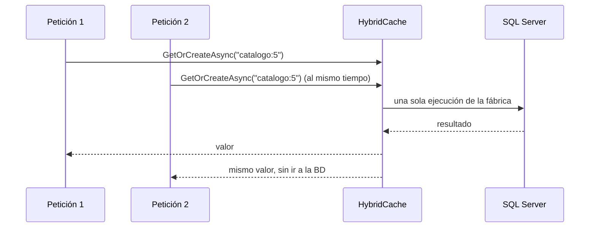

# HybridCache

Parte de: [[Caché en memoria, distribuida y HybridCache]]

> [!info] Cómo avanzar
> `progreso`: **pendiente** → **viendo** (estudiando) → **visto** (contestaste la autoevaluación sin abrir las respuestas) → **dominado** (hiciste el laboratorio o lo aplicaste de verdad).

## Contenido

### Qué es
**HybridCache** es una API de caché de .NET (paquete `Microsoft.Extensions.Caching.Hybrid`, estable desde marzo de 2025 junto con .NET 9, y disponible en .NET 10) que combina una caché **en memoria** como primer nivel (**L1**) y, opcionalmente, una caché **distribuida** como segundo nivel (**L2**). Expone una sola operación principal, `GetOrCreateAsync`, que hace todo el trabajo que antes escribías a mano con [[IMemoryCache]] más [[IDistributedCache]]. Es parte de [[Caché en memoria, distribuida y HybridCache]].

### Cómo funciona
Al pedir una clave:
1. Busca en **L1** (memoria del proceso). Si está, la regresa.
2. Si no, busca en **L2** (si hay un `IDistributedCache` registrado, por ejemplo Redis, HybridCache lo usa automáticamente). Si está, la deserializa, la guarda en L1 y la regresa.
3. Si no está en ningún lado, ejecuta tu **fábrica** (la consulta SQL), guarda el resultado en L2 y L1 y lo regresa.



**Qué resuelve frente a usar las dos cachés a mano:**
- **Protección contra *stampede***: si muchas peticiones piden la misma clave a la vez y no está, solo **una** ejecuta la fábrica; las demás esperan ese resultado. Con `IMemoryCache.GetOrCreateAsync` la fábrica puede correr muchas veces. (La protección es por instancia: dos instancias pueden regenerar cada una su valor.)
- **Serialización integrada**: usa System.Text.Json por defecto para L2 (y puedes registrar serializadores propios); no escribes helpers de bytes.
- **Invalidación por tags**: asocias tags a las entradas (`["cajas", "sucursal:5"]`) y con `RemoveByTagAsync("cajas")` invalidas todas de una vez.
- **Una sola API** con opciones claras: `Expiration` (vida total) y `LocalCacheExpiration` (vida en L1, normalmente menor para que las instancias se re-sincronicen con L2 pronto).
- **Cancelación** y límites de tamaño de clave y de valor configurables.

### Ejemplo
Registro, con Redis como L2 opcional:

```csharp
builder.Services.AddStackExchangeRedisCache(o =>          // si existe, HybridCache lo usa como L2
    o.Configuration = builder.Configuration.GetConnectionString("Redis"));

builder.Services.AddHybridCache(o =>
{
    o.DefaultEntryOptions = new HybridCacheEntryOptions
    {
        Expiration = TimeSpan.FromMinutes(15),
        LocalCacheExpiration = TimeSpan.FromMinutes(2)
    };
});
```

Uso en un slice de Dionisio, con una sentencia SQL por consulta:

```csharp
public sealed class ObtenerCatalogo
{
    public sealed record Query(int Id);

    public sealed class Handler(HybridCache cache, IObtenerCatalogoSql sql, SesionSql sesion)
    {
        public ValueTask<CatalogoDto?> Handle(Query q, CancellationToken ct) =>
            cache.GetOrCreateAsync(
                $"catalogo:{q.Id}",                                         // clave con todos los parámetros
                async c =>
                {
                    var cn = await sesion.ConexionAsync(c);
                    return await cn.QuerySingleOrDefaultAsync<CatalogoDto>(sql.Texto, new { q.Id });
                },
                tags: ["catalogos"],
                cancellationToken: ct);
    }
}

// Al editar un catálogo:
// await cache.RemoveAsync($"catalogo:{id}", ct);       // una clave
// await cache.RemoveByTagAsync("catalogos", ct);        // todas las del tag
```

Guarda en caché **DTOs inmutables** (records); con L2, cada instancia deserializa su copia, pero en L1 se reutiliza la instancia y modificarla afectaría a todos.

### Cuándo usarlo y cuándo no
- **Sí** como opción por defecto para cachear datos en código nuevo: empieza solo con L1 y agrega Redis cuando escales a varias instancias, sin cambiar el código de los handlers.
- **Sí** cuando hay claves muy concurridas que expiran (riesgo de *stampede*).
- **No** para respuestas HTTP completas: [[Output caching]].
- **No** para datos que no toleran estar viejos ni un segundo (saldos, stock en el momento de vender).

### Errores comunes
- **Claves incompletas** que mezclan datos de distintos usuarios o filtros.
- **Esperar invalidación inmediata entre instancias** solo con L1: cada instancia mantiene su L1 hasta `LocalCacheExpiration`.
- **Fábrica que regresa `null` por error** y cachea "no existe" durante 15 minutos; decide si quieres cachear ausencias.
- **Valores enormes**: hay un límite de tamaño de valor por defecto; guarda solo lo necesario.
- **Usar `IMemoryCache` y HybridCache para lo mismo**: duplicas memoria e invalidación.

### Para profundizar
- [Biblioteca HybridCache en ASP.NET Core (Microsoft Learn)](https://learn.microsoft.com/aspnet/core/performance/caching/hybrid)
- [Paquete Microsoft.Extensions.Caching.Hybrid (NuGet)](https://www.nuget.org/packages/Microsoft.Extensions.Caching.Hybrid)
- [[IDistributedCache]]

## Autoevaluación

Contesta primero en voz alta o en papel; luego despliega la respuesta.

> [!question]- ¿Qué es HybridCache?
> Una API (paquete `Microsoft.Extensions.Caching.Hybrid`, desde .NET 9) que combina caché en memoria (L1) y distribuida opcional (L2) con `GetOrCreateAsync`.

> [!question]- ¿Qué problemas resuelve frente a usar las dos a mano?
> Protección contra *stampede*, serialización integrada, invalidación por tags y una sola API.

> [!question]- ¿Cómo se usa?
> ```csharp
> builder.Services.AddHybridCache();
> var cat = await cache.GetOrCreateAsync($"catalogo:{id}", async ct => await sql.EjecutarAsync(new(id), ct), cancellationToken: ct);
> ```

