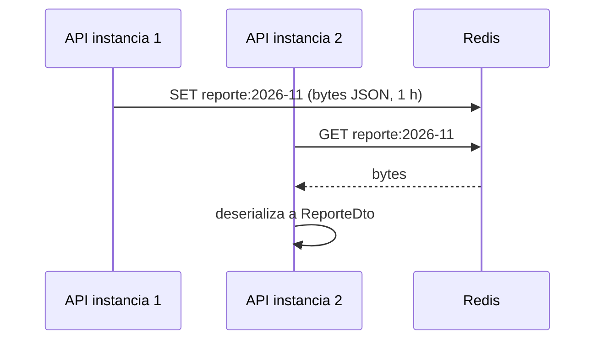

# IDistributedCache

Parte de: [[Caché en memoria, distribuida y HybridCache]]

> [!info] Cómo avanzar
> `progreso`: **pendiente** → **viendo** (estudiando) → **visto** (contestaste la autoevaluación sin abrir las respuestas) → **dominado** (hiciste el laboratorio o lo aplicaste de verdad).

## Contenido

### Qué es
`IDistributedCache` es la abstracción de .NET para una caché **fuera del proceso**, compartida por todas las instancias de la aplicación: Redis, SQL Server, Azure Cosmos DB, NCache, etc. Es parte de [[Caché en memoria, distribuida y HybridCache]]. Su interfaz es deliberadamente simple: guarda y lee **`byte[]` por clave**, con opciones de expiración. Tú decides cómo serializar (normalmente JSON con System.Text.Json).

### Cómo funciona
Métodos principales:
- `GetAsync(clave)` → `byte[]?`; `SetAsync(clave, bytes, opciones)`; `RefreshAsync(clave)` (renueva la expiración deslizante); `RemoveAsync(clave)`.
- Extensiones `GetStringAsync` / `SetStringAsync` para texto.
- `DistributedCacheEntryOptions` con `AbsoluteExpirationRelativeToNow` y `SlidingExpiration`, igual que en memoria.

Implementaciones comunes:
- **Redis**: paquete `Microsoft.Extensions.Caching.StackExchangeRedis`, `AddStackExchangeRedisCache(...)`. Es la más usada; en Azure, Azure Cache for Redis o Azure Managed Redis.
- **SQL Server**: paquete `Microsoft.Extensions.Caching.SqlServer`, `AddDistributedSqlServerCache(...)`; la tabla se crea con la herramienta `dotnet sql-cache create`. Útil si ya tienes SQL Server y no quieres otro servicio, aunque es más lenta que Redis.
- **Memoria** (`AddDistributedMemoryCache`): implementa la interfaz pero vive en el proceso. **No es distribuida**; sirve para desarrollo y pruebas.

**¿Por qué es más lenta que `IMemoryCache`?** Porque cada lectura implica una **llamada de red** (ida y vuelta a Redis o a SQL, aunque sean milisegundos) más **deserializar** los bytes a un objeto nuevo. `IMemoryCache` solo regresa una referencia que ya está en memoria: nanosegundos. A cambio, la distribuida es compartida y sobrevive reinicios de la API. Por eso existe el esquema de dos niveles de [[HybridCache]].



Una ventaja lateral: como los objetos se serializan, cada lectura produce una **copia nueva**, así que no existe el problema de objetos mutables compartidos que tiene la caché en memoria.

### Ejemplo
Redis con un prefijo por aplicación y helpers JSON:

```csharp
builder.Services.AddStackExchangeRedisCache(o =>
{
    o.Configuration = builder.Configuration.GetConnectionString("Redis");
    o.InstanceName = "dionisio:";            // prefijo para no chocar con otras apps
});

public static class CacheJson
{
    public static async Task<T?> LeerAsync<T>(this IDistributedCache c, string clave, CancellationToken ct)
    {
        var bytes = await c.GetAsync(clave, ct);
        return bytes is null ? default : JsonSerializer.Deserialize<T>(bytes);
    }

    public static Task GuardarAsync<T>(this IDistributedCache c, string clave, T valor, TimeSpan vida, CancellationToken ct) =>
        c.SetAsync(clave, JsonSerializer.SerializeToUtf8Bytes(valor),
            new DistributedCacheEntryOptions { AbsoluteExpirationRelativeToNow = vida }, ct);
}

// Uso en un handler de reportes (Wee.Reporteria)
var clave = $"reporte:ventas:{mes:yyyy-MM}";
var rep = await cache.LeerAsync<ReporteVentas>(clave, ct);
if (rep is null)
{
    rep = await consulta.Ejecutar(new(mes), ct);
    await cache.GuardarAsync(clave, rep, TimeSpan.FromHours(1), ct);
}
```

Este patrón "leer, si no hay calcular y guardar" es exactamente lo que HybridCache te da hecho, con protección contra *stampede*.

### Cuándo usarlo y cuándo no
- **Hace falta** cuando tienes **varias instancias** de la API (App Service escalado, contenedores) que deben ver los mismos datos cacheados e invalidarlos juntos.
- **Hace falta** cuando la caché debe **sobrevivir reinicios** o despliegues (un reporte que tarda minutos en calcularse).
- Para sesiones compartidas entre instancias o almacenamiento de estado temporal.
- **No** la necesitas con una sola instancia y datos baratos de recalcular: `IMemoryCache`.
- En código nuevo, considera usarla **a través de HybridCache** en vez de directamente.

### Errores comunes
- **Usar `AddDistributedMemoryCache` en producción** creyendo que es compartida.
- **Sin `InstanceName`**: varias apps en el mismo Redis pisan sus claves.
- **Serializar objetos enormes**: Redis funciona mejor con valores pequeños; guarda solo lo necesario.
- **No manejar la caída de Redis**: si Redis no responde, tu API no debería caerse; trata la caché como opcional y ve a la fuente.
- **Cadena de conexión de Redis en el repo**: va en secretos ([[Configuración y appsettings]]).

### Para profundizar
- [Caché distribuida en ASP.NET Core (Microsoft Learn)](https://learn.microsoft.com/aspnet/core/performance/caching/distributed)
- [Azure Cache for Redis (Microsoft Learn)](https://learn.microsoft.com/azure/azure-cache-for-redis/)
- [[HybridCache]]

## Autoevaluación

Contesta primero en voz alta o en papel; luego despliega la respuesta.

> [!question]- ¿Qué guarda `IDistributedCache`?
> `byte[]` por clave; tú serializas (JSON). Implementaciones: Redis (`AddStackExchangeRedisCache`), SQL Server, memoria (para desarrollo).

> [!question]- ¿Por qué es más lenta que `IMemoryCache`?
> Cada lectura es una llamada de red más deserialización.

> [!question]- ¿Cuándo hace falta?
> Con varias instancias de la API que deben ver los mismos datos cacheados, o para sobrevivir reinicios.

