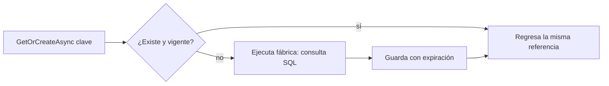

# IMemoryCache

Parte de: [[Caché en memoria, distribuida y HybridCache]]

> [!info] Cómo avanzar
> `progreso`: **pendiente** → **viendo** (estudiando) → **visto** (contestaste la autoevaluación sin abrir las respuestas) → **dominado** (hiciste el laboratorio o lo aplicaste de verdad).

## Contenido

### Qué es
`IMemoryCache` es la caché **en el proceso** de .NET (paquete `Microsoft.Extensions.Caching.Memory`, incluido en ASP.NET Core). Guarda objetos .NET en la memoria de la propia aplicación, por clave, con reglas de expiración. Es la opción más rápida porque no hay red ni serialización: guardas una referencia y la lees de vuelta. Es parte de [[Caché en memoria, distribuida y HybridCache]].

### Cómo funciona
Se registra con `builder.Services.AddMemoryCache()` (como singleton) y se usa con:
- `TryGetValue(clave, out valor)` y `Set(clave, valor, opciones)`.
- `GetOrCreate` / `GetOrCreateAsync(clave, fabrica)`: si existe lo regresa; si no, ejecuta la fábrica, guarda el resultado y lo regresa.
- `Remove(clave)` para invalidar.

**Opciones de expiración** (`MemoryCacheEntryOptions` o en el `ICacheEntry` de la fábrica):
- **Absoluta** (`AbsoluteExpirationRelativeToNow` o `AbsoluteExpiration`): la entrada vence en un momento fijo, se use o no. "Este catálogo vale 10 minutos desde que lo cargué."
- **Deslizante** (`SlidingExpiration`): la entrada vence si **nadie la usa** durante ese tiempo; cada acceso renueva el plazo. Útil para datos que se consultan en ráfagas. El riesgo: un dato muy usado **nunca vence** y nunca se refresca. Por eso se **combina con una absoluta** que pone un tope.
- **Prioridad y tamaño**: `Priority` decide qué se expulsa primero bajo presión; si configuras `SizeLimit` en la caché, cada entrada debe declarar su `Size` y la caché rechaza lo que excede el límite.
- **Tokens de cambio y callbacks** para invalidar por eventos o enterarte cuando algo se expulsa.



**Objetos mutables.** La caché guarda **la referencia** al objeto, no una copia. Si guardas un `List<Caja>` y después alguien hace `lista.Add(...)` o cambia una propiedad, estás modificando **el objeto que está en la caché**: todas las peticiones siguientes ven el cambio, y si dos hilos lo modifican a la vez puedes corromperlo. Guarda objetos **inmutables**: `record` con propiedades `init`, `IReadOnlyList<T>`, `ImmutableArray<T>` o `FrozenDictionary`.

### Ejemplo
Catálogo de denominaciones de Hermes:

```csharp
builder.Services.AddMemoryCache(o => o.SizeLimit = 1_000);  // unidades arbitrarias que tú defines

public sealed record Denominacion(int Valor, string Tipo);

public sealed class CatalogoDenominaciones(IMemoryCache cache, ListarDenominaciones.Handler h)
{
    public async Task<IReadOnlyList<Denominacion>> ObtenerAsync(CancellationToken ct) =>
        (await cache.GetOrCreateAsync("denominaciones", async e =>
        {
            e.AbsoluteExpirationRelativeToNow = TimeSpan.FromMinutes(30); // tope duro
            e.SlidingExpiration = TimeSpan.FromMinutes(5);                // vence si no se usa
            e.Size = 1;
            var lista = await h.Handle(new(), ct);
            return (IReadOnlyList<Denominacion>)lista.ToArray();         // copia inmutable
        }))!;

    public void Invalidar() => cache.Remove("denominaciones");
}
```

Fíjate en que la fábrica convierte a arreglo y lo expone como `IReadOnlyList`: nadie puede agregar elementos al objeto cacheado. Y con `SizeLimit` configurado, olvidar `e.Size` lanza una excepción, lo cual es bueno: te obliga a pensar en el tamaño.

### Cuándo usarlo y cuándo no
- **Sí** con una sola instancia, para datos pequeños y de lectura frecuente: catálogos, configuración de negocio, resultados de cálculos.
- **Sí** como primer nivel dentro de [[HybridCache]].
- **No** con varias instancias si invalidar en todas es importante: cada una tiene su copia ([[IDistributedCache]] o HybridCache con L2).
- **No** para datos grandes sin `SizeLimit`: la memoria del proceso crece sin control.
- **No** si te preocupa la *stampede*: `GetOrCreateAsync` puede ejecutar la fábrica varias veces en paralelo; HybridCache no.

### Errores comunes
- **Solo expiración deslizante**: datos que nunca se refrescan.
- **Guardar objetos mutables** y modificarlos después.
- **Claves que no incluyen todos los parámetros** de la consulta.
- **Crear `new MemoryCache(...)` por clase** en lugar de usar el registrado: varias cachés, más memoria.
- **Esperar que sobreviva a un reinicio** o a un reciclado del App Pool en IIS.

### Para profundizar
- [Caché en memoria en ASP.NET Core (Microsoft Learn)](https://learn.microsoft.com/aspnet/core/performance/caching/memory)
- [Caché en .NET (Microsoft Learn)](https://learn.microsoft.com/dotnet/core/extensions/caching)
- [[HybridCache]]

## Autoevaluación

Contesta primero en voz alta o en papel; luego despliega la respuesta.

> [!question]- ¿Cómo se usa?
> `builder.Services.AddMemoryCache();` y `await cache.GetOrCreateAsync(clave, e => { e.AbsoluteExpirationRelativeToNow = TimeSpan.FromMinutes(5); return Cargar(); });`.

> [!question]- ¿Qué diferencia hay entre expiración absoluta y deslizante?
> Absoluta: vence a un tiempo fijo. Deslizante: se renueva con cada acceso (combínala con una absoluta para que no viva para siempre).

> [!question]- ¿Qué pasa si guardas un objeto mutable y luego lo modificas?
> Modificas el que está en la caché: todos los lectores ven el cambio. Guarda objetos inmutables.

## Práctica

- [[Lab 7 - Cliente HTTP tipado con resiliencia y health checks]]

