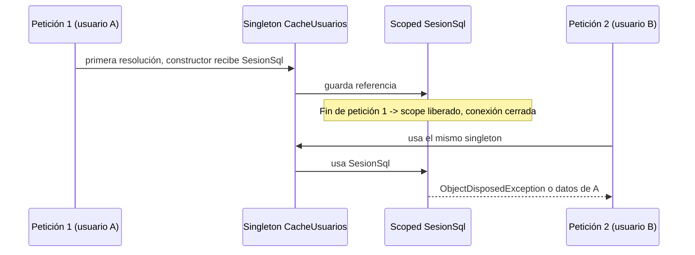

# Captive dependency

Parte de: [[Ciclos de vida (Singleton, Scoped, Transient)]]

> [!info] Cómo avanzar
> `progreso`: **pendiente** → **viendo** (estudiando) → **visto** (contestaste la autoevaluación sin abrir las respuestas) → **dominado** (hiciste el laboratorio o lo aplicaste de verdad).

## Contenido

### Qué es
Una **captive dependency** (dependencia cautiva) ocurre cuando un servicio de vida **larga** recibe uno de vida **más corta** y lo retiene. El caso típico: un **Singleton** que recibe en su constructor un servicio **Scoped**. El singleton se crea una vez y guarda esa instancia en un campo; el Scoped, que debía vivir solo una petición, queda "capturado" para toda la vida de la aplicación. Es el error más común de [[Ciclos de vida (Singleton, Scoped, Transient)]].

### Cómo funciona


El contenedor no "sabe" que el singleton guardó la referencia. Cuando termina el scope de la primera petición, libera la `SesionSql` (cierra la conexión). Desde entonces el singleton tiene en su campo un objeto muerto o, peor, uno vivo que comparten todas las peticiones.

Variantes:
- Singleton → Scoped (la clásica).
- Singleton → Transient con estado o desechable: el transient vive para siempre.
- Middleware por convención con un Scoped en el constructor: el middleware se crea una vez, así que es lo mismo ([[Middleware personalizado en ASP.NET Core]]).
- Un `BackgroundService` (siempre singleton) con un Scoped en el constructor.

### Síntomas
- `ObjectDisposedException` ("Cannot access a disposed object") al usar la conexión o el `DbContext` en peticiones posteriores.
- **Datos de una petición que aparecen en otra**: el usuario B ve el tenant, el usuario o los datos cacheados del usuario A.
- Errores de concurrencia: "A second operation was started on this context" en EF Core, o `SqlConnection` usada desde dos hilos, porque todas las peticiones comparten la misma instancia.
- Transacciones que "se quedan abiertas" o bloqueos en SQL Server.
- Funciona en local (una petición a la vez) y falla en producción con carga.

La buena noticia: con `ValidateScopes = true` el contenedor detecta el caso Singleton → Scoped y **lanza al resolver** (o al arrancar con `ValidateOnBuild`), con un mensaje como "Cannot consume scoped service 'SesionSql' from singleton 'CacheUsuarios'". Ambas validaciones están activas por defecto en Development. No detecta el caso Singleton → Transient con estado, que debes revisar tú.

### Ejemplo
Error y dos correcciones:

```csharp
// Mal: el singleton captura la sesión de la primera petición
public sealed class CatalogoCajas(SesionSql sesion)
{
    public Task<IReadOnlyList<Caja>> ListarAsync(CancellationToken ct) => /* usa sesion */ default!;
}
builder.Services.AddSingleton<CatalogoCajas>();
builder.Services.AddScoped<SesionSql>();

// Corrección 1: bajar el ciclo de vida del consumidor
builder.Services.AddScoped<CatalogoCajas>();

// Corrección 2: si de verdad debe ser singleton (p. ej. guarda una caché), crear scope al usarlo
public sealed class CatalogoCajasCacheado(IServiceScopeFactory f, HybridCache cache)
{
    public ValueTask<IReadOnlyList<Caja>> ListarAsync(CancellationToken ct) =>
        cache.GetOrCreateAsync("cajas", async c =>
        {
            await using var scope = f.CreateAsyncScope();
            var consulta = scope.ServiceProvider.GetRequiredService<ListarCajas.Handler>();
            return await consulta.Handle(new(), c);
        }, cancellationToken: ct);
}
```

Una tercera opción, cuando lo que necesitas es configuración que cambia, es `IOptionsMonitor<T>` en lugar de `IOptionsSnapshot<T>` (que es Scoped).

### Cuándo usarlo y cuándo no
Este es un error a evitar, no una técnica. Criterios para corregirlo:
- Si el consumidor no tiene una razón fuerte para ser singleton, **bájalo a Scoped**. Es lo más simple.
- Si debe ser singleton (caché, worker, cliente costoso), usa **`IServiceScopeFactory`** y crea un scope por unidad de trabajo, sin guardar el Scoped en campos.
- No uses `IHttpContextAccessor` para "sacar" servicios de la petición desde un singleton como atajo: ata tu código a HTTP y falla fuera de una petición.

### Errores comunes
- **Apagar `ValidateScopes`** para que "deje de fallar": escondes el bug.
- **Guardar el scope creado en un campo** del singleton: vuelves a capturar.
- **Inyectar `IOptionsSnapshot<T>` en un singleton**: es Scoped; usa `IOptionsMonitor<T>`.
- **Revisar solo los constructores directos**: la captura puede estar dos niveles abajo (singleton → transient → scoped).

### Para profundizar
- [Validación de scopes (Microsoft Learn)](https://learn.microsoft.com/aspnet/core/fundamentals/dependency-injection#scope-validation)
- [Guía de DI: captive dependency (Microsoft Learn)](https://learn.microsoft.com/dotnet/core/extensions/dependency-injection-guidelines)
- [[Servicios Scoped en DI]]

## Autoevaluación

Contesta primero en voz alta o en papel; luego despliega la respuesta.

> [!question]- ¿Qué es una *captive dependency*?
> Un servicio de vida larga que recibe uno de vida más corta: un singleton que inyecta un Scoped lo "captura" para siempre.

> [!question]- ¿Qué síntomas da?
> Datos de una petición que aparecen en otra, `DbContext` o conexiones usadas desde varios hilos, `ObjectDisposedException`. Con `ValidateScopes` lanza al resolver.

> [!question]- ¿Cómo se corrige?
> Baja el ciclo de vida del consumidor, o inyecta `IServiceScopeFactory` y crea un scope cuando lo necesites.

