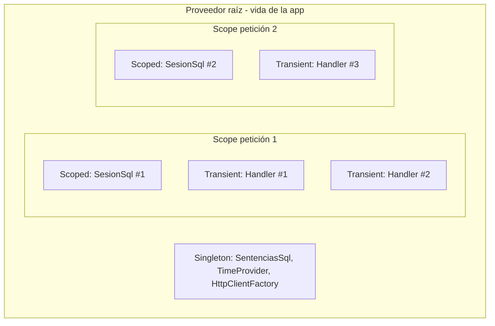

# Ciclos de vida (Singleton, Scoped, Transient)

Parte de: [[03-CSharp-DotNet/05 ASP.NET Core/_Índice ASP.NET Core|ASP.NET Core]]

> [!info] Cómo avanzar
> `progreso`: **pendiente** → **viendo** (estudiando) → **visto** (contestaste la autoevaluación sin abrir las respuestas) → **dominado** (hiciste el laboratorio o lo aplicaste de verdad).

## Contenido

### Qué es
Cuando registras un servicio en el contenedor de [[Inyección de dependencias]] eliges su **ciclo de vida** (*lifetime*): cuánto vive la instancia y quién la comparte. Hay tres:
- **Singleton**: una sola instancia para toda la aplicación, creada la primera vez que se pide (o la que tú registras) y liberada al apagar.
- **Scoped**: una instancia por *scope*. En ASP.NET Core hay un scope por petición HTTP, así que todos los que piden el servicio durante esa petición reciben la misma.
- **Transient**: una instancia nueva cada vez que alguien la pide.

Elegir mal no da error de compilación: da datos cruzados entre usuarios, conexiones usadas desde dos hilos o fugas de memoria. Los detalles de cada uno están en [[Servicios Singleton en DI]], [[Servicios Scoped en DI]] y [[Servicios Transient en DI]]; el error clásico de mezclar ciclos se llama [[Captive dependency]].

### Cómo funciona


1. Al arrancar, el contenedor guarda la descripción de cada servicio (tipo, implementación, lifetime).
2. Por cada petición, ASP.NET Core crea un scope (`HttpContext.RequestServices`) y resuelve ahí el controller, sus parámetros `[FromServices]` y todo su árbol de dependencias.
3. Al terminar la petición, el scope se libera y llama `Dispose`/`DisposeAsync` de los Scoped y Transient desechables que creó.
4. Los Singleton se liberan cuando se libera el proveedor raíz, al apagar la app.

**Regla de oro**: un servicio solo puede depender de servicios que vivan **igual o más** que él. Singleton puede depender de Singleton; Scoped de Scoped o Singleton; Transient de cualquiera.

**En tus proyectos** (SQL en archivos, [[SQL en archivos con una interfaz por consulta]]):
- Las **sentencias SQL** son **Singleton**: no tienen estado, leen su archivo `.sql` (recurso embebido) una vez y solo exponen el texto y el mapeo.
- La **sesión o conexión SQL** (`SesionSql`) es **Scoped**: una por petición, compartida por todos los que participan en la misma transacción.
- Los **handlers** de los slices son **Scoped** (o Transient) porque dependen de la sesión de la petición.

### Ejemplo
Registro típico de un slice y validación de ciclos al arrancar:

```csharp
var builder = WebApplication.CreateBuilder(args);

// Singleton: sin estado, seguros entre hilos
builder.Services.AddSingleton(TimeProvider.System);
builder.Services.AddSingleton<IListarEgresosSql, ListarEgresosSql>();

// Scoped: uno por petición
builder.Services.AddScoped<SesionSql>();
builder.Services.AddScoped<ListarEgresos.Handler>();

// Transient: ligero y sin estado compartido
builder.Services.AddTransient<IValidator<RegistrarEgreso.Command>, RegistrarEgreso.Validador>();

// Detecta errores de ciclo de vida al construir el contenedor (ya activo en Development)
builder.Host.UseDefaultServiceProvider(o =>
{
    o.ValidateScopes = true;   // falla si un Scoped se resuelve desde la raíz o lo captura un Singleton
    o.ValidateOnBuild = true;  // intenta construir cada servicio al hacer Build()
});
```

Con `ValidateOnBuild`, si un singleton depende de `SesionSql`, la app **no arranca** y el mensaje dice exactamente qué servicio consume a cuál. Es mucho mejor que descubrirlo con datos cruzados en producción. Ambas validaciones están activas por defecto en el entorno `Development`; actívalas explícitamente si quieres el mismo control en otros entornos, sabiendo que `ValidateOnBuild` agrega algo de tiempo al arranque.

### Cuándo usarlo y cuándo no
- **Singleton** para lo caro de crear, sin estado mutable o protegido para concurrencia.
- **Scoped** para lo que representa "la unidad de trabajo de esta petición": conexión, transacción, usuario actual.
- **Transient** para objetos ligeros sin estado compartido, cuando cada consumidor puede tener el suyo.
- Si dudas entre Scoped y Transient para un handler, Scoped es la opción predecible.

### Errores comunes
- **Singleton que depende de un Scoped**: [[Captive dependency]].
- **Resolver un Scoped desde el proveedor raíz** (por ejemplo en un `BackgroundService`): crea un scope propio.
- **Estado mutable en un Singleton** sin sincronización: condiciones de carrera.
- **Transient `IDisposable` resuelto desde la raíz** en un ciclo: se acumulan hasta apagar la app.
- **Apagar las validaciones** porque "estorban": esconden errores reales.

### Para profundizar
- [Ciclos de vida de servicios en .NET (Microsoft Learn)](https://learn.microsoft.com/dotnet/core/extensions/dependency-injection#service-lifetimes)
- [Guía de inyección de dependencias (Microsoft Learn)](https://learn.microsoft.com/dotnet/core/extensions/dependency-injection-guidelines)
- [Inyección de dependencias en ASP.NET Core (Microsoft Learn)](https://learn.microsoft.com/aspnet/core/fundamentals/dependency-injection)

## Subtemas

- [[Servicios Singleton en DI]]
- [[Servicios Scoped en DI]]
- [[Servicios Transient en DI]]
- [[Captive dependency]]

## Autoevaluación

Contesta primero en voz alta o en papel; luego despliega la respuesta.

> [!question]- Resume los tres ciclos de vida.
> Singleton: una instancia para toda la app. Scoped: una por scope (en web, por petición). Transient: una nueva cada vez que se pide.

> [!question]- ¿Qué ciclo de vida tienen tus sentencias SQL y tus handlers?
> Las sentencias son singleton (no tienen estado y leen su `.sql` una vez). Los handlers suelen ser Scoped o Transient porque dependen de la conexión/sesión de la petición.

> [!question]- ¿Cómo detectas errores de ciclo de vida al arrancar?
> `builder.Host.UseDefaultServiceProvider(o => { o.ValidateScopes = true; o.ValidateOnBuild = true; });` (por defecto en Development).

## Práctica

- [[Lab 6 - API con controllers, FluentValidation, ProblemDetails y Options]]

## Progreso de los subtemas

```base
filters:
  and:
    - file.inFolder("03-CSharp-DotNet/05 ASP.NET Core/Ciclos de vida (Singleton, Scoped, Transient)")
    - file.name != "Ciclos de vida (Singleton, Scoped, Transient)"
views:
  - type: table
    name: Progreso
    order:
      - file.name
      - progreso
      - nivel
```
