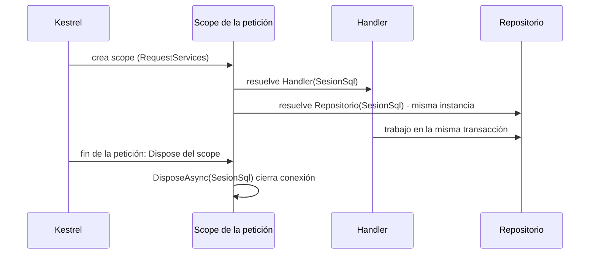

# Servicios Scoped en DI

Parte de: [[Ciclos de vida (Singleton, Scoped, Transient)]]

> [!info] Cómo avanzar
> `progreso`: **pendiente** → **viendo** (estudiando) → **visto** (contestaste la autoevaluación sin abrir las respuestas) → **dominado** (hiciste el laboratorio o lo aplicaste de verdad).

## Contenido

### Qué es
Un servicio **Scoped** tiene una instancia por *scope*. En ASP.NET Core el framework crea un scope por cada petición HTTP: todos los objetos que piden un Scoped durante esa petición (controller, handler, repositorios, validadores) reciben **la misma** instancia, y al terminar la petición el scope se libera junto con ella. Es parte de [[Ciclos de vida (Singleton, Scoped, Transient)]].

Es el ciclo de vida natural para lo que representa "el trabajo de esta petición": la conexión y la transacción SQL, el usuario actual, un `DbContext` de EF Core o un acumulador de eventos de dominio.

### Cómo funciona


1. Al llegar la petición, el middleware de hosting crea un scope y lo deja en `HttpContext.RequestServices`.
2. MVC resuelve ahí el controller y los parámetros `[FromServices]`.
3. Cada vez que el árbol pide `SesionSql`, el scope regresa la instancia que ya creó.
4. Al final, el scope llama `Dispose`/`DisposeAsync` de todo lo desechable que creó.

**¿Por qué la sesión SQL es Scoped?** Porque así el handler y todas las consultas de esa petición comparten la **misma conexión y la misma transacción**. Si el handler registra un egreso y actualiza el saldo de la caja, ambas sentencias Dapper usan la conexión de `SesionSql` y su `IDbTransaction`; si una falla, se revierten juntas. Al final de la petición la conexión vuelve al pool de ADO.NET. Si fuera Transient, cada repositorio tendría su propia conexión y la transacción no los cubriría; si fuera Singleton, todas las peticiones compartirían una conexión entre hilos.

**Fuera de una petición no hay scope.** Un [[BackgroundService]] es singleton y corre sin petición HTTP; si resuelve un Scoped desde el proveedor raíz, con `ValidateScopes` lanza excepción, y sin validación lo convierte en singleton de hecho. La solución es crear un scope propio por unidad de trabajo.

### Ejemplo
Sesión SQL Scoped:

```csharp
public sealed class SesionSql(IOptions<ConexionOpciones> op) : IAsyncDisposable
{
    private SqlConnection? _cn;
    public IDbTransaction? Transaccion { get; private set; }

    public async Task<SqlConnection> ConexionAsync(CancellationToken ct)
    {
        if (_cn is null)
        {
            _cn = new SqlConnection(op.Value.Principal);
            await _cn.OpenAsync(ct);
        }
        return _cn;
    }

    public async Task IniciarAsync(CancellationToken ct) =>
        Transaccion = await (await ConexionAsync(ct)).BeginTransactionAsync(ct);

    public async ValueTask DisposeAsync()
    {
        if (_cn is not null) await _cn.DisposeAsync();   // regresa la conexión al pool
    }
}

builder.Services.AddScoped<SesionSql>();
```

Usar Scoped desde un `BackgroundService`:

```csharp
public sealed class CierreDiario(IServiceScopeFactory fabrica, ILogger<CierreDiario> log) : BackgroundService
{
    protected override async Task ExecuteAsync(CancellationToken ct)
    {
        using var timer = new PeriodicTimer(TimeSpan.FromHours(1));
        while (await timer.WaitForNextTickAsync(ct))
        {
            await using var scope = fabrica.CreateAsyncScope();   // un scope por unidad de trabajo
            var handler = scope.ServiceProvider.GetRequiredService<CerrarCajas.Handler>();
            await handler.Handle(new CerrarCajas.Command(), ct);
            log.LogInformation("Cierre ejecutado");
        }   // al salir del bloque se libera SesionSql
    }
}
```

Dos detalles del ejemplo: la conexión se abre de forma perezosa (solo si alguien la pide), así una petición que no toca la BD no ocupa una conexión del pool; y `CreateAsyncScope` con `await using` libera de forma asíncrona los servicios `IAsyncDisposable`, como `SqlConnection`. Lo mismo aplica en un consumidor de colas o en un job de Hangfire: cada mensaje o ejecución es una "petición" y merece su propio scope.

También puedes crear scopes en pruebas de integración para resolver un handler real con su sesión, igual que lo haría una petición.

### Cuándo usarlo y cuándo no
- **Sí** para conexión/transacción, `DbContext`, contexto del usuario o tenant y handlers que dependen de ellos.
- **Sí** cuando varios componentes de la misma petición deben ver el mismo estado.
- **No** para servicios sin estado y caros de crear: Singleton.
- **No** desde un Singleton directamente: usa `IServiceScopeFactory`.

### Errores comunes
- **Inyectar un Scoped en un Singleton o en el constructor de un middleware**: [[Captive dependency]].
- **Un scope gigante en un `BackgroundService`** que vive para siempre: la conexión nunca se libera; crea un scope por iteración.
- **Usar el Scoped después de que terminó la petición** (por ejemplo en un `Task.Run` sin esperar): `ObjectDisposedException`.
- **Compartir un Scoped entre hilos** dentro de la misma petición con `Task.WhenAll`: `SqlConnection` y `DbContext` no admiten operaciones concurrentes.

### Para profundizar
- [Ciclo de vida Scoped (Microsoft Learn)](https://learn.microsoft.com/dotnet/core/extensions/dependency-injection#scoped)
- [Usar servicios Scoped en un BackgroundService (Microsoft Learn)](https://learn.microsoft.com/dotnet/core/extensions/scoped-service)
- [[Dapper]]

## Autoevaluación

Contesta primero en voz alta o en papel; luego despliega la respuesta.

> [!question]- ¿Qué es un scope en ASP.NET Core?
> Uno por petición HTTP: todos los Scoped resueltos durante la petición comparten instancia y se liberan al terminar.

> [!question]- ¿Por qué la conexión o la sesión SQL (`SesionSql`) suele ser Scoped?
> Para que todos los repositorios de la misma petición compartan conexión y transacción, y se libere al final.

> [!question]- ¿Cómo usas un Scoped desde un `BackgroundService`?
> Inyecta `IServiceScopeFactory`, crea un scope por unidad de trabajo (`await using var scope = f.CreateAsyncScope();`) y resuelve ahí.

