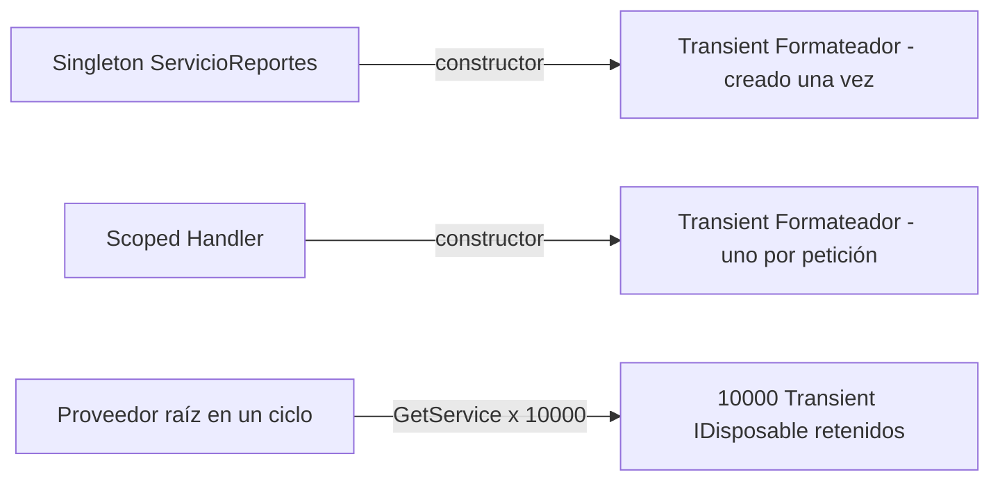

# Servicios Transient en DI

Parte de: [[Ciclos de vida (Singleton, Scoped, Transient)]]

> [!info] Cómo avanzar
> `progreso`: **pendiente** → **viendo** (estudiando) → **visto** (contestaste la autoevaluación sin abrir las respuestas) → **dominado** (hiciste el laboratorio o lo aplicaste de verdad).

## Contenido

### Qué es
Un servicio **Transient** se crea **nuevo cada vez** que alguien lo pide al contenedor: si dos clases lo reciben en su constructor durante la misma petición, cada una obtiene su propia instancia. Es parte de [[Ciclos de vida (Singleton, Scoped, Transient)]] y es el ciclo de vida más "aislado": ningún consumidor comparte estado con otro.

### Cómo funciona
```csharp
builder.Services.AddTransient<IValidator<RegistrarEgreso.Command>, RegistrarEgreso.Validador>();
builder.Services.AddTransient<GeneradorFolio>();
```

Cada `GetService`, cada parámetro de constructor y cada `[FromServices]` produce un objeto nuevo. Esto tiene tres consecuencias importantes:

**1. El "transient" depende de quién lo pide.** La instancia vive tanto como quien la recibió. Si un Scoped la recibe, en la práctica dura la petición; si un **Singleton** la recibe en su constructor, se crea **una sola vez** al construir el singleton y vive para siempre con él. Ya no es transient en ningún sentido útil. Si ese transient guarda estado o depende de algo Scoped, tienes una [[Captive dependency]].

**2. Los Transient desechables se rastrean.** Si la implementación es `IDisposable` o `IAsyncDisposable`, el contenedor guarda una referencia para liberarla cuando termine el scope que la creó. Dentro de una petición no hay problema: al acabar se liberan. Pero si los resuelves muchas veces desde el **proveedor raíz** (por ejemplo, en un singleton que llama `sp.GetService<T>()` en un ciclo, o en un `BackgroundService` sin scope), el "scope" es la aplicación entera: todos se acumulan en memoria hasta que la app se apaga. Es una fuga de memoria lenta y difícil de ver.

**3. Costo de creación.** Crear objetos pequeños es barato en .NET, pero un árbol grande de transients por petición genera presión al recolector de basura. Para objetos pesados, Singleton o Scoped.



### Ejemplo
Uso correcto: validadores y pequeños servicios sin estado.

```csharp
public sealed class GeneradorFolio(TimeProvider reloj)
{
    public string Nuevo(string prefijo) =>
        $"{prefijo}-{reloj.GetUtcNow():yyyyMMddHHmmss}-{Random.Shared.Next(1000, 9999)}";
}

builder.Services.AddTransient<GeneradorFolio>();
```

Uso problemático y su corrección:

```csharp
// Mal: singleton que resuelve transients desechables desde la raíz
public sealed class Exportador(IServiceProvider sp)
{
    public void Exportar()
    {
        var hoja = sp.GetRequiredService<HojaExcel>(); // HojaExcel : IDisposable, Transient
        // ... nunca se libera hasta apagar la app
    }
}

// Bien: scope por operación, se libera al salir
public sealed class ExportadorBien(IServiceScopeFactory f)
{
    public void Exportar()
    {
        using var scope = f.CreateScope();
        var hoja = scope.ServiceProvider.GetRequiredService<HojaExcel>();
        // ... al terminar el using se libera la hoja
    }
}
```

En Wee.Reporteria, donde los objetos de Excel son pesados y desechables, conviene crearlos con `using` directamente (`using var libro = new XLWorkbook();`) en vez de pedirlos al contenedor: no todo tiene que pasar por DI.

Una forma rápida de comprobar qué recibe cada quien: registra un servicio Transient que guarde un `Guid` en su constructor y regrésalo desde dos clases distintas en la misma petición. Verás dos `Guid` diferentes; cambia el registro a Scoped y verás el mismo. Es un experimento de cinco minutos que fija para siempre la diferencia.

### Cuándo usarlo y cuándo no
- **Sí** para servicios ligeros, sin estado compartido, donde cada consumidor puede tener el suyo: validadores, formateadores, generadores, estrategias simples.
- **Sí** cuando un objeto tiene estado interno que no debe compartirse entre consumidores.
- **No** si debe compartirse dentro de la petición (conexión, transacción): Scoped.
- **No** si es caro de crear y sin estado: Singleton.
- **No** para objetos `IDisposable` que vas a resolver desde un singleton o un worker sin crear scope.

### Errores comunes
- **Creer que sigue siendo transient dentro de un singleton**: se crea una vez.
- **Fuga de memoria** por transients desechables resueltos desde la raíz.
- **Registrar todo como Transient por costumbre**: más asignaciones sin beneficio.
- **Esperar que dos clases de la misma petición compartan estado** con un Transient: cada una tiene su copia.

### Para profundizar
- [Ciclo de vida Transient (Microsoft Learn)](https://learn.microsoft.com/dotnet/core/extensions/dependency-injection#transient)
- [Guía de DI: IDisposable y servicios Transient (Microsoft Learn)](https://learn.microsoft.com/dotnet/core/extensions/dependency-injection-guidelines)
- [[Servicios Scoped en DI]]

## Autoevaluación

Contesta primero en voz alta o en papel; luego despliega la respuesta.

> [!question]- ¿Cuándo usar Transient?
> Servicios ligeros y sin estado compartido, donde cada consumidor puede tener su propia instancia.

> [!question]- ¿Qué riesgo hay con Transient `IDisposable`?
> El contenedor guarda referencia para liberarlos al final del scope; resolverlos muchas veces desde el proveedor raíz acumula memoria hasta apagar la app.

> [!question]- ¿Transient dentro de un Singleton sigue siendo transient?
> No en la práctica: se crea una vez al construir el singleton y vive tanto como él.

