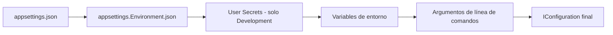

# Configuración y appsettings

Parte de: [[03-CSharp-DotNet/05 ASP.NET Core/_Índice ASP.NET Core|ASP.NET Core]]

> [!info] Cómo avanzar
> `progreso`: **pendiente** → **viendo** (estudiando) → **visto** (contestaste la autoevaluación sin abrir las respuestas) → **dominado** (hiciste el laboratorio o lo aplicaste de verdad).

## Contenido

### Qué es
La **configuración** de ASP.NET Core es un diccionario jerárquico de claves y valores (`ConnectionStrings:Principal`, `Jwt:Emisor`, `Logging:LogLevel:Default`) que se arma combinando varias **fuentes**: archivos JSON, User Secrets, variables de entorno, argumentos de línea de comandos y, si lo agregas, Azure Key Vault o Azure App Configuration. Tu código la lee con `IConfiguration` o, mejor, enlazada a clases tipadas con el [[Options pattern]].

### Cómo funciona
`WebApplication.CreateBuilder(args)` registra estas fuentes en orden. **La última que define una clave gana**:



1. `appsettings.json`: valores base, no sensibles, que se versionan en el repo.
2. `appsettings.{Environment}.json`: diferencias por entorno (`appsettings.Development.json`, `appsettings.Production.json`).
3. **User Secrets**: solo cuando el entorno es `Development`; guarda secretos fuera del repo ([[Secretos con User Secrets]]).
4. **Variables de entorno**: lo que pone el servidor, el contenedor, Azure App Service o el pipeline de Azure DevOps.
5. **Línea de comandos**: `dotnet run --Jwt:Emisor=https://...`.

**Jerarquía y nombres.** En JSON anidas objetos; en código separas con `:`. En variables de entorno el `:` no funciona en todos los sistemas, así que se usa **doble guion bajo** `__`: `ConnectionStrings:Principal` se escribe `ConnectionStrings__Principal`. Los arreglos usan índices: `Cors__Origenes__0`.

**El entorno.** Se define con `ASPNETCORE_ENVIRONMENT` (o `DOTNET_ENVIRONMENT`). Valores convencionales: `Development`, `Staging`, `Production`. **Si no se define, es `Production`**. El entorno decide qué `appsettings.{Environment}.json` se carga, si se cargan User Secrets y lo que tú condiciones con `app.Environment.IsDevelopment()`. En local, `launchSettings.json` lo pone en `Development`.

Los archivos JSON se recargan si cambian en disco (`reloadOnChange`); eso se nota con `IOptionsMonitor<T>`, no con valores que leíste una vez.

### Ejemplo
`appsettings.json` sin secretos:

```json
{
  "ConnectionStrings": {
    "Principal": ""
  },
  "Jwt": {
    "Emisor": "https://hecate.local",
    "Audiencia": "itzamna-api"
  },
  "Cors": {
    "Origenes": [ "https://localhost:5173" ]
  },
  "Logging": {
    "LogLevel": { "Default": "Information", "Microsoft.AspNetCore": "Warning" }
  }
}
```

En desarrollo, la contraseña va a User Secrets:

```powershell
dotnet user-secrets set "ConnectionStrings:Principal" "Server=.;Database=Dionisio;User Id=app;Password=...;TrustServerCertificate=True"
```

En el servidor o en Azure App Service, como variable de entorno o *connection string* de la app: `ConnectionStrings__Principal`. En Azure lo ideal es una referencia a Key Vault o identidad administrada sin contraseña.

Lectura tipada con validación al arrancar:

```csharp
builder.Services.AddOptions<JwtOpciones>()
    .Bind(builder.Configuration.GetSection("Jwt"))
    .ValidateDataAnnotations()
    .ValidateOnStart();

var cadena = builder.Configuration.GetConnectionString("Principal")
    ?? throw new InvalidOperationException("Falta ConnectionStrings:Principal");
```

`GetConnectionString("Principal")` es un atajo para `GetSection("ConnectionStrings")["Principal"]`.

### Cuándo usarlo y cuándo no
- **JSON** para valores por defecto y no sensibles.
- **Variables de entorno** para lo que cambia por servidor y para secretos en hosting tradicional.
- **Azure Key Vault** (o App Configuration con referencias a Key Vault) para secretos en Azure.
- **No** leas `IConfiguration["..."]` regado por el código: enlaza a opciones tipadas y valida al arrancar.

### Errores comunes
- **Contraseña de SQL en `appsettings.json`**: termina en el repo y en el historial de Git. Muévela a User Secrets en local y a variables de entorno o Key Vault en servidores; si ya se subió, **cámbiala**, borrarla del archivo no basta.
- **Usar `:` en variables de entorno de Linux**: no se reconoce; usa `__`.
- **No definir el entorno en el servidor**: es `Production`, y si esperabas `Staging` no carga tu archivo.
- **Esperar User Secrets en producción**: solo se cargan en Development.
- **Errores de nombre** (`ConnectionString` sin "s"): el valor llega vacío; valida con `ValidateOnStart`.

### Para profundizar
- [Configuración en ASP.NET Core (Microsoft Learn)](https://learn.microsoft.com/aspnet/core/fundamentals/configuration/)
- [Usar varios entornos (Microsoft Learn)](https://learn.microsoft.com/aspnet/core/fundamentals/environments)
- [Almacenamiento seguro de secretos en desarrollo (Microsoft Learn)](https://learn.microsoft.com/aspnet/core/security/app-secrets)

## Autoevaluación

Contesta primero en voz alta o en papel; luego despliega la respuesta.

> [!question]- ¿En qué orden se aplican las fuentes de configuración por defecto?
> `appsettings.json` → `appsettings.{Environment}.json` → User Secrets (en Development) → variables de entorno → argumentos de línea de comandos. La última gana.

> [!question]- ¿Cómo se escribe `ConnectionStrings:Principal` como variable de entorno?
> `ConnectionStrings__Principal` (doble guion bajo en lugar de `:`).

> [!question]- ¿Qué define el entorno?
> `ASPNETCORE_ENVIRONMENT` (o `DOTNET_ENVIRONMENT`): `Development`, `Staging`, `Production` (por defecto si no se define).

> [!question]- Error común: guardar la contraseña de SQL en `appsettings.json`. ¿Qué haces?
> User Secrets en desarrollo; variables de entorno o Azure Key Vault en servidores. El json solo con valores no sensibles.

## Práctica

- [[Lab 6 - API con controllers, FluentValidation, ProblemDetails y Options]]

