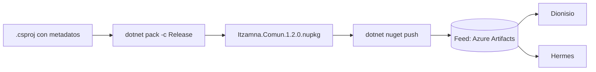

# Crear y publicar paquetes NuGet

Parte de: [[03-CSharp-DotNet/05 ASP.NET Core/_Índice ASP.NET Core|ASP.NET Core]]

> [!info] Cómo avanzar
> `progreso`: **pendiente** → **viendo** (estudiando) → **visto** (contestaste la autoevaluación sin abrir las respuestas) → **dominado** (hiciste el laboratorio o lo aplicaste de verdad).

## Contenido

### Qué es
Un **paquete NuGet** (`.nupkg`) es un archivo zip con tus ensamblados compilados, metadatos (nombre, versión, autor, licencia, dependencias) y opcionalmente un README e ícono. Crear paquetes sirve para **compartir código entre soluciones**: por ejemplo, la base de tus slices (Result, ProblemDetails con `codigo`, el lector de recursos SQL embebidos) usada por Dionisio, Hermes y Reporteria sin copiar y pegar. Se publican en un **feed**: nuget.org (público), Azure Artifacts (privado, el natural si usas Azure DevOps) o GitHub Packages.

### Cómo funciona
1. Pones los metadatos en el `.csproj` (o en `Directory.Build.props`).
2. `dotnet pack -c Release` compila y genera `bin/Release/<Id>.<Version>.nupkg` (y `.snupkg` de símbolos si lo pides).
3. `dotnet nuget push <archivo> --api-key <llave> --source <feed>` lo sube.
4. Los consumidores agregan el feed (en `nuget.config`) y referencian el paquete con `<PackageReference>`.



**Propiedades mínimas** recomendadas:
- `PackageId`: nombre único en el feed (`Itzamna.Comun`).
- `Version`: la versión SemVer del paquete.
- `Authors` y `Description`: quién y qué es.
- `PackageLicenseExpression`: licencia SPDX (`MIT`) o `PackageLicenseFile` si es propietaria.
- `RepositoryUrl` (y `RepositoryType`): de dónde sale el código.
- `PackageReadmeFile`: el README que se muestra en el feed, incluido con un `<None Include="README.md" Pack="true" PackagePath="\" />`.
- Opcionales útiles: `PackageTags`, `PackageIcon`, `IncludeSymbols` + `SymbolPackageFormat=snupkg`. Source Link viene integrado en el SDK desde .NET 8 para repos de GitHub y Azure Repos, así se puede depurar dentro del paquete.

**Versionado con SemVer** (`MAYOR.MENOR.PARCHE`):
- **MAYOR**: cambios que **rompen** a quien lo usa (quitaste un método, cambiaste una firma).
- **MENOR**: agregas funcionalidad **compatible** (un método nuevo).
- **PARCHE**: correcciones compatibles.
- **Prerelease** con sufijo: `1.3.0-beta.1`, `2.0.0-rc.1`. NuGet no las instala por defecto salvo que se pidan.

Una versión publicada es **inmutable**: no puedes sobrescribir `1.2.0`; corriges con `1.2.1`. En nuget.org puedes *deslistar*, no borrar.

### Ejemplo
`.csproj` de una biblioteca compartida:

```xml
<Project Sdk="Microsoft.NET.Sdk">
  <PropertyGroup>
    <TargetFramework>net10.0</TargetFramework>
    <PackageId>Itzamna.Comun</PackageId>
    <Version>1.2.0</Version>
    <Authors>Equipo Itzamna</Authors>
    <Description>Result, ProblemDetails con codigo y lector de SQL embebido para APIs con slices.</Description>
    <PackageLicenseExpression>MIT</PackageLicenseExpression>
    <RepositoryUrl>https://dev.azure.com/miorg/Itzamna/_git/Comun</RepositoryUrl>
    <PackageReadmeFile>README.md</PackageReadmeFile>
    <IncludeSymbols>true</IncludeSymbols>
    <SymbolPackageFormat>snupkg</SymbolPackageFormat>
  </PropertyGroup>
  <ItemGroup>
    <None Include="README.md" Pack="true" PackagePath="\" />
  </ItemGroup>
</Project>
```

En local:

```powershell
dotnet pack src/Itzamna.Comun -c Release -o ./paquetes
dotnet nuget push ./paquetes/Itzamna.Comun.1.2.0.nupkg --source "ItzamnaFeed" --api-key az
```

Con Azure Artifacts, la autenticación la hace el *Azure Artifacts Credential Provider* (la `--api-key` es un valor cualquiera). En Azure Pipelines lo normal es no publicar desde tu máquina: el pipeline corre `dotnet pack` con la versión calculada (por ejemplo desde una etiqueta Git `v1.2.0`) y usa la tarea `NuGetAuthenticate@1` antes del `push` ([[Azure Pipelines]]). Así ninguna llave vive en el repo.

### Cuándo usarlo y cuándo no
- **Sí** para código estable compartido por varias soluciones o equipos.
- **Sí** para herramientas de `dotnet tool` internas.
- **No** para código que cambia en cada sprint junto con una sola app: una referencia de proyecto es más simple.
- **No** publiques en nuget.org código interno de un cliente: usa un feed privado.

### Errores comunes
- **Republicar la misma versión**: el feed la rechaza; sube el número.
- **Romper compatibilidad en una versión MENOR**: los consumidores se actualizan "seguros" y truenan.
- **Llave de nuget.org en el repo o en el pipeline en texto plano**: usa variables secretas o *service connections*.
- **Dependencias con versiones exactas** innecesarias (`[2.1.0]`): bloquean a los consumidores.
- **Sin README ni descripción**: nadie sabe para qué es el paquete.

### Para profundizar
- [Crear un paquete con la CLI de dotnet (Microsoft Learn)](https://learn.microsoft.com/nuget/create-packages/creating-a-package-dotnet-cli)
- [Publicar paquetes NuGet (Microsoft Learn)](https://learn.microsoft.com/nuget/nuget-org/publish-a-package)
- [Azure Artifacts: publicar y consumir paquetes NuGet (Microsoft Learn)](https://learn.microsoft.com/azure/devops/artifacts/get-started-nuget)
- [Semantic Versioning 2.0.0](https://semver.org/)

## Autoevaluación

Contesta primero en voz alta o en papel; luego despliega la respuesta.

> [!question]- ¿Cómo generas y publicas un paquete?
> `dotnet pack -c Release` genera el `.nupkg`; `dotnet nuget push x.nupkg --api-key <llave> --source <feed>` lo publica (nuget.org, Azure Artifacts o GitHub Packages).

> [!question]- ¿Qué propiedades mínimas pones en el `.csproj`?
> `PackageId`, `Version`, `Authors`, `Description`, `PackageLicenseExpression`, `RepositoryUrl` y un `README`.

> [!question]- ¿Cómo versionas un paquete?
> Con SemVer: MAYOR (rompe), MENOR (agrega compatible), PARCHE (corrige). Prerelease con sufijo `-beta.1`.

