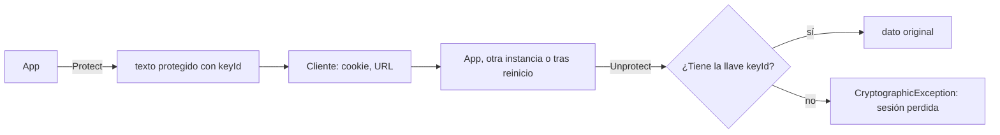

# Data Protection

Parte de: [[03-CSharp-DotNet/05 ASP.NET Core/_Índice ASP.NET Core|ASP.NET Core]]

> [!info] Cómo avanzar
> `progreso`: **pendiente** → **viendo** (estudiando) → **visto** (contestaste la autoevaluación sin abrir las respuestas) → **dominado** (hiciste el laboratorio o lo aplicaste de verdad).

## Contenido

### Qué es
**Data Protection** es el sistema criptográfico integrado de ASP.NET Core para **cifrar y firmar datos que la propia app emite y luego recibe de vuelta**. Lo usa el framework para las cookies de autenticación, los tokens antifalsificación (antiforgery), el estado temporal de OpenID Connect y TempData; y tú lo puedes usar con `IDataProtector.Protect/Unprotect` para valores como un enlace de confirmación o un token temporal en una URL.

Su gran ventaja: no tienes que elegir algoritmos ni administrar llaves a mano. Genera, rota y guarda las llaves por ti. Lo que sí debes decidir es **dónde** se guardan.

### Cómo funciona
- Hay un **anillo de llaves** (*key ring*). Cada llave tiene una vigencia, por defecto **90 días**; antes de que expire se genera una nueva y se usa para proteger lo nuevo.
- Las llaves viejas se conservan para poder **desproteger** lo que se protegió con ellas.
- `Protect` cifra (AES) y autentica (HMAC) el dato e incluye el id de la llave usada. `Unprotect` busca esa llave en el anillo, valida y descifra.
- Cada protector tiene un **propósito** (`CreateProtector("Confirmacion.Correo")`): lo protegido con un propósito no se puede abrir con otro. Así un token de confirmación no sirve como cookie.



**Por qué persistir las llaves en contenedores o con varias instancias.** Por defecto las llaves se guardan localmente: en Windows en el perfil del usuario, en IIS según la configuración del App Pool, y en Linux en `~/.aspnet/DataProtection-Keys`. En un **contenedor** esa carpeta vive dentro del contenedor: si se recrea (cada despliegue), las llaves desaparecen y todas las cookies emitidas dejan de ser válidas. Con **dos instancias** detrás de un balanceador, cada una genera su propio anillo: lo que cifró la instancia A no lo puede abrir la B, y el usuario "pierde la sesión" al azar. La solución es un almacén compartido y persistente (carpeta compartida, Azure Blob Storage, Redis, base de datos) y un `SetApplicationName` igual en todas las instancias. Azure App Service persiste y comparte las llaves entre instancias de la misma app automáticamente.

### Ejemplo
Configuración para varias instancias en Azure, con llaves en Blob protegidas por Key Vault:

```csharp
builder.Services.AddDataProtection()
    .SetApplicationName("itzamna-dionisio")
    .PersistKeysToAzureBlobStorage(new Uri(builder.Configuration["DataProtection:BlobUri"]!), new DefaultAzureCredential())
    .ProtectKeysWithAzureKeyVault(new Uri(builder.Configuration["DataProtection:KeyUri"]!), new DefaultAzureCredential());
```

(Paquetes `Azure.Extensions.AspNetCore.DataProtection.Blobs` y `Azure.Extensions.AspNetCore.DataProtection.Keys`). En un servidor propio con IIS en granja basta `PersistKeysToFileSystem(new DirectoryInfo(@"\\servidor\llaves\dionisio"))`.

Uso directo para un enlace temporal:

```csharp
public sealed class EnlaceDescarga(IDataProtectionProvider dp)
{
    private readonly ITimeLimitedDataProtector _p =
        dp.CreateProtector("Descarga.Reporte").ToTimeLimitedDataProtector();

    public string Crear(long reporteId) => _p.Protect(reporteId.ToString(), TimeSpan.FromMinutes(15));

    public long? Leer(string token)
    {
        try { return long.Parse(_p.Unprotect(token)); }
        catch (CryptographicException) { return null; }   // alterado o expirado
    }
}
```

### Cuándo usarlo y cuándo no
- **Sí** para datos de **vida corta** que la app emite y recibe: cookies, tokens temporales, estado en URLs.
- **No** para cifrar datos **en la base de datos a largo plazo**: no es su objetivo. Las llaves rotan y pueden revocarse o perderse; si se pierde el anillo, los datos quedan ilegibles para siempre. Para datos en reposo usa Always Encrypted o TDE de SQL Server, o cifrado con llaves administradas en Azure Key Vault.
- **No** para contraseñas: se guardan con hash (ASP.NET Core Identity usa `PasswordHasher`), no cifradas.
- **No** sustituye a JWT firmados por tu servidor de identidad.

### Errores comunes
- **Contenedor sin persistir llaves**: cada despliegue cierra la sesión de todos.
- **Varias instancias sin almacén compartido**: errores intermitentes de "antiforgery token could not be decrypted".
- **Distinto `SetApplicationName`** entre instancias: aislamiento involuntario.
- **Llaves en disco sin proteger** en un servidor compartido: cualquiera con acceso a la carpeta puede leerlas; usa `ProtectKeysWith...`.
- **Guardar datos permanentes protegidos** y descubrirlo meses después cuando la llave se revoca.

### Para profundizar
- [Introducción a Data Protection (Microsoft Learn)](https://learn.microsoft.com/aspnet/core/security/data-protection/introduction)
- [Configurar Data Protection (Microsoft Learn)](https://learn.microsoft.com/aspnet/core/security/data-protection/configuration/overview)
- [Administración y vigencia de llaves (Microsoft Learn)](https://learn.microsoft.com/aspnet/core/security/data-protection/configuration/default-settings)

## Autoevaluación

Contesta primero en voz alta o en papel; luego despliega la respuesta.

> [!question]- ¿Para qué sirve Data Protection?
> Cifrar y firmar datos que la app emite y recibe de vuelta: cookies de autenticación, tokens antifalsificación, valores temporales (`IDataProtector.Protect/Unprotect`).

> [!question]- ¿Por qué en contenedores o en varias instancias hay que persistir las llaves?
> Por defecto se guardan localmente; si el contenedor se recrea o hay dos instancias, una no puede descifrar lo que cifró la otra y los usuarios pierden la sesión. Usa `PersistKeysToFileSystem`/Azure Blob y `SetApplicationName`.

> [!question]- ¿Sirve para cifrar datos en la base de datos a largo plazo?
> No es su objetivo: las llaves rotan (90 días por defecto) y se pensó para datos de vida corta. Para datos en reposo usa Always Encrypted o un servicio de llaves.

