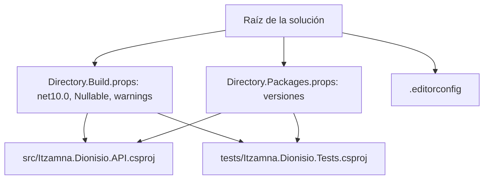

# Directory.Build.props y Central Package Management

Parte de: [[03-CSharp-DotNet/05 ASP.NET Core/_Índice ASP.NET Core|ASP.NET Core]]

> [!info] Cómo avanzar
> `progreso`: **pendiente** → **viendo** (estudiando) → **visto** (contestaste la autoevaluación sin abrir las respuestas) → **dominado** (hiciste el laboratorio o lo aplicaste de verdad).

## Contenido

### Qué es
Son dos mecanismos de MSBuild/NuGet para **configurar todos los proyectos de una solución desde un solo lugar**:
- **`Directory.Build.props`**: un archivo que MSBuild importa **automáticamente** en todos los proyectos (`.csproj`) de su carpeta y subcarpetas. Ahí van las propiedades comunes: `TargetFramework`, `Nullable`, `ImplicitUsings`, `LangVersion`, `TreatWarningsAsErrors`, analizadores, metadatos de empresa.
- **Central Package Management (CPM)**: un archivo `Directory.Packages.props` donde defines **la versión** de cada paquete NuGet una sola vez. Los `.csproj` solo dicen qué paquete usan, sin versión.

En una solución con vertical slices y varios proyectos (Api, pruebas, utilerías), evitan que cada `.csproj` sea una copia ligeramente distinta de los demás.

### Cómo funciona
**`Directory.Build.props`**: al compilar un proyecto, MSBuild sube por las carpetas desde la del `.csproj` hasta encontrar el primer `Directory.Build.props` y lo importa al **inicio** del proyecto. Lo que pongas en el `.csproj` puede sobrescribirlo. Existe también `Directory.Build.targets`, que se importa al **final** (para targets o propiedades que dependen de otras ya calculadas). Solo se importa el **primero** que se encuentra; si quieres heredar uno de una carpeta superior, impórtalo explícitamente.

**CPM**:
1. En la raíz, `Directory.Packages.props` con `<ManagePackageVersionsCentrally>true</ManagePackageVersionsCentrally>`.
2. Cada paquete con `<PackageVersion Include="..." Version="..." />`.
3. En los `.csproj`, `<PackageReference Include="Dapper" />` **sin** `Version`. Si alguien pone versión ahí, el restore falla (error NU1008) a menos que use `VersionOverride` a propósito.
4. `GlobalPackageReference` agrega un paquete a **todos** los proyectos (útil para analizadores).
5. Opcional: `CentralPackageTransitivePinningEnabled` para fijar también versiones de dependencias transitivas.



### Ejemplo
`Directory.Build.props`:

```xml
<Project>
  <PropertyGroup>
    <TargetFramework>net10.0</TargetFramework>
    <Nullable>enable</Nullable>
    <ImplicitUsings>enable</ImplicitUsings>
    <TreatWarningsAsErrors>true</TreatWarningsAsErrors>
    <AnalysisLevel>latest-recommended</AnalysisLevel>
    <EnforceCodeStyleInBuild>true</EnforceCodeStyleInBuild>
    <Company>Itzamna</Company>
  </PropertyGroup>
</Project>
```

`Directory.Packages.props` (los números de versión son de ejemplo; revisa en NuGet las vigentes antes de copiarlos: Pendiente de confirmar):

```xml
<Project>
  <PropertyGroup>
    <ManagePackageVersionsCentrally>true</ManagePackageVersionsCentrally>
  </PropertyGroup>
  <ItemGroup>
    <PackageVersion Include="Dapper" Version="2.1.66" />
    <PackageVersion Include="Microsoft.Data.SqlClient" Version="6.1.1" />
    <PackageVersion Include="FluentValidation.DependencyInjectionExtensions" Version="12.0.0" />
    <PackageVersion Include="xunit.v3" Version="3.1.0" />
  </ItemGroup>
  <ItemGroup>
    <GlobalPackageReference Include="Meziantou.Analyzer" Version="2.0.220" />
  </ItemGroup>
</Project>
```

`.csproj` de la API, ahora mínimo:

```xml
<Project Sdk="Microsoft.NET.Sdk.Web">
  <ItemGroup>
    <PackageReference Include="Dapper" />
    <PackageReference Include="Microsoft.Data.SqlClient" />
    <PackageReference Include="FluentValidation.DependencyInjectionExtensions" />
  </ItemGroup>
  <ItemGroup>
    <EmbeddedResource Include="**\*.sql" />
  </ItemGroup>
</Project>
```

Para migrar una solución existente, mueve cada versión al archivo central y quita el atributo `Version` de los `.csproj`; si dos proyectos usaban versiones distintas, ese es justo el problema que estás resolviendo: elige una. Dependabot y Renovate entienden CPM, y en Azure DevOps un PR de actualización toca un solo archivo.

### Cuándo usarlo y cuándo no
- **Sí** en cualquier solución con más de un proyecto: el costo es mínimo.
- **CPM** sobre todo cuando hay proyectos de pruebas que deben usar las mismas versiones que la API.
- **`VersionOverride`** solo como excepción documentada (un proyecto que necesita otra versión temporalmente).
- En un proyecto único y pequeño puedes vivir sin ellos, aunque `Directory.Build.props` sigue siendo cómodo para las reglas de compilación.

### Errores comunes
- **Versiones distintas del mismo paquete** en cada proyecto: conflictos de binding, comportamientos distintos en pruebas y en producción, y actualizaciones a medias. Es exactamente lo que CPM evita.
- **Poner `Version` en el `.csproj`** con CPM activo: error NU1008.
- **Un `Directory.Build.props` en una subcarpeta** que "tapa" al de la raíz sin importarlo.
- **Olvidar que afecta a todo**: poner `<OutputType>Exe</OutputType>` global convierte tus bibliotecas en ejecutables.
- **Analizadores como `PackageReference` normal** en cada proyecto: usa `GlobalPackageReference`.

### Para profundizar
- [Personalizar el build por carpeta (Microsoft Learn)](https://learn.microsoft.com/visualstudio/msbuild/customize-by-directory)
- [Central Package Management (Microsoft Learn)](https://learn.microsoft.com/nuget/consume-packages/central-package-management)
- [[Analizadores de Roslyn y warnings como errores]]

## Autoevaluación

Contesta primero en voz alta o en papel; luego despliega la respuesta.

> [!question]- ¿Para qué sirve `Directory.Build.props`?
> MSBuild lo importa automáticamente en todos los proyectos de la carpeta y subcarpetas: ahí van `TargetFramework`, `Nullable`, `TreatWarningsAsErrors`, `LangVersion`, analizadores.

> [!question]- ¿Qué es Central Package Management?
> Un `Directory.Packages.props` con `<ManagePackageVersionsCentrally>true</ManagePackageVersionsCentrally>` y `<PackageVersion Include="Dapper" Version="..." />`; los `.csproj` usan `<PackageReference Include="Dapper" />` sin versión.

> [!question]- ¿Qué problema evita?
> Versiones distintas del mismo paquete en cada proyecto y actualizaciones a medias.

