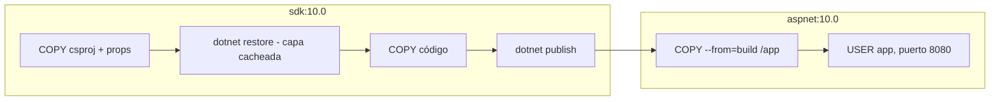

# Dockerfile para .NET

Parte de: [[03-CSharp-DotNet/05 ASP.NET Core/_Índice ASP.NET Core|ASP.NET Core]]

> [!info] Cómo avanzar
> `progreso`: **pendiente** → **viendo** (estudiando) → **visto** (contestaste la autoevaluación sin abrir las respuestas) → **dominado** (hiciste el laboratorio o lo aplicaste de verdad).

## Contenido

### Qué es
Un **Dockerfile** es la receta para construir una **imagen de contenedor** con tu API: qué sistema base usar, cómo compilar y qué copiar a la imagen final. Para .NET, Microsoft publica imágenes oficiales en `mcr.microsoft.com/dotnet/`: `sdk` (para compilar, grande) y `aspnet` (solo el runtime de ASP.NET Core, para ejecutar). La imagen resultante corre igual en tu PC con Docker Desktop, en Azure Container Apps, App Service para contenedores o Kubernetes.

### Cómo funciona
El patrón estándar es **multi-etapa**:
1. **Etapa `build`** sobre `sdk:10.0`: restaura, compila y publica.
2. **Etapa final** sobre `aspnet:10.0`: copia solo la salida de `publish`. La imagen final no lleva el SDK, el código fuente ni los paquetes intermedios: pesa mucho menos y expone menos superficie de ataque.

**Caché de capas.** Cada instrucción crea una capa, y Docker reutiliza las capas cuyo contenido no cambió. Si copias primero **solo los `.csproj`** (y `Directory.Packages.props`, `nuget.config`) y corres `dotnet restore`, esa capa solo se invalida cuando cambian las dependencias. Cuando cambias código (lo más frecuente), Docker reutiliza la capa del restore y no vuelve a descargar los paquetes: el build pasa de minutos a segundos.

**Puerto y usuario.** Desde .NET 8, las imágenes oficiales escuchan en el puerto **8080** (`ASPNETCORE_HTTP_PORTS=8080`), ya no en el 80, y traen un usuario **no root** llamado `app`, cuyo id está en la variable `APP_UID`. Correr como no root es buena práctica: si alguien compromete la app, no es root dentro del contenedor.



### Ejemplo
Dockerfile para Itzamna.Dionisio con Central Package Management:

```dockerfile
FROM mcr.microsoft.com/dotnet/sdk:10.0 AS build
WORKDIR /src

COPY Directory.Build.props Directory.Packages.props nuget.config ./
COPY src/Itzamna.Dionisio.API/Itzamna.Dionisio.API.csproj src/Itzamna.Dionisio.API/
RUN dotnet restore src/Itzamna.Dionisio.API/Itzamna.Dionisio.API.csproj

COPY . .
RUN dotnet publish src/Itzamna.Dionisio.API -c Release -o /app --no-restore

FROM mcr.microsoft.com/dotnet/aspnet:10.0 AS final
WORKDIR /app
COPY --from=build /app .
USER $APP_UID
EXPOSE 8080
ENTRYPOINT ["dotnet", "Itzamna.Dionisio.API.dll"]
```

Y un `.dockerignore` para no mandar basura al contexto de build (y no invalidar la caché):

```text
**/bin/
**/obj/
**/.vs/
**/node_modules/
**/*.user
.git/
```

Construir y correr, pasando la configuración por variables de entorno (nunca dentro de la imagen):

```powershell
docker build -t dionisio:dev .
docker run --rm -p 5080:8080 -e ConnectionStrings__Principal="Server=host.docker.internal;..." dionisio:dev
```

**Sin Dockerfile**: desde .NET 8 el SDK puede construir la imagen directamente con `dotnet publish -t:PublishContainer` (por ejemplo `dotnet publish src/Itzamna.Dionisio.API -t:PublishContainer -p:ContainerRepository=dionisio`). Elige la imagen base adecuada, usa el usuario no root y no requiere tener un Dockerfile. Es ideal para APIs estándar; el Dockerfile sigue siendo útil si necesitas instalar paquetes del sistema o pasos de build especiales.

### Cuándo usarlo y cuándo no
- **Sí** si despliegas a Azure Container Apps, Kubernetes o quieres el mismo entorno en local y en CI.
- **Sí** para levantar dependencias en desarrollo y pruebas (SQL Server, Redis, Testcontainers).
- **No es necesario** si publicas en IIS o App Service "clásico": basta `dotnet publish` ([[Publicación y despliegue de .NET]]).
- Considera imágenes *chiseled* (por ejemplo la variante `noble-chiseled`) si buscas imágenes mínimas sin shell; dificultan depurar dentro del contenedor.

### Errores comunes
- **`COPY . .` antes del restore**: cada cambio de código vuelve a descargar todos los paquetes.
- **Exponer el 80** por costumbre: la app escucha en 8080 y el contenedor "no responde".
- **Secretos en el Dockerfile** (`ENV ConnectionStrings__...`): quedan en las capas de la imagen para siempre.
- **Correr como root** sin necesidad.
- **No persistir llaves de [[Data Protection]]**: cada despliegue cierra las sesiones.

### Para profundizar
- [Contenerizar una app .NET (Microsoft Learn)](https://learn.microsoft.com/dotnet/core/docker/build-container)
- [Publicar como contenedor con el SDK (Microsoft Learn)](https://learn.microsoft.com/dotnet/core/containers/sdk-publish)
- [Imágenes oficiales de .NET (GitHub dotnet-docker)](https://github.com/dotnet/dotnet-docker)

## Autoevaluación

Contesta primero en voz alta o en papel; luego despliega la respuesta.

> [!question]- ¿Cómo es un Dockerfile multi-etapa típico?
> ```dockerfile
> FROM mcr.microsoft.com/dotnet/sdk:10.0 AS build
> WORKDIR /src
> COPY . .
> RUN dotnet publish src/Mi.Api -c Release -o /app
>
> FROM mcr.microsoft.com/dotnet/aspnet:10.0
> WORKDIR /app
> COPY --from=build /app .
> USER $APP_UID
> ENTRYPOINT ["dotnet", "Mi.Api.dll"]
> ```

> [!question]- ¿Por qué copiar primero los `.csproj` y hacer `dotnet restore` antes del resto?
> Para aprovechar la caché de capas: si solo cambia el código, no se vuelven a descargar los paquetes.

> [!question]- ¿En qué puerto escuchan las imágenes oficiales desde .NET 8?
> En el 8080 (`ASPNETCORE_HTTP_PORTS=8080`) y con un usuario no root disponible (`app`).

> [!question]- ¿Qué alternativa hay sin Dockerfile?
> `dotnet publish -t:PublishContainer`: el SDK construye la imagen directamente.

