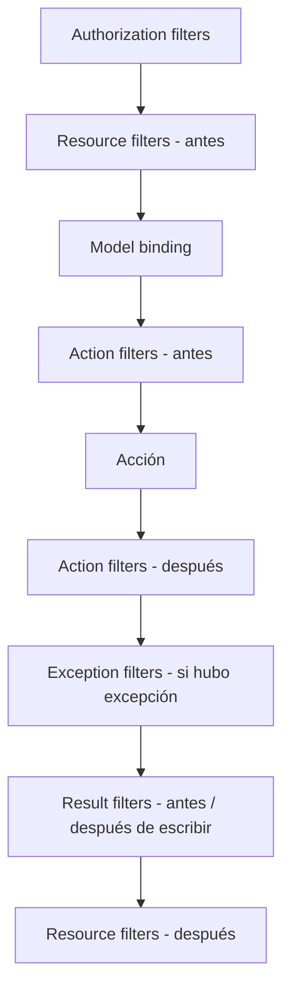

# Filtros

Parte de: [[03-CSharp-DotNet/05 ASP.NET Core/_Índice ASP.NET Core|ASP.NET Core]]

> [!info] Cómo avanzar
> `progreso`: **pendiente** → **viendo** (estudiando) → **visto** (contestaste la autoevaluación sin abrir las respuestas) → **dominado** (hiciste el laboratorio o lo aplicaste de verdad).

## Contenido

### Qué es
Los **filtros** de MVC son puntos de extensión que corren **alrededor de la ejecución de una acción** de controller, dentro del endpoint. A diferencia del middleware, conocen el contexto de MVC: qué acción se eligió, sus atributos, los argumentos ya vinculados y el resultado que va a regresar. Sirven para lógica transversal que depende de eso: autorización propia (`[RequiereSesion]` en Hermes), validación automática con FluentValidation, auditoría, traducción de excepciones o ajustes al resultado.

### Cómo funciona
Tipos de filtros, en el orden en que corren:



- **Authorization** (`IAuthorizationFilter`/`IAsyncAuthorizationFilter`): corren primero, **antes del binding**. Si cortan, nada más se ejecuta.
- **Resource** (`IResourceFilter`): envuelven casi todo, incluido el binding. Útiles para caché o para cortar muy temprano.
- **Action** (`IActionFilter`/`IAsyncActionFilter`): corren justo antes y después de la acción, con `context.ActionArguments` ya llenos. Aquí va la validación.
- **Exception** (`IExceptionFilter`): reciben excepciones no manejadas de la acción y filtros de acción. Para APIs, en tus proyectos se prefiere el [[Manejo global de errores (IExceptionHandler)]], que cubre también lo que ocurre fuera de MVC.
- **Result** (`IResultFilter`): envuelven la escritura del resultado; solo corren si la acción produjo uno.

Los filtros de acción y resultado **envuelven** lo que sigue: en la versión async llamas `await next()` y lo que escribes después corre al regreso. Un filtro **corta** asignando `context.Result` sin llamar a `next`.

Alcance y orden: un filtro puede ser **global** (`AddControllers(o => o.Filters.Add<X>())`), de **controller** o de **acción** (atributo). Por defecto el global envuelve al de controller y este al de acción; la propiedad `Order` lo ajusta.

**Dependencias de DI**: un atributo normal se instancia con `new`, sin DI. Opciones:
- `[ServiceFilter(typeof(X))]`: resuelve `X` del contenedor (debes registrarlo).
- `[TypeFilter(typeof(X))]`: lo crea con `ActivatorUtilities`, resolviendo sus parámetros del contenedor sin registrarlo.
- Global con `o.Filters.Add<X>()`: lo resuelve con DI.
- Dentro del filtro también puedes usar `context.HttpContext.RequestServices`.

### Ejemplo
`ValidacionFiltro` como el de Xolotl.Hecate: busca un `IValidator<T>` para cada argumento y corta con 400 si falla.

```csharp
using FluentValidation;
using Microsoft.AspNetCore.Mvc;
using Microsoft.AspNetCore.Mvc.Filters;

public sealed class ValidacionFiltro(IServiceProvider sp) : IAsyncActionFilter
{
    public async Task OnActionExecutionAsync(ActionExecutingContext ctx, ActionExecutionDelegate next)
    {
        foreach (var arg in ctx.ActionArguments.Values)
        {
            if (arg is null) continue;
            var tipo = typeof(IValidator<>).MakeGenericType(arg.GetType());
            if (sp.GetService(tipo) is not IValidator validador) continue;

            var resultado = await validador.ValidateAsync(new ValidationContext<object>(arg), ctx.HttpContext.RequestAborted);
            if (resultado.IsValid) continue;

            var errores = resultado.Errors
                .GroupBy(e => e.PropertyName)
                .ToDictionary(g => g.Key, g => g.Select(e => e.ErrorMessage).ToArray());
            var pd = new ValidationProblemDetails(errores) { Status = 400, Title = "Hay datos inválidos." };
            pd.Extensions["codigo"] = "validacion";
            ctx.Result = new BadRequestObjectResult(pd);   // corta: la acción no se ejecuta
            return;
        }
        await next();
    }
}

// Program.cs: global, con DI
builder.Services.AddControllers(o => o.Filters.Add<ValidacionFiltro>());
```

Detalles a notar: el filtro recibe `IServiceProvider` porque el tipo de validador se conoce hasta ejecución; usa `RequestAborted` como token de cancelación; y regresa la misma forma de [[ProblemDetails]] con `codigo` que el resto de la API. Así los controllers no tienen ni una línea de validación y cada slice solo declara su `AbstractValidator<Command>`.

### Cuándo usarlo y cuándo no
- **Filtro** cuando necesitas datos de MVC: argumentos vinculados, la acción, sus atributos o el `IActionResult`.
- **Middleware** cuando aplica a toda petición HTTP sin importar el endpoint (correlación, tiempos, headers): ver [[Middleware personalizado en ASP.NET Core]].
- Para autorización estándar, primero [[Autorización con policies]]; un `IAuthorizationFilter` propio solo si tu esquema es especial (como la sesión local de Hermes).
- Si usas Minimal APIs, el equivalente es `IEndpointFilter` ([[ASP.NET Core Minimal APIs]]).

### Errores comunes
- **Esperar DI en un atributo con `new`**: usa `ServiceFilter`/`TypeFilter` o regístralo global.
- **Filtro de excepción para todo**: no atrapa errores de middleware ni del binding; el handler global sí.
- **Olvidar `await next()`** en un filtro async: la acción nunca corre y regresa 200 vacío.
- **Llamar a `next()` y además asignar `Result`**: comportamiento confuso; o cortas o continúas.
- **Estado en campos de un filtro global**: es compartido entre peticiones.

### Para profundizar
- [Filtros en ASP.NET Core (Microsoft Learn)](https://learn.microsoft.com/aspnet/core/mvc/controllers/filters)
- [FluentValidation en ASP.NET Core](https://docs.fluentvalidation.net/en/latest/aspnet.html)
- [[FluentValidation]]

## Autoevaluación

Contesta primero en voz alta o en papel; luego despliega la respuesta.

> [!question]- ¿Qué tipos de filtros hay en MVC y en qué orden corren?
> Authorization → Resource → (binding) → Action → (acción) → Exception → Result. Los de acción y resultado envuelven lo que sigue.

> [!question]- ¿Qué hace un `ValidacionFiltro` como el de Hecate?
> Un `IAsyncActionFilter` que busca un `IValidator<T>` para cada argumento, lo ejecuta y, si falla, corta con un 400 ProblemDetails sin llamar a la acción.

> [!question]- ¿Filtro de MVC o middleware?
> Filtro cuando necesitas datos de MVC (argumentos vinculados, acción, atributos). Middleware para lo que aplica a toda petición HTTP sin importar el endpoint.

> [!question]- ¿Cómo un filtro recibe dependencias de DI?
> Con `[ServiceFilter(typeof(X))]` (registrado en DI), `[TypeFilter(typeof(X))]` o registrándolo global con `o.Filters.Add<X>()`.

## Práctica

- [[Lab 6 - API con controllers, FluentValidation, ProblemDetails y Options]]

