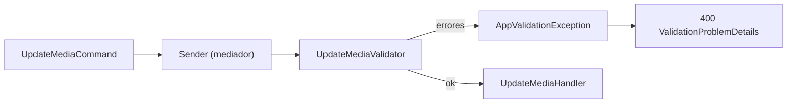

---
proyecto:
  - Itzamna.Dionisio
  - Pochteca.Nomisma
proyectos:
  - "[[Itzamna.Dionisio]]"
  - "[[Pochteca.Nomisma]]"
tipo: tecnologia
nivel: basico
estado: completo
tags:
  - conocimiento
  - backend
  - dotnet
  - validacion
progreso: pendiente
area: C# y .NET
contenido: completo
---
# FluentValidation

> Librería .NET para declarar reglas de validación con una API fluida (`RuleFor(x => x.Nombre).NotEmpty()`); [[Itzamna.Dionisio]] usa FluentValidation 12 y la ejecuta dentro de su mediador antes de cada handler.

## Qué es y qué problema resuelve
Las *DataAnnotations* (`[Required]`, `[MaxLength]`) viven pegadas al DTO y se quedan cortas para reglas condicionales o anidadas. FluentValidation separa las reglas en una clase `AbstractValidator<T>`, con mensajes propios, condiciones (`When`), colecciones (`RuleForEach`), reglas personalizadas (`Must`) y asíncronas (`MustAsync`). Resuelve validaciones dispersas por controllers y mensajes genéricos en inglés.

## Cómo funciona por dentro
- Un validador por tipo: `class XValidator : AbstractValidator<XCommand>`; en el constructor se declaran reglas.
- `ValidateAsync(obj)` devuelve `ValidationResult` con `Errors` (`PropertyName`, `ErrorMessage`).
- `PropertyName` de una propiedad anidada sale con puntos: `Request.DisplayName`.
- `AddValidatorsFromAssembly` (paquete `FluentValidation.DependencyInjectionExtensions`) registra todos los `IValidator<T>`.
- Quién llama a `ValidateAsync` lo decides tú: un filtro MVC, un *behavior* de MediatR o, aquí, el mediador propio.



## Cuándo usarla y cuándo no
### Ventajas
- Reglas legibles, testeables y separadas del DTO.
- Mensajes por regla (`WithMessage`), en el idioma del usuario.
- Condiciones y colecciones sin código imperativo.
### Desventajas
- Dependencia adicional; dos lugares para validar si también usas DataAnnotations.
- Validaciones que necesitan la base (unicidad) tientan a meter consultas en el validador.
- `PropertyName` anidado no coincide con el nombre del campo del front si no se normaliza.

## Alternativas
| Alternativa | En qué se diferencia |
|---|---|
| DataAnnotations + `[ApiController]` | Validación automática con 400; reglas simples en atributos. |
| Validación manual en el handler | Sin dependencia; lo que hace [[Ocelotl.Hermes]] con `Validar.cs`. |
| Validación en el dominio (constructores/guards) | Invariantes siempre válidas; complementa, no reemplaza, la validación de entrada. |

## Cómo se usó en Itzamna
- Paquetes `FluentValidation` 12.* y `FluentValidation.DependencyInjectionExtensions` 12.* en `Itzamna.Dionisio.Application`.
- Registro: `services.AddValidatorsFromAssembly(assembly, ServiceLifetime.Scoped, includeInternalTypes: true)` (`Application/DependencyInjection.cs`).
- Convención (`.ai/02_CONVENTIONS.md`): "validadores junto al comando" y mensajes "en español y pensados para el creador".
- Ejecución: el `RequestHandlerWrapper` del mediador corre todos los validadores del tipo, agrupa por propiedad en camelCase (`Request.DisplayName` → `request.displayName`) y lanza `AppValidationException`, que `AppExceptionHandler` convierte en `ValidationProblemDetails` 400 ([[CQRS y mediador]], [[ProblemDetails]]).

Ejemplo (`Itzamna.Dionisio/src/Itzamna.Dionisio.Application/Features/Collections/Socials.cs`):
```csharp
public sealed class SaveSocialProfileValidator : AbstractValidator<SaveSocialProfileCommand>
{
    public SaveSocialProfileValidator()
    {
        RuleFor(x => x.Request.Platform).Must(EnumText.IsValid<Platform>).WithMessage("Elige una plataforma.");
        RuleFor(x => x.Request.Username).NotEmpty().WithMessage("Escribe tu usuario.").MaximumLength(80);
        RuleFor(x => x.Request.Url).NotEmpty().Must(Guards.IsHttpUrl).WithMessage("Escribe la URL completa de tu perfil (https://…).");
        RuleFor(x => x.Request.CustomName).MaximumLength(40);
    }
}
```
Otros: `UpdateProfileValidator` (slug válido con `Slug.IsValid`, email con `.EmailAddress().When(...)`), `UpdateAboutValidator` (`RuleForEach(x => x.About.Highlights)`), `UpdateMediaValidator`.

Lo que **no** va en validadores: reglas que dependen de la base o de los bytes del archivo (tipo real por firma, peso, dimensiones, cuotas) se validan en el handler y lanzan `AppValidationException.For("file", ...)` (`Features/Media/MediaFeatures.cs`). Ninguna regla usa `MustAsync`.

Funcionalidades: [[Perfil del creador]], [[Módulos del portfolio]], [[Redes sociales y métricas]], [[Contenido y categorías]], [[Biblioteca de medios]].

> [!note] Pendiente de confirmar
> El nombre del campo en el error es la ruta del comando en camelCase (p. ej. `request.username` o `profile.username`). No revisé si el Studio quita ese prefijo al pintar el error junto al campo; lo documenta la parte front de cada funcionalidad.


## Cómo se usó en Pochteca.Nomisma
- FluentValidation 12 con `AddValidatorsFromAssembly` y un `ValidationBehavior<,>` de MediatR que lanza `ValidationException` ([[CQRS y mediador]]).
- `ManejadorErrores` la convierte en **400 `validacion`** con `errores` agrupados por campo ([[ProblemDetails]]).
- Reglas condicionales: `TokenTarjeta` obligatorio `.When(x => x.Metodo == MetodoPago.Tarjeta)`; nombre de 2+ caracteres para OXXO en Stripe.
- Validadores que leen configuración: la **allowlist** de URLs de onboarding de Stripe Connect se inyecta por `IConfiguration`.

```csharp
// Pochteca.Nomisma.Application/Features/StripeConnect/GenerarOnboardingLink/GenerarOnboardingLinkValidator.cs
RuleFor(x => x.ReturnUrl)
    .Must(url => returnAllowlist.Contains(url))
    .WithMessage("ReturnUrl no está en la allowlist configurada (ConnectOnboarding:AllowedReturnUrls).");
```

Este validador se agregó el 2026-11-09: antes, regenerar el link aceptaba cualquier URL.

## Errores comunes y buenas prácticas
- Mensajes técnicos ("'Username' must not be empty"): usar `WithMessage` en lenguaje del usuario.
- Olvidar `.When(...)` en opcionales: un email vacío no debe fallar `EmailAddress()`.
- Consultas pesadas dentro de validadores: mejor en el handler, donde ya está el contexto.
- Validadores `internal` que no se registran: Dionisio pasa `includeInternalTypes: true`.

## Qué estudiar después
- [[CQRS y mediador]], [[ProblemDetails]]
- Validadores hijos (`SetValidator`), `RuleSet`, `CascadeMode`.

## Documentación oficial
- https://docs.fluentvalidation.net/

## Autoevaluación

Contesta primero en voz alta o en papel; luego despliega la respuesta.

> [!question]- ¿Cómo se declara un validador?
> ```csharp
> public sealed class Validador : AbstractValidator<Crear.Command> {
>     public Validador() {
>         RuleFor(x => x.Codigo).NotEmpty().MaximumLength(20);
>         RuleFor(x => x.Monto).GreaterThan(0);
>     }
> }
> ```

> [!question]- ¿Por qué ya no se recomienda la autovalidación de `FluentValidation.AspNetCore`?
> Está descontinuada: no soporta reglas async y mezcla la validación con el binding de MVC. Lo recomendado es invocar el validador de forma explícita, como filtro o como paso del pipeline (tu enfoque).

> [!question]- ¿Cómo registras todos los validadores?
> `services.AddValidatorsFromAssemblyContaining<Validador>();` (paquete `FluentValidation.DependencyInjectionExtensions`).

> [!question]- ¿Cómo conviertes los errores en tu ProblemDetails?
> Con `ValidationResult.ToDictionary()` (propiedad → mensajes) en `errors` y `codigo: "validacion"` con status 400.

## Práctica

- [[Lab 6 - API con controllers, FluentValidation, ProblemDetails y Options]]

