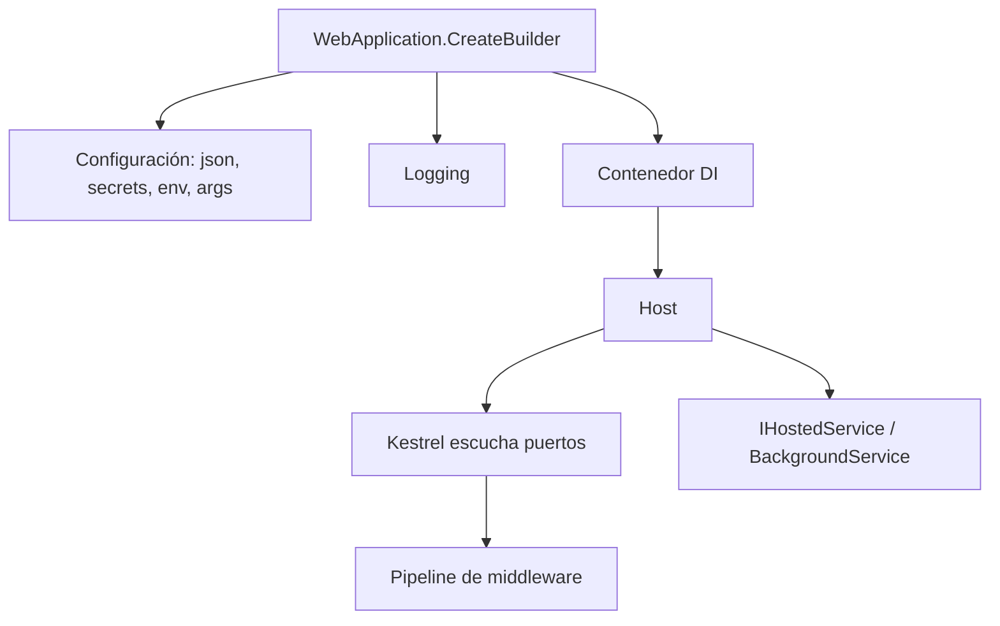

# Generic host y Kestrel

Parte de: [[03-CSharp-DotNet/05 ASP.NET Core/_Índice ASP.NET Core|ASP.NET Core]]

> [!info] Cómo avanzar
> `progreso`: **pendiente** → **viendo** (estudiando) → **visto** (contestaste la autoevaluación sin abrir las respuestas) → **dominado** (hiciste el laboratorio o lo aplicaste de verdad).

## Contenido

### Qué es
El **generic host** (`IHost`) es la infraestructura común de .NET para cualquier aplicación de larga vida: APIs, workers y servicios de Windows. Arma en un solo lugar la [[Inyección de dependencias]], la configuración ([[Configuración y appsettings]]), el logging ([[Logging con ILogger]]) y el ciclo de vida: arranca los `IHostedService` (como un [[BackgroundService]]) y coordina el apagado ordenado cuando llega Ctrl+C o una señal del sistema. `WebApplication.CreateBuilder(args)` usa este host por debajo y le agrega lo web.

**Kestrel** es el servidor HTTP multiplataforma que trae ASP.NET Core. Es el componente que abre el puerto, acepta conexiones TCP, entiende HTTP/1.1, HTTP/2 (y HTTP/3 con QUIC) y convierte cada petición en un `HttpContext` para el pipeline.

### Cómo funciona


Ciclo de vida del host:
1. `Build()` construye el contenedor y la configuración.
2. `Run()` arranca los hosted services, entre ellos el propio servidor web: Kestrel se inicia como un hosted service más.
3. Al recibir la señal de apagado, `IHostApplicationLifetime.ApplicationStopping` se dispara, Kestrel deja de aceptar conexiones y espera a las que están en curso; los `BackgroundService` reciben su `CancellationToken` cancelado. Hay un tiempo máximo de apagado configurable (`HostOptions.ShutdownTimeout`).

Kestrel puede ir **solo** (expuesto directamente, común en contenedores) o **detrás de un proxy inverso** como IIS, Nginx, Azure App Service o un balanceador, que se encarga de TLS, del puerto 443 público y de reinicios. Con IIS en modo *in-process*, la app corre dentro del proceso de IIS y no usa Kestrel para la conexión externa ([[Publicar en IIS (FTP y FileZilla)]]).

**Cómo elige el puerto** (de mayor a menor prioridad, resumido):
- Endpoints configurados en código (`builder.WebHost.ConfigureKestrel(...)`) o en la sección `Kestrel:Endpoints` de la configuración.
- `--urls` en la línea de comandos o la variable `ASPNETCORE_URLS` (`http://+:5080`).
- `ASPNETCORE_HTTP_PORTS` / `ASPNETCORE_HTTPS_PORTS` (desde .NET 8; solo números de puerto, escucha en todas las interfaces).
- `launchSettings.json` (solo en desarrollo, lo usan `dotnet run` y Visual Studio).
- Si no hay nada: `http://localhost:5000`.

Las imágenes oficiales de contenedor definen `ASPNETCORE_HTTP_PORTS=8080`.

### Ejemplo
Cambiar el puerto sin tocar código, de tres formas:

Con una variable de entorno en PowerShell, o con el argumento `--urls`:

```powershell
$env:ASPNETCORE_URLS = "http://localhost:5080"
dotnet run --project src/Itzamna.Dionisio.API

dotnet run --project src/Itzamna.Dionisio.API --urls "http://localhost:5081"
```

```json
// appsettings.Production.json
{
  "Kestrel": {
    "Endpoints": {
      "Http": { "Url": "http://0.0.0.0:8080" }
    },
    "Limits": { "MaxRequestBodySize": 52428800 }
  }
}
```

Y un hosted service que reacciona al apagado:

```csharp
builder.Services.AddHostedService<LimpiezaTemporales>();
builder.Services.Configure<HostOptions>(o => o.ShutdownTimeout = TimeSpan.FromSeconds(20));
```

### Cuándo usarlo y cuándo no
- Para una API, `WebApplication.CreateBuilder` siempre; no armes el host a mano.
- Para un proceso sin HTTP (un consumidor de colas, un job), usa `Host.CreateApplicationBuilder` con la plantilla *Worker Service*.
- Expón Kestrel directo solo en contenedores detrás de un ingress o balanceador; en un servidor Windows tradicional, IIS al frente.
- Configura límites de Kestrel (`Limits`) cuando subes archivos o recibes cuerpos grandes ([[Subida y descarga de archivos]]).

### Errores comunes
- **Puerto ocupado** (`address already in use`): otra instancia o IIS Express quedó corriendo.
- **Escuchar en `localhost` dentro de un contenedor**: nadie de fuera puede conectarse; usa `+`, `*` o `0.0.0.0`.
- **Confiar en `launchSettings.json` en producción**: no se usa al publicar.
- **Ignorar el apagado**: trabajo en segundo plano que no respeta el `CancellationToken` se corta a la mitad.
- **Detrás de proxy sin `UseForwardedHeaders`**: la app cree que la petición fue HTTP y genera URLs o redirecciones incorrectas.

### Para profundizar
- [Generic host de .NET en ASP.NET Core (Microsoft Learn)](https://learn.microsoft.com/aspnet/core/fundamentals/host/generic-host)
- [Servidor web Kestrel (Microsoft Learn)](https://learn.microsoft.com/aspnet/core/fundamentals/servers/kestrel)
- [Configurar endpoints de Kestrel (Microsoft Learn)](https://learn.microsoft.com/aspnet/core/fundamentals/servers/kestrel/endpoints)

## Autoevaluación

Contesta primero en voz alta o en papel; luego despliega la respuesta.

> [!question]- ¿Qué es el *generic host*?
> La infraestructura común de .NET que arma DI, configuración, logging y el ciclo de vida (`IHostedService`, apagado ordenado). `WebApplication.CreateBuilder` lo usa por debajo.

> [!question]- ¿Qué es Kestrel?
> El servidor HTTP multiplataforma que trae ASP.NET Core. Puede ir solo o detrás de un proxy inverso (IIS, Nginx, un balanceador).

> [!question]- ¿Cómo cambias el puerto sin tocar código?
> Con `ASPNETCORE_URLS=http://+:5080`, `ASPNETCORE_HTTP_PORTS=8080` o la sección `Kestrel:Endpoints` en `appsettings.json`.

