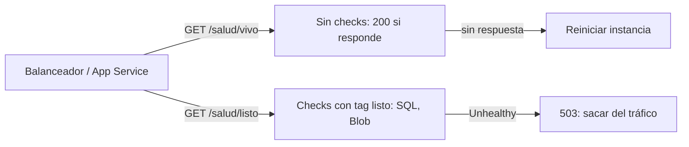

# Health checks

Parte de: [[03-CSharp-DotNet/05 ASP.NET Core/_Índice ASP.NET Core|ASP.NET Core]]

> [!info] Cómo avanzar
> `progreso`: **pendiente** → **viendo** (estudiando) → **visto** (contestaste la autoevaluación sin abrir las respuestas) → **dominado** (hiciste el laboratorio o lo aplicaste de verdad).

## Contenido

### Qué es
Los **health checks** son endpoints que reportan si la aplicación está sana: `Healthy`, `Degraded` o `Unhealthy`. Los consumen los balanceadores de carga, Azure App Service (Health check), Kubernetes, Docker, monitores de disponibilidad o simplemente tu equipo, para saber si una instancia puede recibir tráfico. ASP.NET Core trae el middleware y la infraestructura; tú defines qué revisar.

### Cómo funciona
1. Registras checks con `AddHealthChecks().AddCheck<T>("nombre", tags: [...])`. Cada check implementa `IHealthCheck` y regresa un `HealthCheckResult`.
2. Expones uno o más endpoints con `MapHealthChecks("/ruta", opciones)`.
3. Al llamar el endpoint, se ejecutan los checks seleccionados y se agrega el resultado: el peor estado gana.
4. Códigos HTTP por defecto: **200** para `Healthy` y `Degraded`, **503** para `Unhealthy`.

**Liveness vs. readiness**, dos preguntas distintas:
- **Liveness** ("¿el proceso está vivo?"): si falla, el orquestador **reinicia** la instancia. Debe ser trivial: que la app responda. No debe depender de la BD; si SQL se cae, reiniciar la API no arregla nada y solo genera un ciclo de reinicios.
- **Readiness** ("¿puede atender ahora?"): incluye dependencias críticas (BD, almacenamiento). Si falla, el balanceador **saca** la instancia del tráfico sin reiniciarla y la regresa cuando vuelve a estar lista.

Se separan con **tags** y el `Predicate` de `HealthCheckOptions`.



### Ejemplo
Check de SQL Server ligero, con timeout corto:

```csharp
public sealed class SqlCheck(IOptions<ConexionOpciones> op) : IHealthCheck
{
    public async Task<HealthCheckResult> CheckHealthAsync(HealthCheckContext ctx, CancellationToken ct = default)
    {
        try
        {
            await using var cn = new SqlConnection(op.Value.Principal);
            await cn.OpenAsync(ct);
            await using var cmd = new SqlCommand("SELECT 1", cn) { CommandTimeout = 3 };
            await cmd.ExecuteScalarAsync(ct);
            return HealthCheckResult.Healthy();
        }
        catch (Exception ex)
        {
            return HealthCheckResult.Unhealthy("SQL Server no responde", ex);   // sin cadena de conexión en el mensaje
        }
    }
}
```

Registro y endpoints:

```csharp
builder.Services.AddHealthChecks()
    .AddCheck<SqlCheck>("sql", tags: ["listo"], timeout: TimeSpan.FromSeconds(5));

var app = builder.Build();

app.MapHealthChecks("/salud/vivo", new HealthCheckOptions { Predicate = _ => false }); // ningún check: solo "respondo"
app.MapHealthChecks("/salud/listo", new HealthCheckOptions { Predicate = r => r.Tags.Contains("listo") })
   .AllowAnonymous();          // si tienes FallbackPolicy
```

Existe la colección comunitaria `AspNetCore.HealthChecks.*` (SQL Server, Redis, Azure Blob, URIs) si prefieres no escribirlos. Para que el endpoint no aparezca en OpenAPI y no lo bloquee tu `FallbackPolicy`, márcalo como anónimo y, si lo expones a internet, limita qué información devuelve: por defecto solo regresa el texto del estado, sin detalles.

En Azure App Service, configura la ruta `/salud/listo` en la opción *Health check* de la app: la plataforma deja de mandar tráfico a una instancia que falla de forma repetida y, si sigue mal, la reemplaza. En Docker puedes usar la instrucción `HEALTHCHECK` con `curl` hacia `/salud/vivo` (si la imagen trae curl). En Lab 7 practicas ambos endpoints con un cliente HTTP tipado.

### Cuándo usarlo y cuándo no
- **Siempre** que haya balanceador, App Service con varias instancias, contenedores o un monitor de disponibilidad.
- **Readiness** con las dependencias sin las que la API no sirve; las opcionales pueden reportar `Degraded`.
- **No** uses health checks como monitoreo de negocio ("¿hay ventas hoy?"): eso es métrica o alerta.
- **No** expongas detalles internos (versiones, nombres de servidor) en un endpoint público.

### Errores comunes
- **Consulta pesada cada pocos segundos**: si un check hace un `SELECT COUNT(*)` sobre una tabla grande y el balanceador lo llama cada 5 s por cada instancia, generas carga constante en la BD **solo por monitorear**, y el check puede fallar por lento justo cuando hay carga. Usa `SELECT 1` con timeout corto, o cachea el resultado.
- **Liveness que depende de la BD**: reinicios en cascada cuando SQL tiene un problema.
- **Sin timeout**: un check colgado deja el endpoint colgado.
- **Health check protegido por la FallbackPolicy**: el balanceador recibe 401 y marca todo como caído.

### Para profundizar
- [Health checks en ASP.NET Core (Microsoft Learn)](https://learn.microsoft.com/aspnet/core/host-and-deploy/health-checks)
- [Health check de Azure App Service (Microsoft Learn)](https://learn.microsoft.com/azure/app-service/monitor-instances-health-check)
- [AspNetCore.Diagnostics.HealthChecks (GitHub)](https://github.com/Xabaril/AspNetCore.Diagnostics.HealthChecks)

## Autoevaluación

Contesta primero en voz alta o en papel; luego despliega la respuesta.

> [!question]- ¿Cómo se agregan?
> `builder.Services.AddHealthChecks().AddCheck<SqlCheck>("sql");` y `app.MapHealthChecks("/salud");`.

> [!question]- ¿Qué diferencia hay entre *liveness* y *readiness*?
> Liveness: ¿el proceso vive? (si falla, reiniciar). Readiness: ¿puede atender? (BD accesible); si falla, sacar del balanceador sin reiniciar. Se separan con tags y `Predicate`.

> [!question]- Error común: un health check que hace una consulta pesada cada 5 s. ¿Qué problema causa?
> Carga a la BD solo por monitoreo. Usa `SELECT 1` con timeout corto.

## Práctica

- [[Lab 7 - Cliente HTTP tipado con resiliencia y health checks]]

