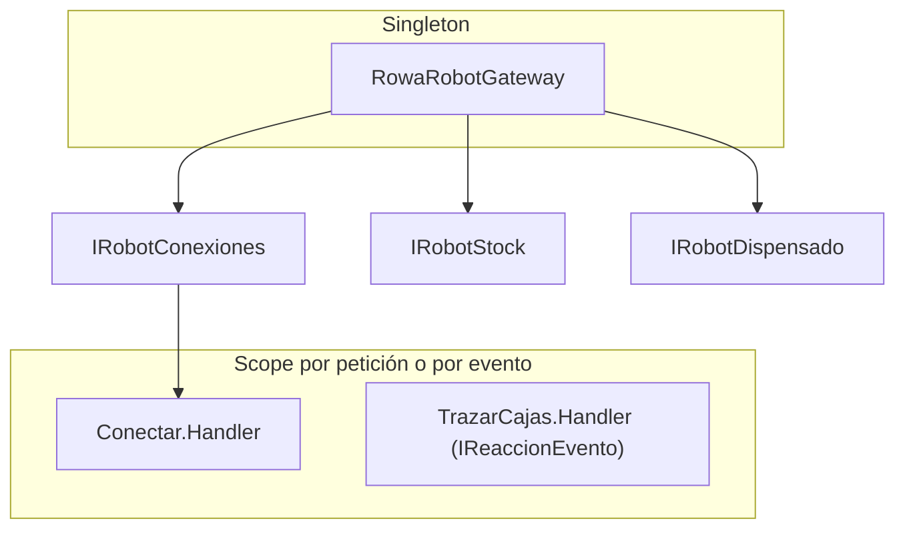

---
proyecto:
  - Ocelotl.Hermes
  - Itzamna.Dionisio
proyectos:
  - "[[Ocelotl.Hermes]]"
  - "[[Itzamna.Dionisio]]"
tipo: patron
nivel: intermedio
estado: completo
tags:
  - conocimiento
  - backend
  - dotnet
  - di
progreso: pendiente
area: C# y .NET
---
# Inyección de dependencias

> Las clases reciben lo que necesitan (puertos, repositorios, opciones) por constructor y un contenedor decide qué implementación entregar; en [[Ocelotl.Hermes]] es lo que une slices, adaptadores y endpoints.

## Qué es y qué problema resuelve
En vez de que una clase haga `new SQLiteConnection(...)` o `new ArgoClient(...)`, declara una dependencia en su constructor (`Handler(IArgoClient argo)`). Un **contenedor** (`IServiceCollection` / `IServiceProvider` de `Microsoft.Extensions.DependencyInjection`) sabe qué clase concreta crear y con qué **tiempo de vida**.

Resuelve: acoplamiento a implementaciones concretas, dificultad para probar (no puedes cambiar Argo real por un fake) y gestión manual del ciclo de vida de objetos.

## Cómo funciona por dentro
- **Registro** (`services.AddX`) en el arranque; **resolución** al crear objetos (`GetRequiredService<T>`, parámetros de endpoints, constructores).
- **Tiempos de vida**:
  - `Singleton`: una instancia para toda la app.
  - `Scoped`: una por scope (en ASP.NET Core, una por petición HTTP; fuera de HTTP hay que crear el scope a mano).
  - `Transient`: una nueva cada vez.
- **Fábricas**: `AddSingleton<IFoo>(sp => sp.GetRequiredService<Foo>())` reenvía una interfaz a una instancia ya registrada.
- **Varias implementaciones de una interfaz**: `GetServices<T>()` devuelve todas.
- **Regla de captura**: un singleton no debe depender de un scoped (lo "capturaría" para siempre).



## Cuándo usarla y cuándo no
### Ventajas
- Cambiar implementaciones sin tocar a quien las usa (Argo real ↔ simulado, local ↔ [[Hecate]]).
- Pruebas con fakes por constructor (ver [[xUnit]]).
- El contenedor maneja creación y `Dispose`.
### Desventajas
- Errores de registro aparecen en ejecución (una dependencia sin registrar).
- Registro por reflexión: menos explícito, hay que conocer la convención.
- Lifetimes mal elegidos causan bugs sutiles (captura de scoped, estado compartido).

## Alternativas
| Alternativa | En qué se diferencia |
|---|---|
| `new` manual / composición en `Main` | Sin contenedor; explícito pero repetitivo. |
| Service Locator | Las clases piden servicios al contenedor; oculta dependencias (antipatrón). |
| Autofac / Lamar / Scrutor | Contenedores o extensiones con escaneo de ensamblados, decoradores, módulos. |
| MediatR | Resuelve handlers por tipo de mensaje; Hermes lo evita a propósito ("sin MediatR"). |

## Cómo se usó en Ocelotl
En [[Ocelotl.Hermes]] hay dos puntos de registro llamados desde `Program.cs`: `AddApplication()` y `AddInfrastructure(configuracion)`. `IIrisNotifier` lo registra la API porque depende del Hub de [[SignalR]].

**1. Registro automático de `Handler` por reflexión** — toda clase anidada llamada `Handler` se registra como scoped; si además implementa `IReaccionEvento`, se expone también por esa interfaz (`Ocelotl.Hermes/src/Ocelotl.Hermes.Application/DependencyInjection.cs`):
```csharp
foreach (var handler in Handlers())
{
    services.AddScoped(handler);

    // Las reacciones a eventos del robot (IReaccionEvento) también se exponen por su interfaz:
    // el repartidor de eventos las pide todas sin conocerlas.
    if (typeof(Abstractions.IReaccionEvento).IsAssignableFrom(handler))
        services.AddScoped(typeof(Abstractions.IReaccionEvento), sp => sp.GetRequiredService(handler));
}
```
`Handlers()` filtra `t is { Name: "Handler", IsClass: true, IsAbstract: false, IsNested: true }`. Las acciones de los [[ASP.NET Core Controllers]] reciben el `Handler` como parámetro `[FromServices]` (scope de la petición). Hoy implementan `IReaccionEvento` `TrazarCajas.Handler` y `TrazarEgresos.Handler` (prueba en `EgresosTests.cs`).

**2. Una instancia detrás de tres interfaces del robot** — `RowaRobotGateway` es singleton y se reenvía a `IRobotConexiones`, `IRobotStock` e `IRobotDispensado` para que compartan el pool de conexiones (`Ocelotl.Hermes/src/Ocelotl.Hermes.Infrastructure/DependencyInjection.cs`):
```csharp
// Una sola instancia del gateway detrás de los tres puertos (comparten el pool de conexiones).
services.AddSingleton<RowaRobotGateway>();
services.AddSingleton<IRobotConexiones>(sp => sp.GetRequiredService<RowaRobotGateway>());
services.AddSingleton<IRobotStock>(sp => sp.GetRequiredService<RowaRobotGateway>());
services.AddSingleton<IRobotDispensado>(sp => sp.GetRequiredService<RowaRobotGateway>());
```
El mismo truco se usa con `ChannelEventPublisher` → `IEventPublisher`, `LocalIdentityProvider` → `IIdentityProvider` y `ArgoSimulado` → `IArgoClient`.

**3. Implementación elegida por configuración** — si `Argo:Simulado:Habilitado` es `true`, se registra `ArgoSimulado`; si no, `AddHttpClient<IArgoClient, ArgoClient>` (typed HttpClient). Ver [[Sincronización con Argo]].

**4. Scopes fuera de HTTP** — los singletons que necesitan handlers scoped crean su propio scope: `EventDispatcher` uno **por evento** (para todas las `IReaccionEvento`) y `RowaInputHandler` uno por solicitud de ingreso para resolver `ResolverPackEntrante.Handler` ([[Ingresos]]). Ver [[BackgroundService]].

Persistencia, identidad, eventos y robot son singletons; los handlers de slices, scoped. Ver [[Arquitectura hexagonal]] y [[Ocelotl.Hermes - Arquitectura]].

> [!tip] Reutilizable
> El registro por convención (`Name == "Handler" && IsNested`) más la prueba que compara `Handlers().Count()` con lo registrado (`SlicesTests.cs`) permite vertical slices sin MediatR en cualquier proyecto .NET.


## Cómo se usó en Itzamna
En [[Itzamna.Dionisio]] la composición sigue el mismo molde que Hermes: `builder.Services.AddApplication()` + `builder.Services.AddInfrastructure(configuration)` y el resto en `Program.cs`.

| Servicio | Lifetime | Dónde | Nota |
|---|---|---|---|
| `ISender` (mediador) | scoped | `Application/DependencyInjection.cs` | [[CQRS y mediador]] |
| Cada `IRequestHandler<,>` | scoped | idem, por reflexión | todas las clases que implementan la interfaz |
| Validadores `IValidator<T>` | scoped | `AddValidatorsFromAssembly` | [[FluentValidation]] |
| `TenantContext` / `ITenantContext` | scoped | idem | misma instancia por las dos llaves |
| `IPortfolioSnapshotBuilder` | scoped | idem | [[Snapshot inmutable versionado]] |
| `AppDbContext` / `IAppDbContext` | scoped | `Infrastructure/DependencyInjection.cs` | `AddDbContext` + reenvío a la interfaz |
| `IFileStorageService` | singleton | idem | Local o Azure según `Storage:Provider` ([[Azure Blob Storage]]) |
| `IImageProcessor` | singleton | idem | [[ImageSharp]] |
| `ICurrentUser` (`HttpCurrentUser`) | scoped | `Program.cs` | usa `IHttpContextAccessor` |
| `IPublicCacheInvalidator` | scoped | `Program.cs` | adaptador en la API ([[Output caching]]) |
| `LocalTokenService` | singleton | `Program.cs` | tokens locales |

**Reenvío de una implementación a varias llaves** (una sola instancia por petición) (`Itzamna.Dionisio/src/Itzamna.Dionisio.Application/DependencyInjection.cs` e `Infrastructure/DependencyInjection.cs`):
```csharp
services.AddScoped<TenantContext>();
services.AddScoped<ITenantContext>(sp => sp.GetRequiredService<TenantContext>());
// Infrastructure
services.AddScoped<IAppDbContext>(sp => sp.GetRequiredService<AppDbContext>());
```

**Registro por reflexión de handlers genéricos** (a diferencia de Hermes, por interfaz y no por nombre de clase):
```csharp
var handlerInterface = typeof(IRequestHandler<,>);
foreach (var type in assembly.GetTypes().Where(t => t is { IsClass: true, IsAbstract: false }))
{
    foreach (var contract in type.GetInterfaces().Where(i => i.IsGenericType && i.GetGenericTypeDefinition() == handlerInterface))
    {
        services.AddScoped(contract, type);
    }
}
```

**Inyección en middleware por método**: `TenantResolutionMiddleware` recibe `RequestDelegate` en el constructor (el middleware vive todo el proceso) y los servicios scoped (`ICurrentUser`, `ITenantContext`, `AppDbContext`) como parámetros de `InvokeAsync`, que es la forma correcta de usar scoped en un middleware ([[Multi-tenancy]]).

**Elección de implementación por configuración**: `Storage:Provider = AzureBlob` registra `AzureBlobFileStorageService`; cualquier otro valor, `LocalFileStorageService`.

**Scopes fuera de una petición**: `DatabaseInitializer` crea un `CreateScope()` para migrar y sembrar; dentro, `JatzSeeder` fija el tenant a mano (`tenant.Set(creator.Id, portfolio.Id)`) y reutiliza los comandos del mediador (`UploadMediaCommand`, `PublishPortfolioCommand`), así el demo pasa por las mismas reglas que un creador real.

> [!note] Pendiente de confirmar
> Dionisio no tiene una prueba que vigile el registro por reflexión (Hermes sí: `SlicesTests.cs`). Un handler sin registrar fallaría solo en ejecución.

## Errores comunes y buenas prácticas
- Registrar la misma clase dos veces (`AddSingleton<IFoo, Foo>()` y `AddSingleton<IBar, Foo>()`) crea **dos instancias**; para compartir una, registrar la concreta y reenviar con fábrica.
- Inyectar un scoped en un singleton: crear scope con `IServiceScopeFactory`.
- Resolver servicios dentro de un bucle de fondo sin `try/catch`: una dependencia faltante tumbaría el `BackgroundService` (Hermes lo atrapa).
- Usar reflexión sin prueba que la vigile: Hermes tiene `Registra_todos_los_handlers_de_los_slices`.
- No poner lógica en los registros; dejar ahí solo la composición.

## Qué estudiar después
- [[Options pattern]], [[BackgroundService]], [[Repository]]
- [[Arquitectura hexagonal]], [[Clean Architecture]], [[Vertical Slice Architecture]]
- `ValidateScopes` / `ValidateOnBuild` del contenedor; `IHttpClientFactory`.

## Documentación oficial

- https://learn.microsoft.com/dotnet/core/extensions/dependency-injection
- https://learn.microsoft.com/aspnet/core/fundamentals/dependency-injection

## Autoevaluación

Contesta primero en voz alta o en papel; luego despliega la respuesta.

> [!question]- ¿Qué problema resuelve la DI?
> Las clases reciben sus dependencias por constructor en lugar de crearlas; el contenedor arma el grafo. Así puedes cambiar implementaciones y probar con fakes.

> [!question]- ¿Qué pasa si un servicio pide una dependencia no registrada?
> Al resolverlo lanza `InvalidOperationException` ("Unable to resolve service"). Con `ValidateOnBuild` (activo en Development) se detecta al arrancar.

> [!question]- ¿Por qué evitar el *service locator* (`provider.GetService<T>()` en tu código)?
> Oculta las dependencias, falla en tiempo de ejecución y complica las pruebas. Úsalo solo en puntos de composición (fábricas, `BackgroundService` creando scopes).

> [!question]- ¿Qué diferencia hay entre `Add` y `TryAdd`?
> `Add` siempre agrega (el último gana al resolver uno). `TryAdd` solo si no hay registro, útil en bibliotecas para permitir que la app lo reemplace.

## Práctica

- [[Lab 6 - API con controllers, FluentValidation, ProblemDetails y Options]]

