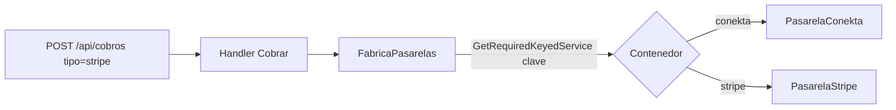

# Keyed services

Parte de: [[03-CSharp-DotNet/05 ASP.NET Core/_Índice ASP.NET Core|ASP.NET Core]]

> [!info] Cómo avanzar
> `progreso`: **pendiente** → **viendo** (estudiando) → **visto** (contestaste la autoevaluación sin abrir las respuestas) → **dominado** (hiciste el laboratorio o lo aplicaste de verdad).

## Contenido

### Qué es
Los **keyed services** (servicios con clave), disponibles desde .NET 8, permiten registrar **varias implementaciones de la misma interfaz** en el contenedor de [[Inyección de dependencias]], cada una identificada por una clave (un `string`, un enum o cualquier objeto), y pedir una en concreto por esa clave. Antes había que escribir una fábrica a mano o recibir todas con `IEnumerable<T>` y filtrar.

Caso típico: varias pasarelas de pago, varios proveedores de almacenamiento (disco local o Azure Blob) o varios generadores de reporte (Excel o PDF).

### Cómo funciona
Registro con clave:

```csharp
builder.Services.AddKeyedScoped<IPasarela, PasarelaConekta>("conekta");
builder.Services.AddKeyedScoped<IPasarela, PasarelaStripe>("stripe");
builder.Services.AddKeyedSingleton<IAlmacen, AlmacenBlob>(TipoAlmacen.Azure);
builder.Services.AddKeyedSingleton<IAlmacen, AlmacenDisco>(TipoAlmacen.Local);
```

Tres formas de resolver:
1. **Clave fija en un parámetro** con `[FromKeyedServices("clave")]`, en constructores, en acciones de controller o en Minimal APIs.
2. **Clave elegida en ejecución** con `sp.GetRequiredKeyedService<IPasarela>(clave)` (o `GetKeyedService`, que regresa `null` si no existe).
3. **Con `KeyedService.AnyKey`** puedes registrar una implementación de respaldo para cualquier clave.



Los ciclos de vida siguen las mismas reglas de [[Ciclos de vida (Singleton, Scoped, Transient)]]: `AddKeyedSingleton`, `AddKeyedScoped` y `AddKeyedTransient`. Un servicio con clave **no** se resuelve con la inyección normal sin clave: si pides `IPasarela` sin atributo, el contenedor solo busca registros sin clave.

### Ejemplo
Clave fija en el constructor (por ejemplo, un servicio que siempre exporta a Excel):

```csharp
public sealed class ExportarCorte([FromKeyedServices("excel")] IGeneradorReporte generador)
{
    public Task<Stream> Ejecutar(Corte c, CancellationToken ct) => generador.Generar(c, ct);
}
```

Clave en ejecución, elegida por el tipo de pago que manda el cliente o por configuración:

```csharp
public sealed class FabricaPasarelas(IServiceProvider sp)
{
    public IPasarela Obtener(string clave) =>
        sp.GetKeyedService<IPasarela>(clave)
        ?? throw new ArgumentOutOfRangeException(nameof(clave), $"Pasarela '{clave}' no registrada");
}

public sealed class Cobrar
{
    public sealed record Command(string Pasarela, decimal Monto, string Referencia);

    public sealed class Handler(FabricaPasarelas fabrica)
    {
        public Task<ResultadoCobro> Handle(Command c, CancellationToken ct) =>
            fabrica.Obtener(c.Pasarela).CobrarAsync(c.Monto, c.Referencia, ct);
    }
}

builder.Services.AddScoped<FabricaPasarelas>();
builder.Services.AddScoped<Cobrar.Handler>();
```

En una acción de controller también puedes pedirlo directo:

```csharp
[HttpPost("reportes/excel")]
public Task<IActionResult> Excel([FromKeyedServices("excel")] IGeneradorReporte g, CancellationToken ct) => /* ... */ default!;
```

Fíjate en que la fábrica recibe `IServiceProvider` del scope de la petición (porque ella misma es Scoped), así que las pasarelas Scoped se resuelven bien. Si la fábrica fuera singleton tendrías una [[Captive dependency]]. Valida la clave que manda el cliente con FluentValidation antes de llegar a la fábrica, para responder 400 en vez de 500.

Otro uso común es el de configuraciones distintas del mismo tipo: dos `HttpClient` tipados o dos clientes de Azure Blob apuntando a cuentas diferentes. Desde .NET 9, `AddHttpClient(...).AddAsKeyed()` registra el cliente con nombre también como keyed service, así puedes inyectarlo con `[FromKeyedServices("pasarela")] HttpClient http` ([[HttpClient e IHttpClientFactory]]).

Para probarlo, en una prueba de integración puedes reemplazar solo una clave (`services.AddKeyedScoped<IPasarela, PasarelaFalsa>("stripe")` después del registro real) sin tocar las demás.

### Cuándo usarlo y cuándo no
- **Keyed services** cuando eliges **una** implementación por nombre o por configuración (tipo de pago, proveedor de almacenamiento, formato de reporte).
- **`IEnumerable<IPasarela>`** cuando necesitas **todas** (por ejemplo, ejecutar varios validadores o notificar a varios canales) o cuando cada implementación decide si aplica (`SoportaTipo(tipo)`). Es el patrón [[Patrón Strategy]] clásico.
- **Interfaces distintas** (`IPasarelaConekta`, `IPasarelaStripe`) si los consumidores siempre saben cuál quieren y las firmas difieren.
- **No** los uses para esconder un `switch` que sería más claro en código.

### Errores comunes
- **Pedir la interfaz sin `[FromKeyedServices]`** y esperar la versión con clave: no la encuentra.
- **Claves "mágicas" repetidas** en varios archivos: usa constantes o un enum.
- **Resolver desde el proveedor raíz** en un singleton: captura Scoped.
- **No validar la clave** que llega del cliente: excepción y 500.

### Para profundizar
- [Keyed services en .NET (Microsoft Learn)](https://learn.microsoft.com/dotnet/core/extensions/dependency-injection#keyed-services)
- [Keyed services en ASP.NET Core (Microsoft Learn)](https://learn.microsoft.com/aspnet/core/fundamentals/dependency-injection#keyed-services)
- [[Inyección de dependencias]]

## Autoevaluación

Contesta primero en voz alta o en papel; luego despliega la respuesta.

> [!question]- ¿Qué son los keyed services (.NET 8)?
> Registrar varias implementaciones de la misma interfaz con una clave: `AddKeyedScoped<IPasarela, PasarelaA>("a")` y resolver con `[FromKeyedServices("a")] IPasarela p`.

> [!question]- ¿Cuándo usarlos en vez de un `IEnumerable<IPasarela>`?
> Cuando eliges una implementación concreta por nombre (configuración o tipo de pago) en lugar de recorrer todas.

> [!question]- ¿Cómo resuelves por clave en tiempo de ejecución?
> `sp.GetRequiredKeyedService<IPasarela>(clave)` desde una fábrica.

