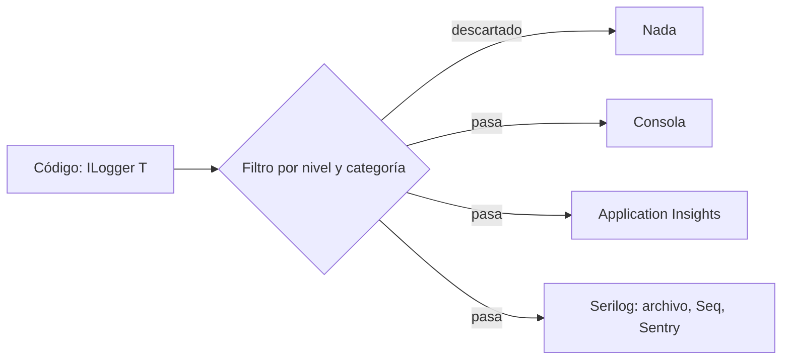

# Logging con ILogger

Parte de: [[03-CSharp-DotNet/05 ASP.NET Core/_Índice ASP.NET Core|ASP.NET Core]]

> [!info] Cómo avanzar
> `progreso`: **pendiente** → **viendo** (estudiando) → **visto** (contestaste la autoevaluación sin abrir las respuestas) → **dominado** (hiciste el laboratorio o lo aplicaste de verdad).

## Contenido

### Qué es
`ILogger<T>` es la abstracción estándar de .NET para registrar eventos de la aplicación. Tu código escribe contra `ILogger<T>` y la configuración decide a dónde van los mensajes (*providers*: consola, debug, EventLog, Application Insights o, con [[Serilog]], archivos, Seq y Sentry). El parámetro `T` define la **categoría** (el nombre completo de la clase), que sirve para filtrar por namespace.

### Cómo funciona
**Niveles**, de menor a mayor severidad: `Trace`, `Debug`, `Information`, `Warning`, `Error`, `Critical` (y `None` para apagar). Se configura el mínimo por categoría en `Logging:LogLevel`:

```json
"Logging": {
  "LogLevel": {
    "Default": "Information",
    "Microsoft.AspNetCore": "Warning",
    "Itzamna.Dionisio": "Debug"
  }
}
```

Gana la categoría más específica. Un mensaje por debajo del mínimo se descarta antes de procesarse.

**Logging estructurado con plantillas.** El mensaje es una *plantilla* con marcadores con nombre:

```csharp
log.LogInformation("Egreso {EgresoId} creado en caja {CajaId}", egreso.Id, caja.Id);
```

El provider guarda el texto final **y** cada valor como propiedad (`EgresoId = 42`). En Seq, Application Insights o Sentry puedes filtrar "todos los logs de `EgresoId = 42`". Con interpolación (`$"Egreso {id} creado"`) solo queda un string: pierdes las propiedades, cada mensaje es distinto (no se agrupan) y el string se arma **aunque el nivel esté apagado**. Los nombres de marcadores van en PascalCase y deben ser consistentes en toda la app.

**Scopes.** `log.BeginScope(...)` agrega propiedades a todos los logs dentro del bloque (por ejemplo, el usuario o la correlación). ASP.NET Core ya agrega `TraceId`, `SpanId` y `RequestPath` cuando el provider soporta scopes.

**`[LoggerMessage]`.** Un *source generator* que crea en compilación métodos de log fuertemente tipados y de alto rendimiento: no hay boxing de valores ni parseo de la plantilla en cada llamada, y revisa al compilar que los parámetros coincidan con la plantilla.



### Ejemplo
Handler con log estructurado y métodos generados:

```csharp
public sealed partial class RegistrarEgreso
{
    public sealed class Handler(SesionSql sesion, ILogger<Handler> log)
    {
        public async Task<long> Handle(Command c, CancellationToken ct)
        {
            var id = await Insertar(c, ct);
            Log.EgresoCreado(log, id, c.CajaId, c.Monto);
            return id;
        }

        private Task<long> Insertar(Command c, CancellationToken ct) => Task.FromResult(1L); // ejemplo
    }

    private static partial class Log
    {
        [LoggerMessage(EventId = 2001, Level = LogLevel.Information,
            Message = "Egreso {EgresoId} creado en caja {CajaId} por {Monto}")]
        public static partial void EgresoCreado(ILogger logger, long egresoId, long cajaId, decimal monto);

        [LoggerMessage(EventId = 2002, Level = LogLevel.Warning,
            Message = "Reintento {Intento} al consultar la caja {CajaId}")]
        public static partial void Reintento(ILogger logger, int intento, long cajaId);
    }
}
```

Para excepciones, pásala como **primer argumento**: `log.LogError(ex, "Falló el cierre de la caja {CajaId}", id);`. Así se guarda la pila completa como dato, no como texto en el mensaje.

### Cuándo usarlo y cuándo no
- **`Information`** para eventos de negocio relevantes (egreso creado, sesión iniciada).
- **`Warning`** para situaciones anómalas recuperables (reintento, valor por defecto aplicado).
- **`Error`** para fallas que afectaron una operación; **`Critical`** para lo que tumba la app.
- **`Debug`/`Trace`** solo en desarrollo o temporalmente.
- **`[LoggerMessage]`** en código caliente o en logs que se repiten mucho; la plantilla normal está bien en lo demás.
- No uses logs como auditoría legal: para eso, una tabla de auditoría en la BD.

### Errores comunes
- **Interpolación `$"..."`** en vez de plantilla: pierdes estructura y rendimiento.
- **Datos sensibles en logs**: nunca contraseñas, tokens JWT, cadenas de conexión, números completos de tarjeta ni datos personales sensibles (CURP, RFC completos, datos de salud). Los logs se copian a muchos sistemas y los lee más gente que la BD.
- **Loguear y relanzar** la misma excepción en cada capa: aparece cinco veces. Regístrala una vez, en el manejador global ([[Manejo global de errores (IExceptionHandler)]]).
- **`Information` en un ciclo de miles de filas**: ruido y costo en Application Insights.
- **Nombres de propiedades inconsistentes** (`{Id}`, `{EgresoID}`, `{egreso}`): no puedes filtrar.

### Para profundizar
- [Logging en .NET y ASP.NET Core (Microsoft Learn)](https://learn.microsoft.com/aspnet/core/fundamentals/logging/)
- [Generación de código de logging en compilación (Microsoft Learn)](https://learn.microsoft.com/dotnet/core/extensions/logger-message-generator)
- [[Serilog]]

## Autoevaluación

Contesta primero en voz alta o en papel; luego despliega la respuesta.

> [!question]- ¿Por qué usar plantillas `LogInformation("Egreso {EgresoId} creado", id)` y no interpolación `$"..."`?
> La plantilla produce logs estructurados (el valor queda como propiedad consultable) y no arma el string si el nivel está apagado.

> [!question]- ¿Qué niveles existen?
> `Trace`, `Debug`, `Information`, `Warning`, `Error`, `Critical`. Se configuran por categoría en `Logging:LogLevel`.

> [!question]- ¿Qué es `[LoggerMessage]`?
> Un source generator que crea métodos de log de alto rendimiento: `[LoggerMessage(Level = LogLevel.Warning, Message = "Reintento {N}")] static partial void Reintento(ILogger l, int n);`.

> [!question]- ¿Qué no debe ir nunca en un log?
> Contraseñas, tokens, números completos de tarjeta, datos personales sensibles.

## Práctica

- [[Lab 6 - API con controllers, FluentValidation, ProblemDetails y Options]]
- [[Lab 7 - Cliente HTTP tipado con resiliencia y health checks]]

