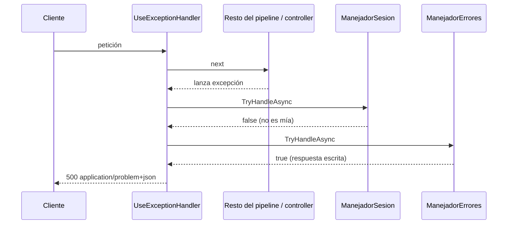

# Manejo global de errores (IExceptionHandler)

Parte de: [[03-CSharp-DotNet/05 ASP.NET Core/_Índice ASP.NET Core|ASP.NET Core]]

> [!info] Cómo avanzar
> `progreso`: **pendiente** → **viendo** (estudiando) → **visto** (contestaste la autoevaluación sin abrir las respuestas) → **dominado** (hiciste el laboratorio o lo aplicaste de verdad).

## Contenido

### Qué es
`IExceptionHandler` (desde .NET 8) es la forma moderna de centralizar en ASP.NET Core qué responde la API cuando ocurre una **excepción no manejada**. Se conecta al middleware `UseExceptionHandler`, que atrapa la excepción, y tus implementaciones deciden la respuesta: normalmente un [[ProblemDetails]] con tu `codigo`, sin filtrar detalles internos. Sustituye a los `try/catch` en cada controller y a los middleware caseros de errores.

### Cómo funciona


Registro:
1. `builder.Services.AddExceptionHandler<T>()`: registra tu manejador (como singleton). Puedes registrar varios; se prueban **en el orden de registro**.
2. `builder.Services.AddProblemDetails()`: registra `IProblemDetailsService`, que escribe ProblemDetails respetando la negociación de contenido y personalizaciones globales.
3. `app.UseExceptionHandler()`: el middleware, **al principio** del pipeline para atrapar todo lo que viene después ([[Orden de los middleware en ASP.NET Core]]).

`TryHandleAsync(HttpContext, Exception, CancellationToken)` regresa `ValueTask<bool>`:
- **`true`**: "ya escribí la respuesta"; la cadena se detiene.
- **`false`**: "no es mía"; el middleware prueba el siguiente manejador. Si ninguno la toma, aplica su comportamiento por defecto (500 genérico).

**Cambio en .NET 10**: cuando un manejador regresa `true`, el middleware **ya no registra** la excepción en `ILogger` ni la marca en las métricas por defecto. Por lo tanto tu manejador debe loguearla (o enviarla a Sentry) explícitamente. Si quieres el comportamiento anterior existe `ExceptionHandlerOptions.SuppressDiagnosticsCallback`.

### Ejemplo
Manejador que traduce una excepción conocida y cubre lo inesperado:

```csharp
public sealed class ManejadorErrores(IProblemDetailsService pds, ILogger<ManejadorErrores> log) : IExceptionHandler
{
    public async ValueTask<bool> TryHandleAsync(HttpContext ctx, Exception ex, CancellationToken ct)
    {
        var (status, codigo, titulo) = ex switch
        {
            SesionRequeridaException => (StatusCodes.Status401Unauthorized, "sesion_requerida", "Se requiere iniciar sesión."),
            OperationCanceledException when ctx.RequestAborted.IsCancellationRequested
                => (StatusCodes.Status499ClientClosedRequest, "cancelada", "El cliente canceló la petición."),
            _ => (StatusCodes.Status500InternalServerError, "error_interno", "Ocurrió un error inesperado.")
        };

        if (status == StatusCodes.Status500InternalServerError)
            log.LogError(ex, "Error no controlado en {Metodo} {Ruta}", ctx.Request.Method, ctx.Request.Path);

        ctx.Response.StatusCode = status;
        var pd = new ProblemDetails { Status = status, Title = titulo, Instance = ctx.Request.Path };
        pd.Extensions["codigo"] = codigo;
        pd.Extensions["traceId"] = ctx.TraceIdentifier;   // para buscarlo en logs o Sentry

        return await pds.TryWriteAsync(new ProblemDetailsContext { HttpContext = ctx, ProblemDetails = pd, Exception = ex });
    }
}

// Program.cs
builder.Services.AddProblemDetails();
builder.Services.AddExceptionHandler<ManejadorErrores>();
var app = builder.Build();
app.UseExceptionHandler();
```

Para una excepción **no esperada** el manejador debe: registrarla con el `TraceId` (en log y Sentry), responder **500** con `codigo: "error_interno"` y **no** incluir `ex.Message` ni la pila en la respuesta. El mensaje puede revelar nombres de tablas, rutas del servidor o datos de otro usuario. El `traceId` le basta a soporte para encontrar el detalle.

### Cuándo usarlo y cuándo no
**¿Excepciones o `Result` para validación y reglas de negocio?** En tus proyectos:
- Lo **esperado** (dato inválido, caja cerrada, saldo insuficiente, no encontrado) se modela con un `Result` que el slice regresa y el controller traduce a 400/404/409. Es explícito, se prueba fácil y no cuesta lo que una excepción.
- El manejador global es la **red de seguridad** para lo inesperado (bugs, BD caída) y para algunas excepciones de infraestructura que conviene traducir en un solo lugar (por ejemplo `SesionRequeridaException` → 401).
- No uses excepciones como control de flujo normal ("lanzo `ValidacionException` en cada handler").

Usa varios manejadores pequeños si la traducción crece; mantén uno final que siempre regrese `true`.

### Errores comunes
- **`UseExceptionHandler` registrado tarde**: no atrapa lo de antes.
- **Filtrar `ex.ToString()` al cliente** en producción.
- **No loguear** en .NET 10 creyendo que el middleware lo hace.
- **Un manejador que regresa `true` sin escribir nada**: el cliente recibe 200 vacío.
- **Escribir la respuesta si ya empezó** (`ctx.Response.HasStarted`): no puedes cambiar status; solo loguea.

### Para profundizar
- [Manejo de errores en ASP.NET Core (Microsoft Learn)](https://learn.microsoft.com/aspnet/core/fundamentals/error-handling)
- [Manejo de errores en APIs web (Microsoft Learn)](https://learn.microsoft.com/aspnet/core/web-api/handle-errors)
- [Cambio en .NET 10: diagnósticos suprimidos en IExceptionHandler (Microsoft Learn)](https://learn.microsoft.com/dotnet/core/compatibility/aspnet-core/10/exception-handler-diagnostics-suppressed)
- [RFC 9457: Problem Details for HTTP APIs](https://www.rfc-editor.org/rfc/rfc9457)

## Autoevaluación

Contesta primero en voz alta o en papel; luego despliega la respuesta.

> [!question]- ¿Cómo se registra un `IExceptionHandler`?
> ```csharp
> builder.Services.AddExceptionHandler<ManejadorErrores>();
> builder.Services.AddProblemDetails();
> app.UseExceptionHandler();
> ```

> [!question]- ¿Qué regresa `TryHandleAsync` y qué significa?
> `ValueTask<bool>`: `true` si ya escribiste la respuesta; `false` pasa al siguiente handler registrado.

> [!question]- ¿Qué debe hacer tu manejador para una excepción no esperada?
> Registrar (Sentry/log) con el `TraceId`, responder 500 ProblemDetails con `codigo: "error_interno"` y **no** filtrar el mensaje ni la pila al cliente.

> [!question]- ¿Excepciones para validación o `Result`?
> `Result` para lo esperado; el manejador global es la red de seguridad para lo inesperado y para excepciones conocidas de infraestructura (p. ej. `SesionRequeridaException` → 401).

## Práctica

- [[Lab 6 - API con controllers, FluentValidation, ProblemDetails y Options]]

