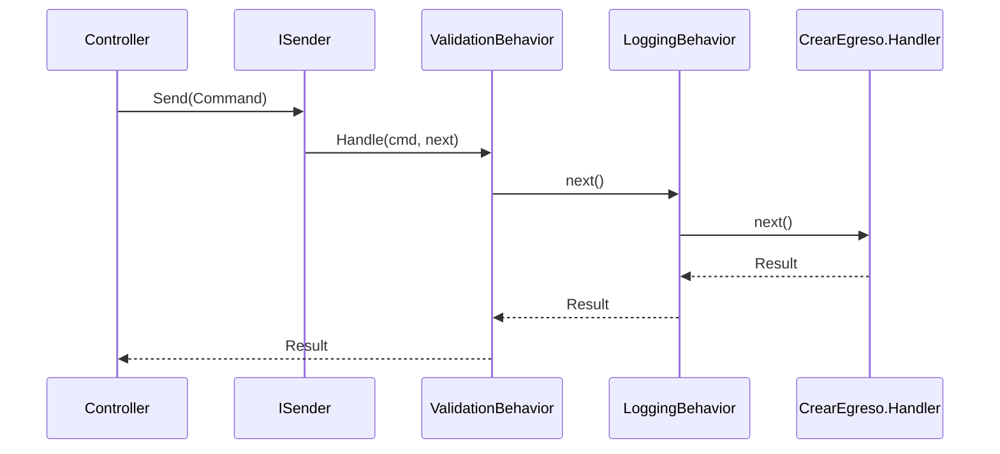

# MediatR

Parte de: [[03-CSharp-DotNet/05 ASP.NET Core/_Índice ASP.NET Core|ASP.NET Core]]

> [!info] Cómo avanzar
> `progreso`: **pendiente** → **viendo** (estudiando) → **visto** (contestaste la autoevaluación sin abrir las respuestas) → **dominado** (hiciste el laboratorio o lo aplicaste de verdad).

## Contenido

### Qué es
**MediatR** es una biblioteca de .NET que implementa el patrón **mediador**: en lugar de que el controller llame directamente al handler, le **envía** un mensaje (`sender.Send(new CrearEgreso.Command(...))`) y MediatR busca y ejecuta el `IRequestHandler` correspondiente. Fue durante años la pieza típica de proyectos con CQRS ([[CQRS y mediador]]). En Itzamna.Dionisio los controllers heredan de una base con `ISender` y delegan en el mediador.

### Cómo funciona
Piezas principales:
- **`IRequest<TResponse>`**: el mensaje (command o query).
- **`IRequestHandler<TRequest, TResponse>`**: la clase que lo atiende.
- **`ISender` / `IMediator`**: el punto de entrada; `Send` resuelve el handler desde DI.
- **`IPipelineBehavior<TRequest, TResponse>`**: comportamientos que **envuelven** cada envío, como middleware alrededor de los handlers. Ahí se ponen validación (FluentValidation), logging, métricas, transacciones o caché.
- **`INotification`** y `Publish`: eventos con varios manejadores.



### Ejemplo
Command, handler y un behavior de validación:

```csharp
public sealed record CrearEgreso(long CajaId, decimal Monto, string Concepto) : IRequest<long>;

public sealed class CrearEgresoHandler(SesionSql sesion, ICrearEgresoSql sql) : IRequestHandler<CrearEgreso, long>
{
    public async Task<long> Handle(CrearEgreso cmd, CancellationToken ct)
    {
        var cn = await sesion.ConexionAsync(ct);
        return await cn.ExecuteScalarAsync<long>(sql.Texto, cmd, sesion.Transaccion);
    }
}

public sealed class ValidacionBehavior<TReq, TRes>(IEnumerable<IValidator<TReq>> validadores)
    : IPipelineBehavior<TReq, TRes> where TReq : notnull
{
    public async Task<TRes> Handle(TReq req, RequestHandlerDelegate<TRes> next, CancellationToken ct)
    {
        foreach (var v in validadores)
            await v.ValidateAndThrowAsync(req, ct);
        return await next();
    }
}

builder.Services.AddMediatR(cfg =>
{
    cfg.RegisterServicesFromAssemblyContaining<Program>();
    cfg.AddOpenBehavior(typeof(ValidacionBehavior<,>));
});
// En v13+ la configuración también recibe la llave de licencia (cfg.LicenseKey).
```

**Licencia.** El 2 de julio de 2025 MediatR (desde la **v13**) y AutoMapper (desde la v15) pasaron a un modelo **dual comercial** de Lucky Penny Software. Hay una **edición comunitaria gratuita** para empresas e individuos con ingresos brutos anuales menores a 5 millones de USD, para ONG con presupuesto menor a ese monto, para uso educativo y para entornos que no son de producción; aun así se requiere una llave de licencia. Las versiones anteriores siguen con su licencia original. Antes de usarlo en el proyecto de un cliente, revisa los términos vigentes en el sitio del proveedor, porque pueden cambiar (Pendiente de confirmar condiciones actuales).

**Alternativa que usas en tus proyectos** (Hermes, Reporteria): **sin mediador**. Cada slice expone su `Handler` como clase concreta, se registra en DI y el controller lo pide directo con `[FromServices]`:

```csharp
[HttpPost]
public Task<IActionResult> Crear([FromBody] CrearEgreso.Command cmd, [FromServices] CrearEgreso.Handler h, CancellationToken ct) =>
    h.Handle(cmd, ct);
```

La validación se aplica con un filtro de MVC ([[Filtros]]) o con un decorador. Ventajas: **sin dependencia externa** ni licencia, **F12 lleva directo al handler** (con MediatR saltas a la interfaz), el compilador detecta si falta un handler y hay menos magia en el registro.

### Cuándo usarlo y cuándo no
- **Sí** si el proyecto ya lo usa y funciona (como Dionisio), si necesitas muchos *behaviors* transversales iguales para todos los handlers o si el equipo ya conoce el patrón.
- **Sí** con la licencia resuelta para tu caso.
- **No** en proyectos nuevos solo "porque es lo que se usa": un handler inyectado directo cubre el 90 % con menos piezas.
- Hay alternativas con *source generators* (por ejemplo, la biblioteca `Mediator` de Martin Othamar) si quieres el patrón sin reflexión.

### Errores comunes
- **Handlers que llaman a otros handlers con `Send`**: cadenas difíciles de seguir; extrae la lógica común.
- **Behaviors con lógica de negocio**: deben ser transversales.
- **Validar lanzando excepciones** en el behavior y luego atraparlas en todos lados: prefiere un `Result`.
- **Actualizar a v13+ sin revisar la licencia**.
- **Usar `Publish` para flujos que necesitan transacción** con el comando: los manejadores de notificaciones no comparten garantías.

### Para profundizar
- [Repositorio de MediatR (GitHub)](https://github.com/LuckyPennySoftware/MediatR)
- [Anuncio de las ediciones comerciales de AutoMapper y MediatR (Jimmy Bogard)](https://www.jimmybogard.com/automapper-and-mediatr-commercial-editions-launch-today/)
- [[Vertical Slice Architecture]]

## Autoevaluación

Contesta primero en voz alta o en papel; luego despliega la respuesta.

> [!question]- ¿Qué hace MediatR?
> Implementa un mediador: `sender.Send(new Crear.Command(...))` busca el `IRequestHandler` correspondiente; los `IPipelineBehavior` envuelven cada envío (validación, logging, transacción).

> [!question]- ¿Qué cambió con su licencia?
> Desde 2025 (v13) es comercial, con una edición comunitaria gratuita bajo ciertos límites. Revisa los términos antes de usarlo en un cliente (Pendiente de confirmar condiciones actuales).

> [!question]- ¿Qué alternativa usas en tus proyectos?
> Inyectar el `Handler` del slice directamente (`[FromServices]`) y aplicar FluentValidation como filtro o decorador: sin dependencia externa y con navegación directa al código.

