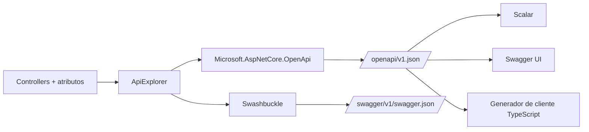

# Microsoft.AspNetCore.OpenApi vs Swashbuckle

Parte de: [[03-CSharp-DotNet/05 ASP.NET Core/_Índice ASP.NET Core|ASP.NET Core]]

> [!info] Cómo avanzar
> `progreso`: **pendiente** → **viendo** (estudiando) → **visto** (contestaste la autoevaluación sin abrir las respuestas) → **dominado** (hiciste el laboratorio o lo aplicaste de verdad).

## Contenido

### Qué es
Para documentar una API se genera un **documento OpenAPI** (JSON o YAML) que describe endpoints, parámetros, esquemas y respuestas. Con él se arman interfaces interactivas (Swagger UI, Scalar), se generan clientes (por ejemplo, tipos de TypeScript para Itzamna.Clio) y se prueban contratos. En ASP.NET Core hay dos generadores principales:
- **`Microsoft.AspNetCore.OpenApi`**: el generador **integrado** de Microsoft, disponible desde .NET 9.
- **Swashbuckle.AspNetCore**: la biblioteca comunitaria que durante años vino en las plantillas (`AddSwaggerGen` + `UseSwaggerUI`).

El uso con Swagger UI y Scalar en tus proyectos está en [[OpenAPI con Swagger y Scalar]].

### Cómo funciona
**Qué cambió desde .NET 9:** las plantillas de Web API **ya no incluyen Swashbuckle**. Usan `Microsoft.AspNetCore.OpenApi`: `builder.Services.AddOpenApi()` registra el generador y `app.MapOpenApi()` expone el documento en `/openapi/v1.json`. La **interfaz gráfica no viene incluida**: se agrega aparte, normalmente Scalar (`Scalar.AspNetCore`) o Swagger UI (`Swashbuckle.AspNetCore.SwaggerUI`, solo la UI).

Ambos generadores leen los mismos metadatos de ASP.NET Core (*ApiExplorer*): rutas, verbos, `[ProducesResponseType]`, `[Tags]`, comentarios XML, tipos de los parámetros. Funcionan con controllers y con Minimal APIs.

**Ventajas del generador integrado:**
- Lo **mantiene Microsoft** y avanza con cada versión de .NET (soporte de nuevas características el mismo día).
- **Transformadores** de documento, operación y esquema (`AddDocumentTransformer`, `AddOperationTransformer`, `AddSchemaTransformer`) para personalizar: agregar el esquema de seguridad Bearer, ejemplos o tu extensión `codigo` en errores.
- **Generación en build** con el paquete `Microsoft.Extensions.ApiDescription.Server`: el JSON queda como archivo al compilar, útil para revisarlo en PRs o generar clientes en el pipeline.
- **.NET 10 genera OpenAPI 3.1 por defecto** (con opción de pedir 3.0) y puede servir YAML si la ruta termina en `.yaml`.
- Compatible con Native AOT en Minimal APIs.



### Ejemplo
Generador integrado con esquema Bearer y Scalar en desarrollo:

```csharp
using Scalar.AspNetCore;

builder.Services.AddOpenApi(o =>
{
    o.AddDocumentTransformer((doc, ctx, ct) =>
    {
        doc.Info.Title = "Itzamna.Dionisio API";
        doc.Info.Version = "v1";
        return Task.CompletedTask;
    });
});

var app = builder.Build();
if (app.Environment.IsDevelopment())
{
    app.MapOpenApi();                 // /openapi/v1.json
    app.MapScalarApiReference();      // /scalar
}
```

Nota: .NET 10 actualizó la dependencia `Microsoft.OpenApi` a una versión mayor nueva (para OpenAPI 3.1), y transformadores escritos para .NET 9 pueden necesitar ajustes de tipos o namespaces al migrar (Pendiente de confirmar los cambios exactos contra la guía de migración de tu versión).

Documentar respuestas en los controllers sirve para ambos generadores:

```csharp
[HttpGet("{id:long}")]
[ProducesResponseType<ObtenerEgreso.Dto>(StatusCodes.Status200OK)]
[ProducesResponseType<ProblemDetails>(StatusCodes.Status404NotFound)]
public Task<ActionResult<ObtenerEgreso.Dto>> Obtener(long id, [FromServices] ObtenerEgreso.Handler h, CancellationToken ct) =>
    h.Handle(new(id), ct);
```

### Cuándo usarlo y cuándo no
- **Proyectos nuevos en .NET 9/10**: generador integrado + Scalar o Swagger UI.
- **Seguirías con Swashbuckle** en un proyecto existente con muchos filtros propios (`IOperationFilter`, `ISchemaFilter`, `IDocumentFilter`) mientras migras; Swashbuckle sigue publicando versiones (existe una guía de migración a su v10), así que no es urgente cambiar si funciona.
- Si solo necesitas la UI, puedes usar el generador integrado con la UI de Swagger.
- **No** expongas el documento ni la UI en producción si la API es privada, o protégelos con autorización.

### Errores comunes
- **Esperar Swagger UI** con solo `AddOpenApi()`: hay que agregar la UI.
- **Mezclar ambos generadores** sin querer: dos documentos distintos que no coinciden.
- **No declarar `[ProducesResponseType]`**: el documento solo muestra 200 y los clientes generados no conocen tus errores.
- **Copiar transformadores de .NET 9** a .NET 10 sin revisar los cambios de la librería `Microsoft.OpenApi`.
- **Publicar `/openapi` a internet** en una API interna.

### Para profundizar
- [OpenAPI en ASP.NET Core (Microsoft Learn)](https://learn.microsoft.com/aspnet/core/fundamentals/openapi/overview)
- [Generar documentos OpenAPI (Microsoft Learn)](https://learn.microsoft.com/aspnet/core/fundamentals/openapi/aspnetcore-openapi)
- [Swashbuckle.AspNetCore (GitHub)](https://github.com/domaindrivendev/Swashbuckle.AspNetCore)
- [Scalar (GitHub)](https://github.com/scalar/scalar)

## Autoevaluación

Contesta primero en voz alta o en papel; luego despliega la respuesta.

> [!question]- ¿Qué cambió en las plantillas desde .NET 9?
> Ya no incluyen Swashbuckle: usan `Microsoft.AspNetCore.OpenApi` (`AddOpenApi()` + `MapOpenApi()`) que genera el documento; la UI se agrega aparte (Scalar o Swagger UI).

> [!question]- ¿Qué ventajas tiene la generación integrada?
> La mantiene Microsoft, soporta transformadores de documento y operación, y se puede generar en build. .NET 10 genera OpenAPI 3.1.

> [!question]- ¿Cuándo seguirías con Swashbuckle?
> En proyectos existentes con muchos filtros propios de Swashbuckle, mientras migras.

