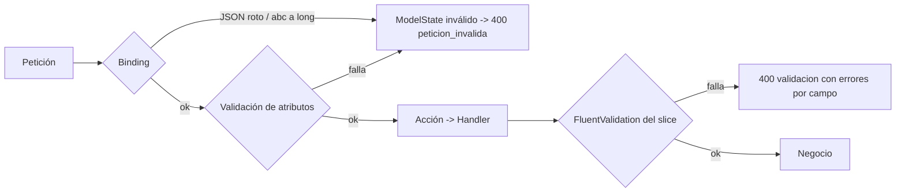

# Model binding y validación

Parte de: [[03-CSharp-DotNet/05 ASP.NET Core/_Índice ASP.NET Core|ASP.NET Core]]

> [!info] Cómo avanzar
> `progreso`: **pendiente** → **viendo** (estudiando) → **visto** (contestaste la autoevaluación sin abrir las respuestas) → **dominado** (hiciste el laboratorio o lo aplicaste de verdad).

## Contenido

### Qué es
El **model binding** es la parte de MVC que toma datos crudos de la petición HTTP (segmentos de ruta, query string, cuerpo JSON, headers, formularios) y los convierte en los parámetros tipados de tu acción. La **validación** de modelo revisa después esos objetos y deja los problemas en `ModelState`. Con `[ApiController]`, si `ModelState` queda inválido MVC responde **400 automáticamente** sin entrar a la acción.

En tus proyectos hay una división clara: el binding solo debe fallar cuando la petición está **mal formada**; las reglas de negocio las valida [[FluentValidation]] dentro del slice.

### Cómo funciona
Fuentes de datos y sus atributos:
- `[FromRoute]`: valores de la plantilla (`{id:long}`).
- `[FromQuery]`: query string (`?pagina=2&texto=caja`). Funciona con un record completo de filtros.
- `[FromBody]`: el cuerpo (JSON con System.Text.Json). Solo **un** parámetro puede venir del body.
- `[FromHeader]`: un header (`[FromHeader(Name = "X-Idempotencia")] string llave`).
- `[FromForm]`: `multipart/form-data` o `x-www-form-urlencoded`, incluido `IFormFile`.
- `[FromServices]`: no viene de la petición, sino del contenedor DI (tu `Handler`). También `[FromKeyedServices("clave")]`.

Con `[ApiController]` hay **inferencia**: los tipos complejos se asumen `[FromBody]`, `IFormFile` se asume `[FromForm]`, los nombres que coinciden con la plantilla se asumen `[FromRoute]` y los simples restantes `[FromQuery]`. Los servicios registrados en DI también se infieren, pero escribir `[FromServices]` deja la intención clara.



**Error de binding vs. error de validación de negocio:**
- **Binding**: el cliente mandó algo que ni siquiera se puede convertir: JSON mal formado, cuerpo vacío, `"abc"` en un campo `long`, fecha inválida. Es un problema de contrato. Respuesta: 400 con `codigo: "peticion_invalida"`.
- **Validación de negocio**: el JSON es correcto y los tipos convierten, pero el dato no cumple reglas: monto negativo, nombre vacío, fecha fuera de rango. Respuesta: 400 con `codigo: "validacion"` y la lista de errores por campo.

Mezclarlas genera mensajes duplicados y formas de error distintas. Por eso en Hermes se apaga el `[Required]` implícito de referencias no anulables (`SuppressImplicitRequiredAttributeForNonNullableReferenceTypes = true`) y se personaliza la respuesta automática.

### Ejemplo
Personalizar el 400 automático para que tenga la misma forma que el resto de tus [[ProblemDetails]]:

```csharp
builder.Services.AddControllers(o =>
        o.SuppressImplicitRequiredAttributeForNonNullableReferenceTypes = true)
    .ConfigureApiBehaviorOptions(o =>
    {
        o.InvalidModelStateResponseFactory = ctx =>
        {
            var pd = new ValidationProblemDetails(ctx.ModelState)
            {
                Status = StatusCodes.Status400BadRequest,
                Title = "La petición no tiene un formato válido.",
                Instance = ctx.HttpContext.Request.Path
            };
            pd.Extensions["codigo"] = "peticion_invalida";
            pd.Extensions["traceId"] = ctx.HttpContext.TraceIdentifier;
            return new BadRequestObjectResult(pd) { ContentTypes = { "application/problem+json" } };
        };
    });
```

Acción con varias fuentes:

```csharp
[HttpPost("{cajaId:long}/egresos")]
public Task<IActionResult> Registrar(
    long cajaId,                                            // ruta
    [FromBody] RegistrarEgreso.Command cmd,                 // body
    [FromHeader(Name = "X-Idempotencia")] string? llave,    // header
    [FromServices] RegistrarEgreso.Handler h,               // DI
    CancellationToken ct) =>
    h.Handle(cmd with { CajaId = cajaId, Llave = llave }, ct);
```

Con esto, Itzamna.Clio recibe siempre la misma forma de error: si el JSON llega roto ve `peticion_invalida`; si llega bien pero con un monto negativo ve `validacion` con el campo `monto` y su mensaje. El front puede decidir qué mostrar leyendo solo el `codigo`.

Para tipos que el binding no sabe convertir de un string (por ejemplo un `Folio` propio en la ruta), implementa `IParsable<T>` (con `TryParse`); MVC lo usa para ruta y query sin escribir un model binder personalizado.

### Cuándo usarlo y cuándo no
- Deja al binding la **forma** (tipos y JSON válido); deja las **reglas** a FluentValidation.
- Usa atributos explícitos (`[FromQuery]`, `[FromServices]`) en records y servicios para no depender de la inferencia.
- Data Annotations (`[Required]`, `[Range]`) sirven en proyectos pequeños; en tus APIs prefieres validadores para tener reglas probables y mensajes en español.

### Errores comunes
- **Record de filtros sin `[FromQuery]` en un GET**: se infiere body y responde 415 o 400.
- **Dos parámetros `[FromBody]`**: no se puede; agrúpalos en un record.
- **`[Required]` implícito + FluentValidation**: dos mensajes distintos para el mismo campo.
- **Enums como número sin querer**: registra `JsonStringEnumConverter` para aceptar texto.
- **Fiarse de `ModelState.IsValid` dentro de la acción** con `[ApiController]`: nunca entras si es inválido.

### Para profundizar
- [Model binding en ASP.NET Core (Microsoft Learn)](https://learn.microsoft.com/aspnet/core/mvc/models/model-binding)
- [Validación de modelo (Microsoft Learn)](https://learn.microsoft.com/aspnet/core/mvc/models/validation)
- [Crear APIs web con ASP.NET Core: atributo ApiController (Microsoft Learn)](https://learn.microsoft.com/aspnet/core/web-api/)

## Autoevaluación

Contesta primero en voz alta o en papel; luego despliega la respuesta.

> [!question]- ¿De dónde puede leer el model binding?
> Ruta (`[FromRoute]`), query (`[FromQuery]`), body (`[FromBody]`), headers (`[FromHeader]`), formularios (`[FromForm]`) y DI (`[FromServices]`).

> [!question]- ¿Qué diferencia hay entre un error de *binding* y uno de *validación* de negocio?
> Binding: el JSON está mal formado o un tipo no convierte (`"abc"` a `int`) → 400 `peticion_invalida`. Validación: el dato llega bien pero no cumple reglas → 400 `validacion` desde FluentValidation.

> [!question]- ¿Cómo personalizas la respuesta automática de `ModelState` inválido?
> `services.Configure<ApiBehaviorOptions>(o => o.InvalidModelStateResponseFactory = ctx => ...)` para regresar tu ProblemDetails con `codigo`.

## Práctica

- [[Lab 6 - API con controllers, FluentValidation, ProblemDetails y Options]]

