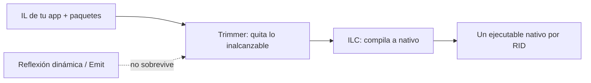

# Native AOT y rendimiento

Parte de: [[03-CSharp-DotNet/05 ASP.NET Core/_Índice ASP.NET Core|ASP.NET Core]]

> [!info] Cómo avanzar
> `progreso`: **pendiente** → **viendo** (estudiando) → **visto** (contestaste la autoevaluación sin abrir las respuestas) → **dominado** (hiciste el laboratorio o lo aplicaste de verdad).

## Contenido

### Qué es
**Native AOT** (*Ahead-of-Time*) es un modo de publicación en el que **toda la aplicación se compila a código máquina nativo antes de ejecutarse**. El resultado es un solo ejecutable para una plataforma concreta (`win-x64`, `linux-x64`...), sin JIT y sin necesidad de tener .NET instalado. Se activa con `<PublishAot>true</PublishAot>`. Se diferencia de ReadyToRun ([[Publicación y despliegue de .NET]]) en que ReadyToRun precompila pero conserva el JIT y todo el runtime; Native AOT elimina el JIT y recorta todo lo que no se usa.

### Cómo funciona
1. Compilas tu IL normalmente.
2. El **trimmer** analiza qué código es alcanzable desde `Main` y elimina el resto (de tu código, de los paquetes y del framework).
3. El compilador **ILC** genera código nativo para todo lo que quedó.
4. Se enlaza con un runtime mínimo en un ejecutable nativo.

**Ventajas** (según Microsoft): arranque mucho más rápido (no hay JIT al inicio), menor uso de memoria, ejecutable más pequeño que una publicación self-contained completa, ideal para contenedores densos y escalado rápido.

**Limitaciones**, todas derivadas de que en ejecución ya no se puede generar ni descubrir código:
- **Reflexión sin límites no funciona**: el trimmer no puede saber qué tipos vas a buscar por nombre. La reflexión debe estar anotada (`[DynamicallyAccessedMembers]`) o reemplazarse.
- **Nada de generar código en ejecución**: `System.Reflection.Emit`, expresiones compiladas dinámicamente y proxies dinámicos no están disponibles.
- **Se necesitan *source generators***: JSON con `JsonSerializerContext`, logging con `[LoggerMessage]`, configuración con el generador de *binding*, regex con `[GeneratedRegex]`.
- **No se puede cargar ensamblados dinámicamente** (plugins).
- El build requiere el toolchain nativo de la plataforma (en Windows, las herramientas de C++ de Visual Studio) y publicar por cada RID.
- Si el publish emite **warnings de AOT o de trimming**, la app puede fallar en ejecución: hay que resolverlos todos.

**Compatibilidad de ASP.NET Core** (documentación de .NET 10): Minimal APIs tiene soporte **parcial**; CORS, health checks, JWT, rate limiting, output caching y gRPC están soportados; **MVC (controllers) no es compatible**, igual que Blazor Server y Session. La plantilla `webapiaot` usa `WebApplication.CreateSlimBuilder()`, solo Minimal APIs y JSON con source generation.



### Ejemplo
API mínima compatible con AOT:

```csharp
using System.Text.Json.Serialization;

var builder = WebApplication.CreateSlimBuilder(args);
builder.Services.ConfigureHttpJsonOptions(o =>
    o.SerializerOptions.TypeInfoResolverChain.Insert(0, AppJson.Default));

var app = builder.Build();
app.MapGet("/api/tipo-cambio/{moneda}", (string moneda) => new TipoCambio(moneda, 18.25m));
app.Run();

public sealed record TipoCambio(string Moneda, decimal Valor);

[JsonSerializable(typeof(TipoCambio))]
internal partial class AppJson : JsonSerializerContext;
```

```xml
<PropertyGroup>
  <PublishAot>true</PublishAot>
  <InvariantGlobalization>true</InvariantGlobalization>
</PropertyGroup>
```

Publicar: `dotnet publish -c Release -r linux-x64`. Revisa que no salga ningún warning `IL2xxx`/`IL3xxx`.

**¿Te conviene en tus APIs?** Por ahora **no**. Tus APIs (Dionisio, Hermes, Reporteria) usan **controllers**, que no son compatibles; tendrías que reescribirlas a Minimal APIs. Además **Dapper** genera código en ejecución para mapear resultados; existe **Dapper.AOT**, un generador que lo hace en compilación, pero es otra pieza a adoptar y probar. FluentValidation, librerías de Excel y otras dependencias también tendrían que ser compatibles. La ganancia (arranque en milisegundos) importa poco en una API que arranca una vez y vive días en IIS o App Service.

Donde **sí** brilla: funciones serverless con arranque en frío, herramientas de consola internas, sidecars y microservicios pequeños en contenedores que escalan a cero.

### Cuándo usarlo y cuándo no
- **Sí** en servicios pequeños nuevos con Minimal APIs, donde el arranque y la memoria cuestan dinero (Azure Container Apps escalando a cero, Functions).
- **Sí** en herramientas CLI que quieres distribuir como un solo ejecutable.
- **No** en APIs con controllers, EF Core con muchas características dinámicas o librerías basadas en reflexión.
- **Antes de AOT**, prueba ReadyToRun: obtienes parte de la mejora de arranque sin restricciones.

### Errores comunes
- **Ignorar los warnings de trimming/AOT**: la app compila y falla en ejecución.
- **Serializar JSON sin `JsonSerializerContext`**: excepción al primer request.
- **Esperar que `CreateSlimBuilder` traiga todo**: omite HTTPS de Kestrel, integración con IIS y algunas restricciones de ruta.
- **Medir en Debug**: compara siempre publicaciones Release.
- **Elegir AOT "por rendimiento"** sin medir: en estado estable, el JIT con PGO dinámico puede igualar o superar al código AOT.

### Para profundizar
- [Soporte de Native AOT en ASP.NET Core (Microsoft Learn)](https://learn.microsoft.com/aspnet/core/fundamentals/native-aot)
- [Despliegue Native AOT en .NET (Microsoft Learn)](https://learn.microsoft.com/dotnet/core/deploying/native-aot/)
- [Dapper.AOT (GitHub)](https://github.com/DapperLib/DapperAOT)

## Autoevaluación

Contesta primero en voz alta o en papel; luego despliega la respuesta.

> [!question]- ¿Qué es Native AOT?
> Compilar toda la app a código nativo antes de ejecutar: arranque muy rápido, menos memoria y un solo ejecutable, sin JIT.

> [!question]- ¿Qué limitaciones tiene?
> No admite reflexión dinámica sin anotaciones ni generar código en ejecución; requiere source generators (JSON, logging). ASP.NET Core MVC (controllers) no es compatible: solo Minimal APIs.

> [!question]- ¿Te conviene en tus APIs con controllers y Dapper?
> No por ahora: perderías controllers y Dapper usa generación dinámica (existe `Dapper.AOT` como alternativa). AOT brilla en funciones serverless y herramientas de consola.

