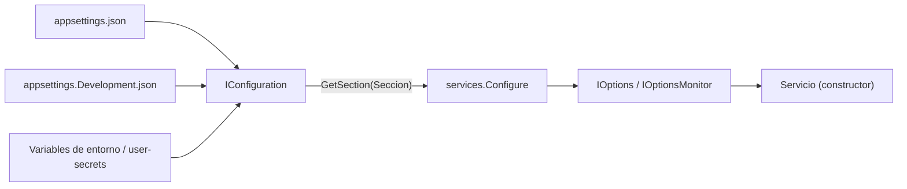

---
proyecto:
  - Ocelotl.Hermes
  - Itzamna.Dionisio
  - ReporteriaAzure
proyectos:
  - "[[Ocelotl.Hermes]]"
  - "[[Itzamna.Dionisio]]"
  - "[[ReporteriaAzure]]"
tipo: patron
nivel: basico
estado: completo
tags:
  - conocimiento
  - backend
  - dotnet
  - configuracion
progreso: pendiente
area: C# y .NET
contenido: completo
---
# Options pattern

> Cada sección de `appsettings.json` se enlaza a una clase tipada y se inyecta como `IOptions<T>`; [[Ocelotl.Hermes]] lo usa para Argo, Robot, Ingreso, Persistencia, Identidad y Seguridad.

## Qué es y qué problema resuelve
En lugar de leer cadenas sueltas (`config["Argo:BaseUrl"]`) por todo el código, se define una clase POCO (`ArgoOptions`) con propiedades y valores por defecto, se **enlaza** a una sección de configuración y se inyecta donde se necesita. Resuelve: claves mágicas repetidas, conversiones manuales (`TimeSpan`, `int`), y acoplamiento de las clases a `IConfiguration`.

## Cómo funciona por dentro

- **Fuentes de configuración** (en orden, la última gana): `appsettings.json` → `appsettings.{Environment}.json` → user-secrets (Development) → variables de entorno (`Argo__ApiKey`) → argumentos.
- **Registro**: `services.Configure<T>(config.GetSection("X"))` o `services.AddOptions<T>()`.
- **Consumo**:
  - `IOptions<T>`: singleton, se lee una vez (`.Value`).
  - `IOptionsSnapshot<T>`: scoped, se recalcula por petición.
  - `IOptionsMonitor<T>`: singleton con `CurrentValue` que cambia si el archivo se recarga.
- **PostConfigure**: ajustar el objeto después del enlace (p. ej. cargar un archivo externo).
- `GetSection(...).Get<T>()`: enlace directo sin DI (útil antes de `Build()`).



## Cuándo usarla y cuándo no
### Ventajas
- Tipado fuerte y valores por defecto en un solo lugar.
- Fácil de probar: `Options.Create(new XOptions { ... })`.
- Secretos fuera del repo vía user-secrets o variables de entorno.
### Desventajas
- Un error de nombre en la sección deja silenciosamente los valores por defecto (si no se valida).
- Tres interfaces (`IOptions`, `Snapshot`, `Monitor`) que confunden al principio.
- Sin validación explícita, valores inválidos llegan a ejecución.

## Alternativas
| Alternativa | En qué se diferencia |
|---|---|
| `IConfiguration` directo | Claves de texto en cada uso, sin tipado. |
| Constantes en código | No se pueden cambiar sin recompilar. |
| Variables de entorno leídas a mano | Lo que hace Hermes solo para `HERMES_SESSION_SECRET` e `isElectron`. |
| `ValidateDataAnnotations` / `ValidateOnStart` | Complemento (no alternativa) para validar al arrancar; Hermes no lo usa. |

## Cómo se usó en Ocelotl
En [[Ocelotl.Hermes]] cada clase de opciones declara su sección como constante `Seccion` y trae valores por defecto (`Ocelotl.Hermes/src/Ocelotl.Hermes.Infrastructure/Robot/RobotOptions.cs`):
```csharp
public sealed class RobotOptions
{
    public const string Seccion = "Robot";

    /// <summary>Id de suscriptor WWKS2 con el que Hermes se presenta ante el robot.</summary>
    public int SubscriberId { get; set; } = 100;

    /// <summary>Cuánto esperar a que el robot acepte la conexión.</summary>
    public TimeSpan TimeoutConexion { get; set; } = TimeSpan.FromSeconds(15);
```

Registro en `Ocelotl.Hermes/src/Ocelotl.Hermes.Infrastructure/DependencyInjection.cs`:
```csharp
services.Configure<PersistenciaOptions>(configuracion.GetSection(PersistenciaOptions.Seccion));
services.Configure<IdentidadOptions>(configuracion.GetSection(IdentidadOptions.Seccion));
services.Configure<ArgoOptions>(configuracion.GetSection(ArgoOptions.Seccion));
services.Configure<RobotOptions>(configuracion.GetSection(RobotOptions.Seccion));
```

Secciones y quién las consume:
| Sección | Clase | Claves | Consumidor |
|---|---|---|---|
| `Argo` | `ArgoOptions` | `BaseUrl`, `ApiKey`, `DispositivoId`, `Timeout`, `ReintentosLectura` | `ArgoClient`, `ArgoHttpEventSink`, `ConfigurarArgo` (HttpClient) |
| `Argo:Simulado` | `ArgoSimuladoOptions` | `Habilitado`, `Respuesta`, `AceptarCodigosDesconocidos`, `Catalogo`, `Codigos` | `ArgoSimulado` vía `IOptionsMonitor` |
| `Robot` | `RobotOptions` | `SubscriberId`, `IntervaloRevisionEstadoMs`, `TimeoutConexion`, `TimeoutOperacion` | `RowaStorageSystemFactory`, `RowaRobotGateway` |
| `Ingreso` | `IngresoOptions` | `TimeoutConsultaArgo` (5 s), `PrefijoCodigoPorDefecto` (`OCL`) | `ResolverPackEntrante`, `RegistrarIngreso` |
| `Persistencia` | `PersistenciaOptions` | `RutaBaseDatos` (vacío = `%LOCALAPPDATA%\Ocelotl\Hermes\hermes.db`) | `ConexionSqlite` |
| `Identidad` | `IdentidadOptions` | `UsuarioInicial` (`Usuario`, `Nombre`, `Password`, `Rol`) | `LocalIdentityProvider` |
| `Seguridad` | `SeguridadOptions` | `OrigenesPermitidos` | CORS en `Program.cs` (con `Get<SeguridadOptions>()`, sin DI) |

Detalles:
- `IngresoOptions` se registra en `Program.cs` (`Configure<IngresoOptions>`), porque Application no recibe `IConfiguration`; `AddApplication()` solo hace `AddOptions<IngresoOptions>()`.
- `ArgoSimulado` usa `IOptionsMonitor.CurrentValue`: según el comentario de `appsettings.Development.json`, `Respuesta` se puede cambiar con Hermes corriendo.
- `PostConfigure<IServiceProvider>(CargarCatalogoSimulado)` carga el catálogo JSON a `Codigos`; `Program.cs` lee `IOptions<ArgoSimuladoOptions>.Value` al arrancar para que un catálogo mal configurado falle de inmediato.
- `ApiKey` no va en el repo: user-secrets (`UserSecretsId` en el `.csproj` de la API) o variable `Argo__ApiKey`.
- En pruebas: `Options.Create(new PersistenciaOptions { RutaBaseDatos = ... })` (ver [[xUnit]]).

Funcionalidades: [[Conexión de robots]], [[Ingresos]], [[Formato de códigos de ingreso]], [[Sincronización con Argo]], [[Sesión y roles]], [[Arranque y seguridad local]].

> [!tip] Reutilizable
> La constante `public const string Seccion` en cada clase de opciones evita repetir el nombre de la sección como texto en el registro y en las pruebas.


## Cómo se usó en Itzamna
[[Itzamna.Dionisio]] usa el mismo molde (constante con el nombre de la sección, aquí `SectionName` en vez de `Seccion`):

| Sección | Clase | Claves | Consumidor |
|---|---|---|---|
| `Auth` | `AuthOptions` (`API/Auth/`) | `Authority`, `Issuer`, `Audience`, `RequireHttpsMetadata`, `SigningKey` | JwtBearer en `Program.cs` (vía `Get<AuthOptions>()`), `LocalTokenService` ([[JWT y autenticación con Bearer]]) |
| `AccessLogin` | `AccessLoginOptions` | `Enabled`, `Code`, `AllowedEmails` | `AccessController` ([[Autenticación y acceso]]) |
| `MediaLimits` | `MediaLimitsOptions` (`Application/Common/`) | `MaxImageBytes`, `MaxVideoBytes`, `AllowVideos`, `MaxBytesPerCreator`, `MaxTotalBytes` | `UploadMediaHandler` ([[Biblioteca de medios]]) |
| `Storage` | `StorageOptions` (`Infrastructure/Storage/`) | `Provider`, `PublicBaseUrl`, `LocalRoot`, `AzureConnectionString`, contenedores | almacenamiento y `Program.cs` ([[Azure Blob Storage]]) |
| `ConnectionStrings:Dionisio` | — | cadena de [[SQL Server]] | `AddInfrastructure` (`GetConnectionString`) |
| `Cors:Origins`, `Database:InitializeOnStartup`, `Seed:Demo` | — (lectura directa) | | `Program.cs` con `Get<string[]>()` / `GetValue` |

Igual que `IngresoOptions` en Hermes, `MediaLimitsOptions` vive en Application pero se registra en `Program.cs` (`builder.Services.Configure<MediaLimitsOptions>(...)`).

Valores por entorno:
- `appsettings.json`: todo apagado o local (`Provider: Local`, `AccessLogin.Enabled: false`, límites de espacio en 0 = sin límite).
- `appsettings.Development.json`: `SigningKey` de desarrollo y `Seed:Demo: true`.
- `appsettings.Production.json`: `Provider: AzureBlob`, videos de 50 MB, 1 GB por creador y 10 GB en total ("tope de costo"). Los secretos (`Auth:SigningKey`, `AccessLogin:Code`, cadenas de conexión) van en App Service → Variables de entorno.

`Itzamna.Dionisio/src/Itzamna.Dionisio.Application/Common/MediaLimitsOptions.cs`:
```csharp
public sealed class MediaLimitsOptions
{
    public const string SectionName = "MediaLimits";

    public long MaxImageBytes { get; set; } = 15L * 1024 * 1024;
    public long MaxVideoBytes { get; set; } = 200L * 1024 * 1024;
    public bool AllowVideos { get; set; } = true;

    /// <summary>Espacio máximo de originales por creador.</summary>
    public long MaxBytesPerCreator { get; set; }
```

Validación al arrancar: no usa `ValidateOnStart`, pero falla rápido a mano: sin `Auth:Authority` ni `Auth:SigningKey` lanza `InvalidOperationException`; `LocalTokenService` exige `SigningKey` de 32 caracteres o más; `AzureBlobFileStorageService` exige `AzureConnectionString`.

> [!note] Pendiente de confirmar
> El límite de video del front (`VITE_MAX_VIDEO_MB: '50'` en el pipeline de Clio) se mantiene igual que `MediaLimits:MaxVideoBytes` **a mano**; no hay un endpoint que exponga los límites.


## Cómo se usó en ReporteriaAzure
[[ReporteriaAzure]] es el primer proyecto que usa **`ValidateOnStart`**: si falta un valor obligatorio, la API no arranca.

| Sección | Clase | Claves | Consumidor |
|---|---|---|---|
| `Azure` | `AzureDevOpsOptions` (`Infrastructure/AzureDevOps/`) | `Version_Api`, `ADO_ORGANIZATION`, `ADO_PROJECT`, `Carpera`, `BaseUrl`, `Pat`, `Timeout`, `Endpoints.{GetBoard, GetTablero, GetWorkItems}` | `AzureDevOpsClient` ([[Azure DevOps REST API]]) |

- Las llaves conservan sus nombres originales (incluido el error `Carpera`) para no romper la configuración del servidor; `URL_Board` se borró porque no se usaba.
- `Pat` va en `appsettings.json`: el proyecto se publica copiando la carpeta por FileZilla.

`ReporteriaAzure/Infrastructure/DependencyInjection.cs`:
```csharp
services.AddOptions<AzureDevOpsOptions>()
    .Bind(configuracion.GetSection(AzureDevOpsOptions.SectionName))
    .Validate(o => !string.IsNullOrWhiteSpace(o.Pat),
        "Falta Azure:Pat en appsettings.json (token de Azure DevOps con permiso de lectura de Work Items).")
    // … organización, proyecto y plantillas de Endpoints
    .ValidateOnStart();
```

> [!tip] Reutilizable
> Escribe en el mensaje de `Validate` **cómo arreglarlo** (dónde va el valor), no solo qué falta.

## Errores comunes y buenas prácticas
- Poner secretos en `appsettings.json` (Hermes lo advierte en `ArgoOptions.ApiKey`).
- Escribir mal el nombre de la sección: se usan los defaults sin aviso. Hermes no usa `ValidateOnStart` (posible mejora).
- Usar `IOptions<T>` cuando se espera recarga en caliente: usar `IOptionsMonitor<T>`.
- `TimeSpan` en JSON se escribe `"00:00:15"`.
- Las variables de entorno usan `__` como separador de secciones (`Argo__ApiKey`).

## Qué estudiar después
- [[Inyección de dependencias]], [[NET y CSharp|.NET y C#]]
- Validación de opciones (`ValidateDataAnnotations`, `ValidateOnStart`), user-secrets.

## Documentación oficial

- https://learn.microsoft.com/dotnet/core/extensions/options
- https://learn.microsoft.com/aspnet/core/fundamentals/configuration/options
- https://learn.microsoft.com/aspnet/core/security/app-secrets

## Autoevaluación

Contesta primero en voz alta o en papel; luego despliega la respuesta.

> [!question]- ¿Qué diferencia hay entre `IOptions<T>`, `IOptionsSnapshot<T>` e `IOptionsMonitor<T>`?
> `IOptions`: singleton, se lee una vez. `IOptionsSnapshot`: Scoped, se recalcula por petición (ve cambios). `IOptionsMonitor`: singleton que notifica cambios con `OnChange`.

> [!question]- ¿Para qué sirve `ValidateOnStart()`?
> Ejecuta la validación de las opciones **al arrancar** la app: si falta una configuración, la app no inicia en lugar de fallar en la primera petición.

> [!question]- Escribe el registro con validación.
> ```csharp
> builder.Services.AddOptions<PasarelaOptions>()
>     .Bind(builder.Configuration.GetSection("Pasarela"))
>     .ValidateDataAnnotations()
>     .Validate(o => o.TimeoutSegundos is > 0 and <= 60, "Timeout fuera de rango")
>     .ValidateOnStart();
> ```

> [!question]- ¿Cómo validas Options con FluentValidation?
> Implementa `IValidateOptions<T>` que ejecute tu `AbstractValidator<T>` y regístralo como singleton; `ValidateOnStart` lo usa al arrancar.

## Práctica

- [[Lab 6 - API con controllers, FluentValidation, ProblemDetails y Options]]

