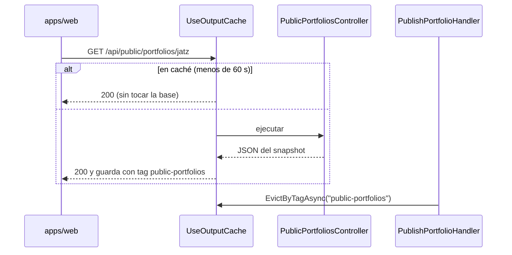

# Output caching

> Middleware de ASP.NET Core (.NET 7+) que guarda la respuesta HTTP completa en el servidor y la reutiliza sin ejecutar el endpoint; [[Itzamna.Dionisio]] lo usa para el portfolio público, con 60 s de vida e invalidación por etiqueta al publicar.

## Qué es y qué problema resuelve
El endpoint público (`GET /api/public/portfolios/{slug}`) es anónimo y el más visitado; cada visita costaría consultas a la base. Output caching guarda **en el servidor** la respuesta ya generada y la sirve directo. A diferencia del *response caching* (headers `Cache-Control` para navegadores/proxies), el servidor controla la vida y puede **invalidar** cuando cambian los datos.

## Cómo funciona por dentro
- `AddOutputCache(o => o.AddPolicy(...))` define políticas: duración (`Expire`), variación (`SetVaryByRouteValue`, query, header) y **etiquetas** (`Tag`).
- `[OutputCache(PolicyName = "...")]` en la acción la activa.
- `UseOutputCache()` intercepta: si hay entrada válida para la llave (ruta + variaciones) la devuelve; si no, ejecuta y guarda.
- `IOutputCacheStore.EvictByTagAsync(tag)` borra todas las entradas con esa etiqueta.
- Por defecto solo cachea `GET/HEAD` con 200 y **sin usuario autenticado** ni cookies.
- El almacén por defecto es **memoria del proceso** (por instancia); hay almacén Redis para varias instancias.



## Cuándo usarla y cuándo no
### Ventajas
- Gran ahorro en endpoints anónimos y repetitivos.
- Invalidación explícita por etiqueta.
- Configuración declarativa por política.
### Desventajas
- En memoria: cada instancia tiene su caché y se pierde al reiniciar.
- Riesgo de cachear algo personalizado si se cambia la política por defecto.
- Datos "viejos" hasta `Expire` si no se invalida.

## Alternativas
| Alternativa | En qué se diferencia |
|---|---|
| Response caching / `Cache-Control` | Lo guardan el navegador o el CDN; el servidor no invalida. |
| `IMemoryCache` / `HybridCache` | Cachean datos (objetos), no la respuesta HTTP. |
| CDN delante de la API (Azure Front Door) | Caché en el borde; invalidación por purga. |
| Redis output cache store | Mismo middleware, caché compartida entre instancias. |

## Cómo se usó en Itzamna
Política en `Itzamna.Dionisio/src/Itzamna.Dionisio.API/Program.cs`:
```csharp
builder.Services.AddOutputCache(o => o.AddPolicy("public-portfolio", p => p
    .Expire(TimeSpan.FromSeconds(60))
    .SetVaryByRouteValue("slug")
    .Tag(OutputCachePublicInvalidator.Tag)));
```
- Acción: `PublicPortfoliosController.Get` con `[OutputCache(PolicyName = "public-portfolio")]` y `[EnableRateLimiting("public")]`.
- Pipeline: `UseOutputCache()` va después de `UseAuthorization()`.
- **Invalidación**: Application define el puerto `IPublicCacheInvalidator`; la API lo implementa con `OutputCachePublicInvalidator` (`API/Caching/`). Lo llaman `PublishPortfolioHandler`, `RestoreVersionHandler` y `UnpublishHandler` después de `SaveChangesAsync` ([[Publicación y versiones]]). Así Application no depende de ASP.NET Core ([[Clean Architecture]]).
- Comentario del invalidador: "Invalida todos los portfolios públicos en caché (60 s de vida). Suficiente a esta escala; con muchos creadores conviene una etiqueta por slug." El parámetro `slug` se recibe pero no se usa.
- La respuesta es el JSON del snapshot tal cual (`Content(result.Json, "application/json; charset=utf-8")`), lo que hace barato servirlo ([[Snapshot inmutable versionado]]).

Funcionalidad: [[Portfolio público]].

> [!note] Pendiente de confirmar
> No revisé si las respuestas 301 (slug viejo, `RedirectPermanent`) y 404 se cachean: por defecto output caching solo guarda 200, así que esas irían siempre a la base. Con varias instancias de App Service, la invalidación solo limpiaría la instancia que publicó (hoy el plan parece ser una instancia: "F1" en el pipeline).

> [!tip] Reutilizable
> Puerto `IPublicCacheInvalidator` en Application + implementación con `IOutputCacheStore` en la API: invalidar caché desde un caso de uso sin acoplarlo al framework web.

## Errores comunes y buenas prácticas
- Poner `UseOutputCache()` antes de autenticación/CORS: el orden importa; aquí va al final.
- Invalidar antes de `SaveChangesAsync`: una petición podría volver a cachear lo viejo. Dionisio invalida después.
- No variar por la ruta: todos los slugs compartirían respuesta. Aquí `SetVaryByRouteValue("slug")`.
- Cachear endpoints autenticados con una política personalizada sin variar por usuario.

## Qué estudiar después
- [[Rate limiting]], [[Snapshot inmutable versionado]], [[ASP.NET Core Controllers]]
- `HybridCache`, Redis output cache, CDN.

## Documentación oficial
- https://learn.microsoft.com/aspnet/core/performance/caching/output

## Autoevaluación

Contesta primero en voz alta o en papel; luego despliega la respuesta.

> [!question]- ¿Qué es output caching?
> Guardar en el servidor la respuesta completa de un endpoint y servirla sin ejecutar la acción: `AddOutputCache()`, `UseOutputCache()` y `[OutputCache(Duration = 60)]`.

> [!question]- ¿En qué se diferencia de *response caching*?
> Response caching depende de headers HTTP (`Cache-Control`) y del cliente. Output caching lo controla el servidor y admite invalidar por tags (`EvictByTagAsync`).

> [!question]- ¿Qué no debes cachear así?
> Respuestas que dependen del usuario (salvo que varíes por usuario) o datos que deben estar al instante; por defecto no cachea peticiones autenticadas.

