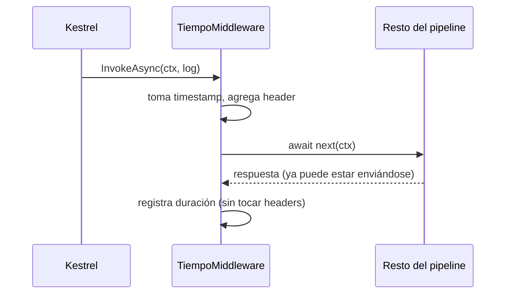

# Middleware personalizado en ASP.NET Core

Parte de: [[Pipeline y middleware]]

> [!info] Cómo avanzar
> `progreso`: **pendiente** → **viendo** (estudiando) → **visto** (contestaste la autoevaluación sin abrir las respuestas) → **dominado** (hiciste el laboratorio o lo aplicaste de verdad).

## Contenido

### Qué es
Un middleware personalizado es tu propio eslabón del [[Pipeline y middleware]]. Se escribe cuando hay algo que debe pasar en **todas** las peticiones (o en una rama) y que no necesita saber nada de MVC: medir tiempos, propagar un id de correlación, agregar headers de seguridad, rechazar peticiones sin un header obligatorio o abrir un `LogContext` con datos de la petición.

### Cómo funciona
La forma recomendada es una clase "por convención":
1. Un constructor que recibe `RequestDelegate next` (y, si quieres, servicios **Singleton**).
2. Un método público `InvokeAsync(HttpContext ctx, ...)` que regresa `Task`. Los parámetros extra de `InvokeAsync` se resuelven desde DI **en cada petición**.
3. Se registra con `app.UseMiddleware<T>()` o con un método de extensión `app.UseMiTiempo()`.

El punto clave: ASP.NET Core crea la instancia del middleware **una sola vez** al construir el pipeline. En la práctica se comporta como singleton. Si pides un servicio Scoped (por ejemplo tu sesión SQL o un `DbContext`) en el constructor, quedaría capturado para toda la vida de la app: es una [[Captive dependency]]. Con `ValidateScopes` activo (por defecto en Development) incluso falla al arrancar. Por eso los Scoped se piden como parámetros de `InvokeAsync`.

Alternativa: implementar `IMiddleware`. En ese caso registras la clase en DI (`AddScoped<MiMiddleware>()`) y el framework la resuelve por petición, así que el constructor sí puede recibir Scoped. Es un poco más lento y más explícito.



**Después de `await next(ctx)`** la respuesta puede haber empezado a enviarse al cliente. Una vez que `ctx.Response.HasStarted` es `true`, los headers y el status ya salieron por la red: cambiarlos lanza `InvalidOperationException`. Si necesitas agregar un header "al final", usa `ctx.Response.OnStarting(...)`, que se ejecuta justo antes de enviar los headers. Tampoco escribas al cuerpo después de `next` si otro componente ya respondió, porque corrompes la respuesta.

### Ejemplo
Middleware de tiempo y correlación, con el logger pedido por petición:

```csharp
using System.Diagnostics;

public sealed class TiempoMiddleware(RequestDelegate next)
{
    public async Task InvokeAsync(HttpContext ctx, ILogger<TiempoMiddleware> log)
    {
        var inicio = Stopwatch.GetTimestamp();
        var correlacion = ctx.TraceIdentifier;

        // Header agregado justo antes de que salgan los headers
        ctx.Response.OnStarting(() =>
        {
            ctx.Response.Headers["X-Correlacion"] = correlacion;
            return Task.CompletedTask;
        });

        using (log.BeginScope(new Dictionary<string, object> { ["Correlacion"] = correlacion }))
        {
            await next(ctx);
        }

        // Solo lectura y log: nada de tocar headers aquí
        log.LogInformation("{Metodo} {Ruta} -> {Status} en {Ms:0.0} ms",
            ctx.Request.Method, ctx.Request.Path, ctx.Response.StatusCode,
            Stopwatch.GetElapsedTime(inicio).TotalMilliseconds);
    }
}

public static class TiempoMiddlewareExtensiones
{
    public static IApplicationBuilder UseTiempo(this IApplicationBuilder app) =>
        app.UseMiddleware<TiempoMiddleware>();
}

// Program.cs
// app.UseExceptionHandler();
// app.UseTiempo();
```

Observa tres decisiones del ejemplo: el header se agrega con `OnStarting` (seguro aunque la respuesta empiece antes), el logger llega por `InvokeAsync` (por petición) y el método de extensión `UseTiempo()` deja `Program.cs` legible. Para probarlo, una prueba de integración con WebApplicationFactory puede revisar que toda respuesta traiga `X-Correlacion`.

Si el middleware solo aplica a una parte de la API (por ejemplo, exigir un header de API key en `/api/integraciones`), regístralo dentro de una rama con `app.UseWhen(ctx => ctx.Request.Path.StartsWithSegments("/api/integraciones"), r => r.UseMiddleware<ApiKeyMiddleware>())`, así no afecta al resto de las rutas.

### Cuándo usarlo y cuándo no
- **Sí**: lógica transversal HTTP, independiente del endpoint.
- **No** si necesitas los argumentos de la acción, el `ModelState` o atributos del controller: usa [[Filtros]].
- **No** para manejar excepciones: usa [[Manejo global de errores (IExceptionHandler)]].
- **No** si ya existe un middleware oficial (CORS, rate limiting, compresión, HTTP logging): úsalo y configúralo.

### Errores comunes
- **Scoped en el constructor**: captura la instancia; pídelo en `InvokeAsync`.
- **Cambiar headers después de `next`**: usa `OnStarting` o hazlo antes.
- **No llamar a `next` por accidente** en una rama del `if`: el resto del pipeline nunca corre.
- **Leer el body sin `EnableBuffering()`**: lo consumes y el controller recibe un cuerpo vacío.
- **Guardar estado por petición en campos de la clase**: la instancia es compartida entre hilos; usa variables locales o `HttpContext.Items`.

### Para profundizar
- [Escribir middleware personalizado (Microsoft Learn)](https://learn.microsoft.com/aspnet/core/fundamentals/middleware/write)
- [Activación de middleware con IMiddleware (Microsoft Learn)](https://learn.microsoft.com/aspnet/core/fundamentals/middleware/extensibility)
- [Middleware de ASP.NET Core (Microsoft Learn)](https://learn.microsoft.com/aspnet/core/fundamentals/middleware/)

## Autoevaluación

Contesta primero en voz alta o en papel; luego despliega la respuesta.

> [!question]- ¿Cómo se escribe un middleware como clase?
> ```csharp
> public sealed class TiempoMiddleware(RequestDelegate next) {
>     public async Task InvokeAsync(HttpContext ctx, ILogger<TiempoMiddleware> log) {
>         var t = Stopwatch.GetTimestamp();
>         await next(ctx);
>         log.LogInformation("{Ruta} {Ms}", ctx.Request.Path, Stopwatch.GetElapsedTime(t).TotalMilliseconds);
>     }
> }
> // app.UseMiddleware<TiempoMiddleware>();
> ```

> [!question]- ¿Por qué los servicios Scoped se piden en `InvokeAsync` y no en el constructor?
> El middleware se crea **una vez** (como singleton); un Scoped en el constructor quedaría capturado para toda la vida de la app.

> [!question]- ¿Qué no debes hacer después de `await next(ctx)`?
> Cambiar headers o el status si la respuesta ya empezó a enviarse (`ctx.Response.HasStarted`); lanza excepción.

